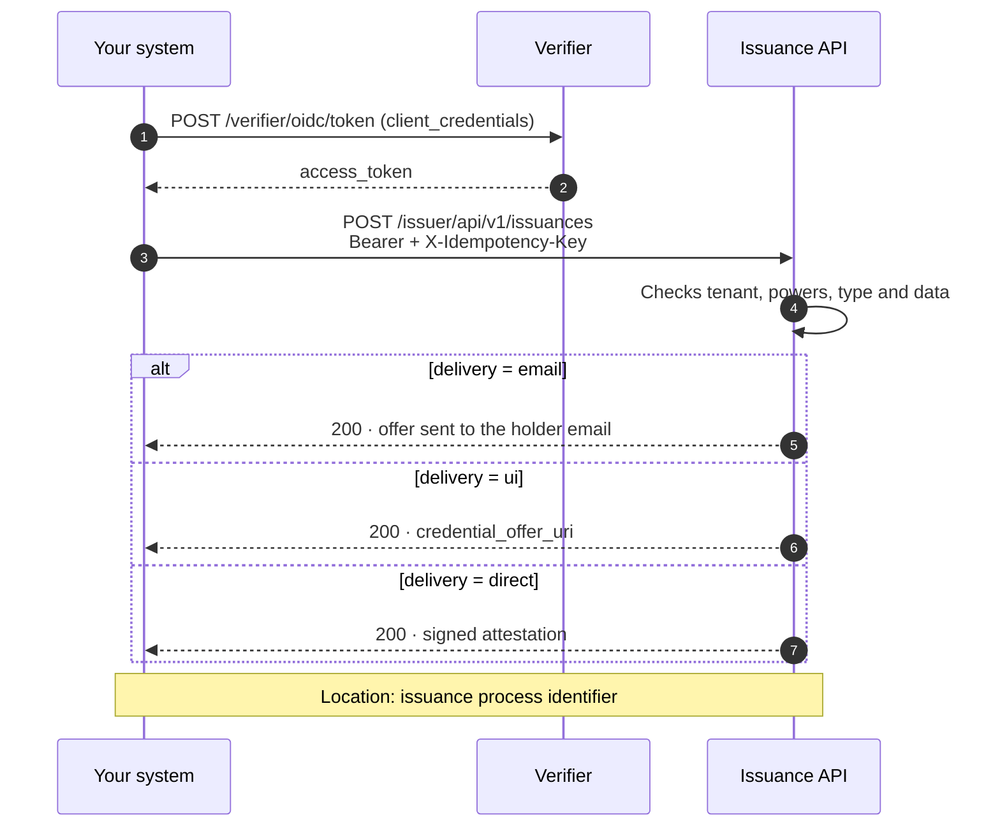

# Issuance API

Issue attestations from your backend with a single call, without going through the Issuance Portal or the Administration Portal. Your system authenticates to the Verifier with its machine credential, requests the issuance and chooses how the attestation is delivered to the holder.

[:material-file-document: **Issuance OpenAPI contract**](../api-reference/issuer.en.md){ .md-button .md-button--primary }
[:material-language-java: Java SDK — M2M authentication](verifier-m2m-sdk-java.en.md){ .md-button }

??? tip "When to use this guide"
    - Your system already knows **when** to issue an attestation: an employee joins, a professional registers, a course ends.
    - You want to issue from your own processes, without a person logging into the Issuance Portal or the Administration Portal.
    - You need to retry safely, without issuing the same attestation twice.

??? info "Prerequisites"
    - A **machine credential** (`LEARCredentialMachine`) of your organization, with the `Onboarding · Execute` power in your tenant's domain, and its **EC P-256 private key**.
    - Your tenant address, for example `https://sandbox.stg.eudistack.net`.
    - The `credential_configuration_id` of each attestation type you will issue, enabled in your tenant's catalogue, and the schema of its data.

---

## Feature status

This guide describes the full API contract. Some parts are not deployed yet: they are marked **Coming soon** in their section and should not be used until they are.

| Feature | Status |
|---|---|
| M2M authentication to the Verifier | Available |
| Issuance with `email` and `ui` delivery | Available |
| `direct` delivery of types without holder binding | Available |
| `direct` delivery with `holder_key` (types with holder binding) | Coming soon |
| Any type enabled in the tenant catalogue | Partial: today only the LEAR types and the product certification |
| Issuance process identifier in the `Location` header | Coming soon |
| Renewal of the offer of a draft process | Coming soon |
| `organization` field | Coming soon |
| Validity dates (`validFrom`, `validUntil`) | Coming soon |
| Idempotency with `X-Idempotency-Key` | Partial: see [Retries and idempotency](#retries-and-idempotency) |
| Errors with the codes in this guide | Partial: today some errors carry other codes |
| Rate limit per organization | Coming soon: today there is a limit per IP address |

---

## The flow, in short



Each request issues **one** attestation for **one** holder, with **one** delivery mode. The response includes the `Location` header with the process identifier, which is the reference to query or revoke it later.

---

## Step 1: Get the access token

Your system authenticates to your tenant's **Verifier** with the `client_credentials` grant and its machine credential (`private_key_jwt`). There is no client pre-registration and no shared secret: the credential is enough, and the tenant is derived from its powers.

=== "Java SDK"

    ```java
    VerifierM2MClient client = VerifierM2MClient.builder()
        .verifierUrl("https://sandbox.stg.eudistack.net/verifier")
        .privateKey(privateKey)
        .credentialJwt(machineCredentialJwt)
        .build();

    AccessToken token = client.authenticate();
    ```

    Installation and options in [Java SDK — M2M authentication](verifier-m2m-sdk-java.en.md).

=== "HTTP"

    ```http
    POST /verifier/oidc/token HTTP/1.1
    Host: sandbox.stg.eudistack.net
    Content-Type: application/x-www-form-urlencoded

    grant_type=client_credentials
    &client_id=<your system identifier>
    &client_assertion_type=urn:ietf:params:oauth:client-assertion-type:jwt-bearer
    &client_assertion=<JWT signed with the machine credential key>
    ```

    The `client_assertion` carries `iss` and `sub` equal to `client_id`, `aud` with the Verifier address, a short `exp`, a unique `jti` and, in `vp_token`, the presentation of the machine credential encoded in Base64.

Reuse the `access_token` until it expires. Send it on every call: `Authorization: Bearer <access_token>`.

---

## Step 2: Choose the delivery mode

The `delivery` field decides what EUDIStack does with the attestation and what the API returns. It takes a single value.

| `delivery` | What EUDIStack does | What the API returns | When to use it |
|---|---|---|---|
| `email` (default) | Sends the holder an email with the attestation offer. | Confirmation of the delivery. | The holder stores the attestation in their wallet from the email. |
| `ui` | Prepares the offer and returns it. | `credential_offer_uri`. | Your application shows the offer to the holder, for example as a QR code. |
| `direct` | Signs the attestation and returns it, with no wallet involved. | `signed_credential`. | Your system receives the signed attestation, for example for a machine. |

With `email` and `ui`, the optional `grant_type` field decides how the holder collects the attestation in their wallet: `authorization_code` (default) or `urn:ietf:params:oauth:grant-type:pre-authorized_code`.

### Attestations bound to a holder key

!!! info "Coming soon"
    Today `direct` delivery is only available for types without holder binding. For types with holder binding, `direct` with `holder_key` will come in a later release.

Some attestation types require cryptographic holder binding: the attestation is bound to a key that only the holder controls. With `email` and `ui`, the holder's wallet provides that key when it collects the attestation, and you do nothing.

With `direct` there is no wallet involved, so you must send the holder's **public key** in `holder_key`, as a JWK (RFC 7517). EUDIStack does not ask for proof that the holder controls it. A key that includes the private part is rejected with `invalid_holder_key`.

---

## Step 3: Request the issuance

!!! info "Coming soon"
    Issuance is available, but the response does not include the `Location` header with the process identifier yet.

`POST /issuer/api/v1/issuances`

| Field | Required | Description |
|---|---|---|
| `credential_configuration_id` | Yes | Attestation type, enabled in your tenant's catalogue. |
| `payload` | Yes | Attestation data, with the structure of the type's schema. |
| `email` | Yes | Holder email, or the email of the person responsible for a machine attestation. |
| `delivery` | No | `email` (default), `ui` or `direct`. |
| `grant_type` | No | Only with `email` and `ui`. See step 2. |
| `holder_key` | Depends on the type | Holder public key as a JWK. Only with `direct` and types with holder binding. |
| `organization` | No | `organizationIdentifier` of another organization of your tenant that will own the attestation. Only for the tenant administrator. By default, your system's organization. **Coming soon.** |

Inside `payload` you can set `validFrom` and `validUntil` (ISO 8601) if the type allows setting the validity; otherwise the type's default validity applies. **Coming soon.**

=== "email"

    ```http
    POST /issuer/api/v1/issuances HTTP/1.1
    Host: sandbox.stg.eudistack.net
    Authorization: Bearer <access_token>
    X-Idempotency-Key: 7d1c9f3a-2b4e-4c8a-9f10-5e6d7a8b9c01
    Content-Type: application/json

    {
      "credential_configuration_id": "learcredential.employee.w3c.4",
      "delivery": "email",
      "email": "holder@company.example",
      "payload": { "...": "attributes per the type schema" }
    }
    ```

    ```http
    HTTP/1.1 200 OK
    Location: /api/v1/issuances/0b6f1d2e-8c4a-4b1f-9e2d-7a5c3f8e1b90
    Content-Type: application/json

    { "responses": [ { "channel": "email", "status": 200 } ] }
    ```

=== "ui"

    ```json
    {
      "credential_configuration_id": "learcredential.employee.w3c.4",
      "delivery": "ui",
      "grant_type": "urn:ietf:params:oauth:grant-type:pre-authorized_code",
      "email": "holder@company.example",
      "payload": { "...": "attributes per the type schema" }
    }
    ```

    ```json
    {
      "responses": [
        {
          "channel": "ui",
          "status": 200,
          "body": { "credential_offer_uri": "openid-credential-offer://?credential_offer_uri=https%3A%2F%2F..." }
        }
      ]
    }
    ```

=== "direct"

    ```json
    {
      "credential_configuration_id": "learcredential.machine.sd.1",
      "delivery": "direct",
      "email": "owner@company.example",
      "holder_key": {
        "kty": "EC",
        "crv": "P-256",
        "x": "f83OJ3D2xF1Bg8vub9tLe1gHMzV76e8Tus9uPHvRVEU",
        "y": "x_FEzRu9m36HLN_tue659LNpXW6pCyStikYjKIWI5a0"
      },
      "payload": { "...": "attributes per the type schema" }
    }
    ```

    ```json
    {
      "responses": [
        {
          "channel": "direct",
          "status": 200,
          "body": { "signed_credential": "eyJhbGciOiJFUzI1NiIsInR5cCI6ImRjK3NkLWp3dCJ9...~WyJzYWx0Ii...~" }
        }
      ]
    }
    ```

    `signed_credential` uses the compact serialization: SD-JWT for `dc+sd-jwt` and JWT for `jwt_vc_json`.

**Store the `Location` identifier** with the holder's record in your system: it is the reference to [query](query-api.en.md) or [revoke](revocation-api.en.md) the attestation.

---

## Renew the offer

!!! info "Coming soon"
    This operation is not available yet. Today the offer can only be renewed from the link in the email the holder receives.

A credential offer expires after 10 minutes. If the holder has not opened it in time, request a new one for the same process, without creating another issuance:

`POST /issuer/api/v1/issuances/{id}/credential-offer`

`{id}` is the process identifier returned by the issuance in `Location`. The request has no body. EUDIStack creates a new offer with the same grant, voids the previous one and delivers it with the process delivery mode:

| Process mode | What it returns |
|---|---|
| `email` | Confirmation that the new offer was sent to the holder email. |
| `ui` | The new `credential_offer_uri`, with the same shape as in the issuance. |

You can only renew while the process is a draft (`DRAFT`), that is, while the holder has not collected the attestation. In any other state, or if the mode is `direct`, it is rejected with 409 `offer_not_renewable`. A process that does not exist or is outside your scope gets 404 `issuance_not_found`.

With `ui`, this lets you always show a valid offer: when the one you show expires, request another and replace the QR code. Once the holder collects the attestation, renewal returns `offer_not_renewable`: stop renewing.

---

## Retries and idempotency

Always send the `X-Idempotency-Key` header with a unique value per issuance, for example a UUID generated when preparing the request, and reuse it when retrying that same issuance. This lets you retry after a network cut or a timeout without issuing twice.

| Situation | Contract behaviour | Behaviour today |
|---|---|---|
| Same key and same body, after a success | Returns the same response without issuing another attestation, for 24 hours. | Same, for 1 hour, unless the service has restarted. |
| Same key with another body | Rejected with 422 `idempotency_key_reused`. | Returns the response of the first request. |
| Same key while the first request is still running | Rejected with 409 `idempotency_in_progress`. | Both are processed: it may issue twice. |
| Retry after an error | Processed again: errors are not stored. | Same. |

While idempotency is partial, do not send two requests with the same key at the same time, and do not reuse a key for a different issuance.

---

## Errors

!!! info "Coming soon"
    Today some issuance errors do not follow the table in this section yet: not all of them are `application/problem+json`, `BAD_REQUEST` does not include `violations`, and an unknown delivery mode returns `invalid_request`. The rate limit is 100 requests per minute per IP address, and its 429 has no body. The contract sets 300 requests per minute per organization for systems.

Errors are returned as `application/problem+json` (RFC 9457). Build your logic on `type`, which is a stable code, not on `title` or `detail`. A rejected request leaves nothing created.

```json
{
  "type": "payload_validation_error",
  "title": "Payload validation error",
  "status": 400,
  "detail": "The payload does not match the schema of learcredential.machine.sd.1",
  "instance": "/api/v1/issuances",
  "violations": [ { "field": "payload.mandatee.serviceName", "message": "is required" } ]
}
```

| HTTP | `type` | Cause | What to do |
|---|---|---|---|
| 400 | `BAD_REQUEST` | A field is missing or has a wrong format. `violations` says which. | Fix the request. |
| 400 | `payload_validation_error` | The data does not match the type's schema. | Fix `payload`. |
| 400 | `unsupported_credential_type` | The type does not exist or is not enabled in your tenant. | Check `credential_configuration_id`. |
| 400 | `invalid_delivery_mode` | `delivery` is not `email`, `ui` or `direct`, or has several values. | Send a single mode. |
| 400 | `invalid_grant_type` | `grant_type` is not one of its two values. | Fix or remove the field. |
| 400 | `invalid_validity` | The validity end is not after the start, or exceeds the type's maximum duration. | Adjust the dates. |
| 400 | `invalid_holder_key` | The holder key is missing when required, is not a valid public key, or includes the private part. | Send only the public key. |
| 400 | `unknown_organization` | `organization` is not an organization of your tenant. | Check the identifier. |
| 401 | `invalid_token`, `authentication_error` | The token is missing, invalid or expired. | Get a new token. |
| 403 | `insufficient_permission` | Your credential's powers do not allow this issuance. | Check the machine credential powers. |
| 403 | `tenant_mismatch` | The tenant of the address is not your credential's tenant. | Use your tenant address. |
| 409 | `delivery_mode_not_eligible` | The type or the tenant does not allow that delivery mode. | Use another mode. |
| 409 | `offer_not_renewable` | When renewing the offer: the process is no longer a draft or its mode is `direct`. | Stop renewing: the holder already collected the attestation or the process ended. |
| 409 | `idempotency_in_progress` | Another request with the same key is running. | Wait and retry. |
| 422 | `idempotency_key_reused` | The same key was sent with another body. | Use a new key for each issuance. |
| 429 | `rate_limited` | The rate limit was exceeded. | Wait for `Retry-After`. |
| 500 | `persistence_failed`, `delivery_failed` | Internal error. | Retry later with the same key. |
| 503 | `signing_failed`, `status_list_unavailable`, `wallet_delivery_timeout` | A required service is unavailable. | Wait for `Retry-After` and retry with the same key. |

??? question "Troubleshooting"

    | Symptom | Probable cause | Resolution |
    |---|---|---|
    | 403 when issuing a given type | The type is not enabled in your tenant, or does not support API issuance yet | Check your tenant catalogue with your EUDIStack contact |
    | 403 `tenant_mismatch` | You are calling another tenant's address | Use the address of your machine credential's tenant |
    | 401 after working for a while | The `access_token` has expired | Get a new one with the same credential and repeat the call |
    | `delivery_mode_not_eligible` with `direct` | The type requires holder binding | Use `email` or `ui` until `direct` with `holder_key` is available |

??? warning "Security considerations"
    - The machine credential's private key is your system's identity: keep it in a secrets manager, never in code or logs. If it is compromised, report it so the credential can be revoked.
    - Send only the holder's **public** key in `holder_key`. Their private key must never leave their device.
    - With `direct`, the signed attestation only travels in the response: EUDIStack does not store it. Treat it as the holder's personal data.

---

## Full reference

The full issuance API contract, with every field, response and error code, is in the [Issuer API reference](../api-reference/issuer.en.md).
