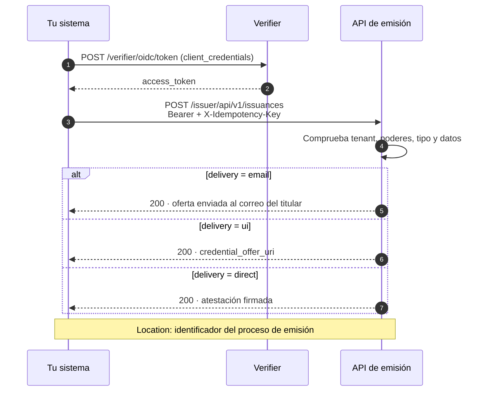

# API de emisión

Emite atestaciones desde tu backend con una sola llamada, sin pasar por el Portal de Emisión o el Portal de Administración. Tu sistema se autentica ante el Verifier con su credencial de máquina, pide la emisión y elige cómo se entrega la atestación al titular.

[:material-file-document: **Contrato OpenAPI de emisión**](../api-reference/issuer.md){ .md-button .md-button--primary }
[:material-language-java: SDK Java — Autenticación M2M](verifier-m2m-sdk-java.md){ .md-button }

??? tip "¿Cuándo usar esta guía?"
    - Tu sistema ya sabe **cuándo** debe emitir una atestación: alta de un empleado, colegiación, fin de un curso.
    - Quieres emitir desde tus propios procesos, sin que una persona entre al Portal de Emisión o al Portal de Administración.
    - Necesitas reintentar de forma segura, sin emitir dos veces la misma atestación.

??? info "Requisitos previos"
    - Una **credencial de máquina** (`LEARCredentialMachine`) de tu organización, con el poder `Onboarding · Execute` en el dominio de tu tenant, y su **clave privada EC P-256**.
    - La dirección de tu tenant, por ejemplo `https://sandbox.stg.eudistack.net`.
    - El `credential_configuration_id` de cada tipo de atestación que vas a emitir, habilitado en el catálogo de tu tenant, y el esquema de sus datos.

---

## Estado de las funciones

La guía describe el contrato completo de la API. Algunas partes aún no están desplegadas: están marcadas como **Próximamente** en su sección y no conviene usarlas hasta que lo estén.

| Función | Estado |
|---|---|
| Autenticación M2M ante el Verifier | Disponible |
| Emisión con entrega `email` y `ui` | Disponible |
| Entrega `direct` de tipos sin vinculación al titular | Disponible |
| Entrega `direct` con `holder_key` (tipos con vinculación al titular) | Próximamente |
| Cualquier tipo habilitado en el catálogo del tenant | Parcial: hoy solo los tipos LEAR y la certificación de producto |
| Identificador del proceso en la cabecera `Location` | Próximamente |
| Renovación de la oferta de un proceso en borrador | Próximamente |
| Campo `organization` | Próximamente |
| Fechas de vigencia (`validFrom`, `validUntil`) | Próximamente |
| Idempotencia con `X-Idempotency-Key` | Parcial: ver [Reintentos e idempotencia](#reintentos-e-idempotencia) |
| Errores con los códigos de esta guía | Parcial: hoy algunos errores llevan otros códigos |
| Límite de volumen por organización | Próximamente: hoy hay un límite por dirección IP |

---

## El flujo, en resumen



Cada petición emite **una** atestación para **un** titular, con **un** modo de entrega. La respuesta incluye la cabecera `Location` con el identificador del proceso, que es la referencia para consultarlo o revocarlo después.

---

## Paso 1: Obtén el token de acceso

Tu sistema se autentica ante el **Verifier** de tu tenant con el grant `client_credentials` y su credencial de máquina (`private_key_jwt`). No hay registro previo de cliente ni secreto compartido: la credencial basta, y el tenant se deduce de sus poderes.

=== "SDK Java"

    ```java
    VerifierM2MClient client = VerifierM2MClient.builder()
        .verifierUrl("https://sandbox.stg.eudistack.net/verifier")
        .privateKey(privateKey)
        .credentialJwt(machineCredentialJwt)
        .build();

    AccessToken token = client.authenticate();
    ```

    Instalación y opciones en [SDK Java — Autenticación M2M](verifier-m2m-sdk-java.md).

=== "HTTP"

    ```http
    POST /verifier/oidc/token HTTP/1.1
    Host: sandbox.stg.eudistack.net
    Content-Type: application/x-www-form-urlencoded

    grant_type=client_credentials
    &client_id=<identificador de tu sistema>
    &client_assertion_type=urn:ietf:params:oauth:client-assertion-type:jwt-bearer
    &client_assertion=<JWT firmado con la clave de la credencial de máquina>
    ```

    El `client_assertion` lleva `iss` y `sub` iguales a `client_id`, `aud` con la dirección del Verifier, `exp` de pocos minutos, un `jti` único y, en `vp_token`, la presentación de la credencial de máquina codificada en Base64.

Reutiliza el `access_token` hasta que caduque. Envíalo en cada llamada: `Authorization: Bearer <access_token>`.

---

## Paso 2: Elige el modo de entrega

El campo `delivery` decide qué hace EUDIStack con la atestación y qué te devuelve la API. Admite un solo valor.

| `delivery` | Qué hace EUDIStack | Qué devuelve la API | Cuándo usarlo |
|---|---|---|---|
| `email` (por defecto) | Envía al titular un correo con la oferta de la atestación. | La confirmación del envío. | El titular guarda la atestación en su wallet desde el correo. |
| `ui` | Prepara la oferta y te la devuelve. | `credential_offer_uri`. | Tu aplicación muestra la oferta al titular, por ejemplo como código QR. |
| `direct` | Firma la atestación y te la devuelve, sin wallet de por medio. | `signed_credential`. | Tu sistema recibe la atestación ya firmada, por ejemplo para una máquina. |

Con `email` y `ui`, el campo opcional `grant_type` decide cómo recoge el titular la atestación en su wallet: `authorization_code` (por defecto) o `urn:ietf:params:oauth:grant-type:pre-authorized_code`.

### Abrir la oferta en un wallet concreto

Con `ui`, la API devuelve el `credential_offer_uri` con el esquema `openid-credential-offer://`. El dispositivo del titular lo abre con el wallet que tenga registrado para ese esquema, sea cual sea, y si no tiene ninguno el enlace no hace nada. Si quieres que la oferta la abra un wallet concreto, por ejemplo el wallet web de EUDIStack, cambia el principio del enlace por la dirección donde ese wallet recibe ofertas (su `credential_offer_endpoint`, OID4VCI 1.0 §4) y deja el resto igual:

| | Enlace |
|---|---|
| Devuelve la API | `openid-credential-offer://?credential_offer_uri=https%3A%2F%2Fsandbox.stg.eudistack.net%2Fissuer%2Foid4vci%2Fv1%2Fcredential-offer%2FpV7DBgfDTXWGfq0mBPMg8Q` |
| Muestras al titular | `https://sandbox.stg.eudistack.net/wallet/protocol/callback?credential_offer_uri=https%3A%2F%2Fsandbox.stg.eudistack.net%2Fissuer%2Foid4vci%2Fv1%2Fcredential-offer%2FpV7DBgfDTXWGfq0mBPMg8Q` |

- Sustituye solo `openid-credential-offer://`. La consulta `?credential_offer_uri=…` se conserva tal cual: ya viene codificada y no hay que volver a codificarla.
- Si construyes el enlace a partir del valor de `credential_offer_uri` ya decodificado, codifícalo una sola vez.
- El wallet de EUDIStack recibe ofertas en `https://<tenant>.<entorno>.eudistack.net/wallet/protocol/callback`. Para otro wallet, usa el `credential_offer_endpoint` que publica en sus metadatos.
- El resultado es un enlace `https` normal: sirve como código QR, como botón o en un correo, y abre el wallet web aunque el titular no tenga ninguna app instalada.

=== "JavaScript"

    ```javascript
    const WALLET_OFFER_ENDPOINT = "https://sandbox.stg.eudistack.net/wallet/protocol/callback";

    function toWalletLink(credentialOfferUri) {
      const query = credentialOfferUri.substring(credentialOfferUri.indexOf("?"));
      return WALLET_OFFER_ENDPOINT + query;
    }
    ```

=== "Java"

    ```java
    static final String WALLET_OFFER_ENDPOINT = "https://sandbox.stg.eudistack.net/wallet/protocol/callback";

    static String toWalletLink(String credentialOfferUri) {
        String query = credentialOfferUri.substring(credentialOfferUri.indexOf('?'));
        return WALLET_OFFER_ENDPOINT + query;
    }
    ```

Si [renuevas la oferta](#renovar-la-oferta), aplica la misma transformación al enlace nuevo.

### Atestaciones vinculadas a una clave del titular

!!! info "Próximamente"
    Hoy la entrega `direct` solo está disponible para tipos sin vinculación al titular. Para los tipos con vinculación, `direct` con `holder_key` llegará en una próxima versión.

Algunos tipos de atestación exigen vinculación criptográfica al titular: la atestación queda ligada a una clave que solo él controla. Con `email` y `ui`, el wallet del titular aporta esa clave al recoger la atestación y no tienes que hacer nada.

Con `direct` no hay wallet de por medio, así que tienes que enviar la **clave pública** del titular en `holder_key`, en formato JWK (RFC 7517). EUDIStack no pide prueba de que el titular la controla. Una clave que incluya la parte privada se rechaza con `invalid_holder_key`.

---

## Paso 3: Pide la emisión

!!! info "Próximamente"
    La emisión está disponible, pero la respuesta todavía no incluye la cabecera `Location` con el identificador del proceso.

`POST /issuer/api/v1/issuances`

| Campo | Obligatorio | Descripción |
|---|---|---|
| `credential_configuration_id` | Sí | Tipo de atestación, habilitado en el catálogo de tu tenant. |
| `payload` | Sí | Datos de la atestación, con la estructura del esquema del tipo. |
| `email` | Sí | Correo del titular, o de la persona responsable en una atestación de máquina. |
| `delivery` | No | `email` (por defecto), `ui` o `direct`. |
| `grant_type` | No | Solo con `email` y `ui`. Ver el paso 2. |
| `holder_key` | Según el tipo | Clave pública del titular en JWK. Solo con `direct` y tipos con vinculación al titular. |
| `organization` | No | `organizationIdentifier` de otra organización de tu tenant a la que pertenecerá la atestación. Solo para el administrador del tenant. Por defecto, la organización de tu sistema. **Próximamente.** |

Dentro de `payload` puedes indicar `validFrom` y `validUntil` (ISO 8601) si el tipo permite fijar la vigencia; si no, se aplica la vigencia por defecto del tipo. **Próximamente.**

=== "email"

    ```http
    POST /issuer/api/v1/issuances HTTP/1.1
    Host: sandbox.stg.eudistack.net
    Authorization: Bearer <access_token>
    X-Idempotency-Key: 7d1c9f3a-2b4e-4c8a-9f10-5e6d7a8b9c01
    Content-Type: application/json

    {
      "credential_configuration_id": "learcredential.employee.w3c.4",
      "delivery": "email",
      "email": "titular@empresa.example",
      "payload": { "...": "atributos según el esquema del tipo" }
    }
    ```

    ```http
    HTTP/1.1 200 OK
    Location: /api/v1/issuances/0b6f1d2e-8c4a-4b1f-9e2d-7a5c3f8e1b90
    Content-Type: application/json

    { "responses": [ { "channel": "email", "status": 200 } ] }
    ```

=== "ui"

    ```json
    {
      "credential_configuration_id": "learcredential.employee.w3c.4",
      "delivery": "ui",
      "grant_type": "urn:ietf:params:oauth:grant-type:pre-authorized_code",
      "email": "titular@empresa.example",
      "payload": { "...": "atributos según el esquema del tipo" }
    }
    ```

    ```json
    {
      "responses": [
        {
          "channel": "ui",
          "status": 200,
          "body": { "credential_offer_uri": "openid-credential-offer://?credential_offer_uri=https%3A%2F%2F..." }
        }
      ]
    }
    ```

=== "direct"

    ```json
    {
      "credential_configuration_id": "learcredential.machine.sd.1",
      "delivery": "direct",
      "email": "responsable@empresa.example",
      "holder_key": {
        "kty": "EC",
        "crv": "P-256",
        "x": "f83OJ3D2xF1Bg8vub9tLe1gHMzV76e8Tus9uPHvRVEU",
        "y": "x_FEzRu9m36HLN_tue659LNpXW6pCyStikYjKIWI5a0"
      },
      "payload": { "...": "atributos según el esquema del tipo" }
    }
    ```

    ```json
    {
      "responses": [
        {
          "channel": "direct",
          "status": 200,
          "body": { "signed_credential": "eyJhbGciOiJFUzI1NiIsInR5cCI6ImRjK3NkLWp3dCJ9...~WyJzYWx0Ii...~" }
        }
      ]
    }
    ```

    `signed_credential` va en serialización compacta: SD-JWT para `dc+sd-jwt` y JWT para `jwt_vc_json`.

**Guarda el identificador de `Location`** junto al registro del titular en tu sistema: es la referencia para [consultar](query-api.md) o [revocar](revocation-api.md) la atestación.

---

## Renovar la oferta

!!! info "Próximamente"
    Esta operación aún no está disponible. Hoy la oferta solo se puede renovar desde el enlace del correo que recibe el titular.

Una oferta de credencial caduca a los 10 minutos. Si el titular no la ha abierto a tiempo, pide una nueva para el mismo proceso, sin crear otra emisión:

`POST /issuer/api/v1/issuances/{id}/credential-offer`

`{id}` es el identificador del proceso que devolvió la emisión en `Location`. La petición no lleva cuerpo. EUDIStack crea una oferta nueva con el mismo grant, anula la anterior y la entrega con el modo de entrega del proceso:

| Modo del proceso | Qué devuelve |
|---|---|
| `email` | La confirmación del envío de la oferta nueva al correo del titular. |
| `ui` | El `credential_offer_uri` nuevo, con la misma forma que en la emisión. |

Solo se puede renovar mientras el proceso está en borrador (`DRAFT`), es decir, mientras el titular no ha recogido la atestación. En otro estado, o si el modo es `direct`, se rechaza con 409 `offer_not_renewable`. Un proceso que no existe o que está fuera de tu ámbito recibe 404 `issuance_not_found`.

Con `ui`, esto te permite mostrar siempre una oferta vigente: cuando caduca la que muestras, pide otra y sustituye el código QR. Cuando el titular recoge la atestación, la renovación devuelve `offer_not_renewable`: deja de renovar.

---

## Reintentos e idempotencia

Envía siempre la cabecera `X-Idempotency-Key` con un valor único por emisión, por ejemplo un UUID generado al preparar la petición, y reutilízalo en los reintentos de esa misma emisión. Así puedes reintentar tras un corte de red o un timeout sin emitir dos veces.

| Situación | Comportamiento del contrato | Comportamiento hoy |
|---|---|---|
| Misma clave y mismo cuerpo, después de un éxito | Devuelve la misma respuesta sin emitir otra atestación, durante 24 horas. | Igual, durante 1 hora, salvo que el servicio se haya reiniciado. |
| Misma clave con otro cuerpo | Se rechaza con 422 `idempotency_key_reused`. | Devuelve la respuesta de la primera petición. |
| Misma clave mientras la primera petición sigue en curso | Se rechaza con 409 `idempotency_in_progress`. | Se procesan las dos: puede emitirse dos veces. |
| Reintento después de un error | Se procesa de nuevo: los errores no se guardan. | Igual. |

Mientras la idempotencia sea parcial, no lances dos peticiones con la misma clave a la vez y no reutilices una clave para una emisión distinta.

---

## Errores

!!! info "Próximamente"
    Hoy algunos errores de emisión todavía no siguen la tabla de esta sección: no todos salen como `application/problem+json`, `BAD_REQUEST` no incluye `violations` y un modo de entrega desconocido devuelve `invalid_request`. El límite de volumen es de 100 peticiones por minuto por dirección IP, y su 429 no tiene cuerpo. El contrato fija 300 peticiones por minuto por organización para sistemas.

Los errores se devuelven como `application/problem+json` (RFC 9457). Programa tu lógica sobre `type`, que es un código estable, no sobre `title` ni `detail`. Una petición rechazada no deja nada creado.

```json
{
  "type": "payload_validation_error",
  "title": "Payload validation error",
  "status": 400,
  "detail": "The payload does not match the schema of learcredential.machine.sd.1",
  "instance": "/api/v1/issuances",
  "violations": [ { "field": "payload.mandatee.serviceName", "message": "is required" } ]
}
```

| HTTP | `type` | Causa | Qué hacer |
|---|---|---|---|
| 400 | `BAD_REQUEST` | Falta un campo o tiene un formato incorrecto. `violations` indica cuál. | Corrige la petición. |
| 400 | `payload_validation_error` | Los datos no cumplen el esquema del tipo. | Corrige `payload`. |
| 400 | `unsupported_credential_type` | El tipo no existe o no está habilitado en tu tenant. | Revisa `credential_configuration_id`. |
| 400 | `invalid_delivery_mode` | `delivery` no es `email`, `ui` ni `direct`, o lleva varios valores. | Envía un solo modo. |
| 400 | `invalid_grant_type` | `grant_type` no es uno de sus dos valores. | Corrige o quita el campo. |
| 400 | `invalid_validity` | El fin de la vigencia no es posterior al inicio, o supera la duración máxima del tipo. | Ajusta las fechas. |
| 400 | `invalid_holder_key` | Falta la clave del titular cuando se exige, no es una clave pública válida o incluye la parte privada. | Envía solo la clave pública. |
| 400 | `unknown_organization` | `organization` no es una organización de tu tenant. | Revisa el identificador. |
| 401 | `invalid_token`, `authentication_error` | Falta el token, no es válido o ha caducado. | Pide un token nuevo. |
| 403 | `insufficient_permission` | Los poderes de tu credencial no permiten esta emisión. | Revisa los poderes de la credencial de máquina. |
| 403 | `tenant_mismatch` | El tenant de la dirección no es el de tu credencial. | Usa la dirección de tu tenant. |
| 409 | `delivery_mode_not_eligible` | El tipo o el tenant no admiten ese modo de entrega. | Usa otro modo. |
| 409 | `offer_not_renewable` | Al renovar la oferta: el proceso ya no está en borrador o su modo es `direct`. | Deja de renovar: el titular ya recogió la atestación o el proceso terminó. |
| 409 | `idempotency_in_progress` | Otra petición con la misma clave está en curso. | Espera y reintenta. |
| 422 | `idempotency_key_reused` | La misma clave se envió con otro cuerpo. | Usa una clave nueva para cada emisión. |
| 429 | `rate_limited` | Se ha superado el límite de volumen. | Espera lo que indique `Retry-After`. |
| 500 | `persistence_failed`, `delivery_failed` | Error interno. | Reintenta más tarde con la misma clave. |
| 503 | `signing_failed`, `status_list_unavailable`, `wallet_delivery_timeout` | Un servicio necesario no está disponible. | Espera `Retry-After` y reintenta con la misma clave. |

??? question "Troubleshooting"

    | Síntoma | Causa probable | Resolución |
    |---|---|---|
    | 403 al emitir un tipo concreto | El tipo no está habilitado en tu tenant, o hoy aún no admite la emisión por API | Comprueba el catálogo de tu tenant con tu interlocutor de EUDIStack |
    | 403 `tenant_mismatch` | Llamas a la dirección de otro tenant | Usa la dirección del tenant de tu credencial de máquina |
    | 401 tras funcionar un rato | El `access_token` ha caducado | Pide otro con la misma credencial y repite la llamada |
    | `delivery_mode_not_eligible` con `direct` | El tipo exige vinculación al titular | Usa `email` o `ui` hasta que `direct` con `holder_key` esté disponible |

??? warning "Consideraciones de seguridad"
    - La clave privada de la credencial de máquina es la identidad de tu sistema: guárdala en un gestor de secretos, nunca en el código ni en los registros. Si se compromete, avisa para revocar la credencial.
    - Envía en `holder_key` solo la clave **pública** del titular. Su clave privada nunca debe salir de su dispositivo.
    - Con `direct`, la atestación firmada solo viaja en la respuesta: EUDIStack no la guarda. Trátala como un dato personal del titular.

---

## Referencia completa

El contrato completo de la API de emisión, con todos los campos, respuestas y códigos de error, está en la [referencia de la API del Issuer](../api-reference/issuer.md).
