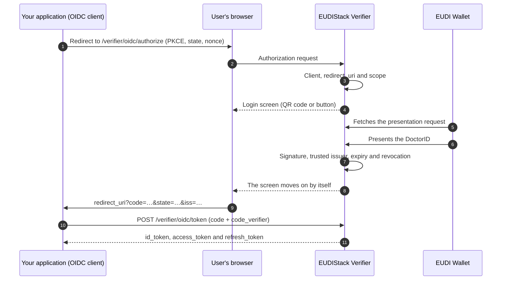

# OIDC IdP — Login with a verifiable credential

The EUDIStack Verifier is a standard OpenID Connect identity provider (IdP). Your application starts a normal OIDC login and the Verifier does the rest. It asks the user to present a verifiable credential from their EUDI wallet, verifies it and returns the verified attributes to your application in a signed ID Token. Your application never talks to the wallet.

This guide uses the **DoctorID** as its example: the professional credential of registered physicians, consumed by a platform such as an e-prescription platform. The flow is the same for any other credential; only the scope and the attributes change.

??? tip "When to use this guide"
    Use this guide if:

    - Your application already integrates an OIDC provider (Spring Security, Auth.js, NextAuth, a library certified by the OpenID Foundation…), or you have a corporate IAM (Keycloak, Entra ID) that supports external providers.
    - You want your users to sign in by presenting a verifiable credential (eIDAS 2.0), with no username or password.
    - You do not want to implement OID4VP in your backend.

    If your integration is a backend service with no user present, see the [Java M2M SDK](verifier-m2m-sdk-java.en.md).

??? info "Prerequisites"
    - Your application, **registered as an OIDC client** of the tenant. The EUDIStack team does this at your request: see [Before you start](#before-you-start-client-registration).
    - An **OIDC library** that supports the Authorization Code flow with PKCE `S256` and `ES256` signatures.
    - If your application has a server: an **EC P-256 key pair** and a public URL serving its public key as a JWKS.

!!! abstract "In short"
    1. **[Request registration](#before-you-start-client-registration)** with your application's details. You receive your `client_id`, the tenant's discovery document and test users.
    2. **[Start the authorization](#step-1-start-the-authorization)** with PKCE `S256`, a new `state` and a `nonce`.
    3. **[Exchange the code](#step-2-exchange-the-code)** for the tokens and validate their signature with the discovery keys.
    4. **[Read the attributes](#step-3-read-the-doctorid-attributes)** from the ID Token.
    5. **[Keep the session](#step-4-keep-and-end-the-session)** with the Refresh Token and end it through the Verifier.

---

## Before you start: client registration

Registration is not self-service. The EUDIStack team does it for each application and each environment: first in the test environment and, once you are done, in production.

**1. Send your application's details.** [Contact support](../../support.en.md) with this information:

| Item | Example | What it is for |
|---|---|---|
| Application name | `E-prescription` | Identifies your client. It is sent to the physician's wallet in the credential request. |
| Client type | Confidential | See [Client types](#client-types). |
| `redirect_uri` | `https://rx.example.com/oidc/callback` | Exact HTTPS address the user returns to with the code. You can give several. |
| `post_logout_redirect_uri` | `https://rx.example.com/` | Where the user returns after [logout](#end-the-session). |
| Public key URL (JWKS) | `https://rx.example.com/.well-known/jwks.json` | Confidential clients only. The Verifier uses it to check the signature of your `client_assertion`. |
| Environment | Test | Production registration is requested separately, once testing is done. |

**2. Receive the registration reply.** The team sends you:

- Your `client_id`, different in each environment.
- The address of your tenant's **discovery document**, in the form `https://<tenant>.<domain>/verifier/.well-known/openid-configuration`. All the Verifier's endpoints and public keys come from it.
- The **test users**: synthetic physicians with their DoctorID in a test wallet.

!!! info "No shared secrets, ever"
    The Verifier does not issue a `client_secret`. A confidential client authenticates with its own private key (`private_key_jwt`), which never leaves your server. To rotate your key, publish the new one in your JWKS with a new `kid`: the registration does not change.

---

## Client types

| Type | For | Authentication at the token endpoint | PKCE |
|---|---|---|---|
| **Confidential** | Applications with their own server, and corporate IAMs (Keycloak, Entra ID…) | `private_key_jwt`: a JWT signed with `ES256` using your private key (RFC 7523) | Mandatory, `S256` |
| **Public** | Applications with no server: SPA or mobile app | None (`none`) | Mandatory, `S256` |

If you have a server, always choose a confidential client. The tokens stay on your server, and the exchange needs your private key on top of the PKCE verifier.

A **corporate IAM** registers the Verifier as an external identity provider; for the Verifier it is just another confidential client. Your applications keep talking to your IAM, which governs their session. See [Keycloak as a broker](#keycloak-as-a-broker).

---

## The flow

From your application's point of view this is the OpenID Connect Authorization Code flow with PKCE. What changes is what the user sees: instead of a form, the Verifier's login screen asks them to present their credential with their wallet. They scan a QR code if the wallet is on another device, or tap a button if it is on the same one.



The Verifier checks the credential when it is presented, before issuing the code. If it is revoked, expired or issued by an untrusted issuer, the login does not complete and your application receives no code.

---

## Step 1: Start the authorization

Redirect the user's browser to the `authorization_endpoint` from the discovery document:

```http
GET /verifier/oidc/authorize?
  response_type=code&
  client_id=<your-client-id>&
  redirect_uri=https%3A%2F%2Frx.example.com%2Foidc%2Fcallback&
  scope=openid%20doctorid%20offline_access&
  state=4f1c2a9e-7b3d-4c8e-9a51-2d6f0e8b7c13&
  nonce=b8e2d1f4-3a6c-4e9b-8d70-1c5a9f2e6b48&
  code_challenge=i2oTsSGNMAWUkSB6JyeIQCXdDX5gPVEN_N3XmccjYNo&
  code_challenge_method=S256
```

| Parameter | Value |
|---|---|
| `response_type` | Always `code`. |
| `client_id` | The one from your registration. |
| `redirect_uri` | One of those in your registration, exactly as registered: scheme, host, port and path. |
| `scope` | `openid doctorid offline_access`. `openid` always; `doctorid` requests the DoctorID; `offline_access` requests the Refresh Token. Only request scopes in your registration. |
| `state` | A random value, **new for every login**. Store it in the browser session and check it on return. The Verifier rejects a `state` that is already in use. |
| `nonce` | A random value, new for every login. It comes back in the ID Token: check it. |
| `code_challenge` and `code_challenge_method` | PKCE: `BASE64URL(SHA-256(code_verifier))` and always `S256`. Mandatory for every client, confidential ones included. `plain` is rejected. |

---

## Step 2: Exchange the code

When the user presents their credential, the browser returns to your `redirect_uri`:

```
https://rx.example.com/oidc/callback?code=e7e168e7-6a02-42d8-ad9f-0b5edb51ba6f&state=4f1c2a9e-7b3d-4c8e-9a51-2d6f0e8b7c13&iss=https%3A%2F%2F<tenant>.<domain>%2Fverifier
```

Before exchanging the code:

1. Check that `state` is the one you stored for this browser.
2. Check that `iss` equals the `issuer` in the discovery document (RFC 9207). This detects mix-up attacks if you work with more than one provider.

Exchange the code at the `token_endpoint` straight away: it is single use.

=== "Confidential client"
    ```http
    POST /verifier/oidc/token
    Content-Type: application/x-www-form-urlencoded

    grant_type=authorization_code&
    client_id=<your-client-id>&
    code=e7e168e7-6a02-42d8-ad9f-0b5edb51ba6f&
    redirect_uri=https%3A%2F%2Frx.example.com%2Foidc%2Fcallback&
    code_verifier=nCk4LYmjcikQMRfI7rNzci1wnC8sn6kuVfDxj5qvF6k&
    client_assertion_type=urn%3Aietf%3Aparams%3Aoauth%3Aclient-assertion-type%3Ajwt-bearer&
    client_assertion=eyJhbGciOiJFUzI1NiIsInR5cCI6IkpXVCIsImtpZCI6InJ4LTIwMjYifQ…
    ```

    The `client_assertion` is a JWT signed with your private key using `ES256`, with your JWKS `kid` in the header:

    ```json
    {
      "iss": "<your-client-id>",
      "sub": "<your-client-id>",
      "aud": "https://<tenant>.<domain>/verifier",
      "jti": "0b9d3c2e-5f61-4a8b-9e47-1d2c3b4a5f60",
      "iat": 1794304160,
      "exp": 1794304280
    }
    ```

    `aud` is the `issuer` from the discovery document; the `token_endpoint` is accepted too, which is what libraries such as Keycloak send by default. Use a new `jti` and a short expiry for every exchange.

=== "Public client"
    ```http
    POST /verifier/oidc/token
    Content-Type: application/x-www-form-urlencoded

    grant_type=authorization_code&
    client_id=<your-client-id>&
    code=e7e168e7-6a02-42d8-ad9f-0b5edb51ba6f&
    redirect_uri=https%3A%2F%2Frx.example.com%2Foidc%2Fcallback&
    code_verifier=nCk4LYmjcikQMRfI7rNzci1wnC8sn6kuVfDxj5qvF6k
    ```

The response carries the three tokens:

```json
{
  "access_token": "eyJraWQiOiJkaWQ6a2V5Ono…",
  "id_token": "eyJraWQiOiJkaWQ6a2V5Ono…",
  "refresh_token": "FvqdvpiHzeroCq4f6VVdFJ1CvfMxDdWqpMx-3k0e4PI",
  "token_type": "Bearer",
  "expires_in": 899
}
```

**Validate the ID Token** before using it, as OpenID Connect Core §3.1.3.7 requires:

- The signature, with the key from the discovery `jwks_uri` whose `kid` matches the header. Tokens are signed with **`ES256`** (EC P-256). If the `kid` is not among the keys you have stored, download the `jwks_uri` once more; if it is still missing, reject the token.
- `iss` equal to the discovery `issuer`, `aud` equal to your `client_id`, `exp` in the future, `iat` not in the future (allow a clock skew of a few seconds) and `nonce` equal to the one you sent.

!!! warning "Configure `ES256` in your library"
    The discovery document currently advertises `RS256` in `id_token_signing_alg_values_supported`, but tokens are signed with `ES256`. If your library takes the algorithm from the discovery document or defaults to `RS256` (Spring Security does, for example), set `ES256` explicitly for the ID Token.

---

## Step 3: Read the DoctorID attributes

The ID Token carries the attributes the physician presented. `sub` is their **registration number** (número de colegiado). It is the same in every application of the tenant and does not change between logins, so use it as the user identifier in your application.

| Claim | Meaning | Type | ID Token | Access Token |
|---|---|---|---|---|
| `sub` | Registration number | Text, 9 digits | Yes | Yes |
| `personal_administrative_number` | Registration number | Text, 9 digits | Yes | Yes |
| `given_name`, `givenName` | Given name | Text | Yes; a refreshed one, `givenName` only | `givenName` only |
| `family_name`, `familyName` | Family name | Text | Yes; a refreshed one, `familyName` only | `familyName` only |
| `name` | Full name | Text | Yes, except a refreshed one | No |
| `medical_board` | Medical board or boards the physician is registered with | List of text | Yes, if the DoctorID has it | Yes, if the DoctorID has it |
| `medical_speciality` | Speciality or specialities | List of text | Yes | Yes |
| `legally_entitled` | Legally entitled to practise | Boolean | Yes, if the DoctorID has it | Yes, if the DoctorID has it |
| `credential_type` | Type of credential presented: `urn:es.cgcom:doctorid:1` | Text | Yes | Yes |
| `auth_time` | Time of the presentation | Seconds since epoch | Yes | No |

Name, family name, registration number and speciality are always present. Medical board and entitlement may be missing if the physician's DoctorID does not carry them: treat a missing value as "unknown", not as `false`.

=== "ID Token"
    ```json
    {
      "iss": "https://<tenant>.<domain>/verifier",
      "sub": "282801234",
      "aud": "<your-client-id>",
      "iat": 1794303714,
      "exp": 1794303774,
      "auth_time": 1794303714,
      "nonce": "b8e2d1f4-3a6c-4e9b-8d70-1c5a9f2e6b48",
      "acr": "0",
      "credential_type": "urn:es.cgcom:doctorid:1",
      "given_name": "María",
      "family_name": "García López",
      "name": "María García López",
      "givenName": "María",
      "familyName": "García López",
      "personal_administrative_number": "282801234",
      "medical_board": ["Colegio Oficial de Médicos de Barcelona"],
      "medical_speciality": ["Internal Medicine"],
      "legally_entitled": true,
      "vc_json": "…"
    }
    ```

=== "Access Token"
    ```json
    {
      "iss": "https://<tenant>.<domain>/verifier",
      "sub": "282801234",
      "aud": "<your-client-id>",
      "iat": 1794303714,
      "exp": 1794304614,
      "jti": "2076acfc-1d46-4152-b120-f19350ddfa08",
      "scope": "openid doctorid",
      "tenant": "<tenant>",
      "credential_type": "urn:es.cgcom:doctorid:1",
      "givenName": "María",
      "familyName": "García López",
      "personal_administrative_number": "282801234",
      "medical_board": ["Colegio Oficial de Médicos de Barcelona"],
      "medical_speciality": ["Internal Medicine"],
      "legally_entitled": true,
      "vc": { "…": "…" }
    }
    ```

    The Access Token is a JWT signed with the same keys. Use it to call your own APIs: check the `ES256` signature with the `jwks_uri` key whose `kid` matches, `iss`, `aud`, `exp` and `iat` as for the ID Token, and also that `scope` contains `doctorid`. An API cannot check `nonce`. Both tokens have the same signature and the same `aud`, and the ID Token has no `scope`: without that check, your API would also accept an ID Token. `scope` carries the credential's scope, not every scope you requested.

The data in the examples is synthetic.

!!! warning "Do not use `vc_json` or `vc`"
    Today the ID Token carries the full credential in `vc_json`, and the Access Token in `vc`. **They will be removed**: the platform should only deliver the attributes, not the whole credential. Always read the claims in the table and do not depend on `vc_json` or `vc`.

!!! info "User info (`userinfo`)"
    The discovery document publishes a `userinfo_endpoint`, but today it does not accept the Verifier's Access Tokens and answers `401`. Read the attributes from the ID Token, which carries all of those in the table. This guide will be updated when the endpoint is available.

### Assurance level: `acr` and `amr`

Today the ID Token carries `acr` with the fixed value `"0"` and no `amr`. Do not use `acr` to decide the assurance level of the login. The DoctorID is always presented from the wallet, and the Verifier checks its signature, issuer, expiry and revocation before issuing the code.

!!! info "Coming soon"
    `acr` will carry the eIDAS level of assurance reached (`http://eidas.europa.eu/LoA/substantial` or `http://eidas.europa.eu/LoA/high`) and `amr` the authentication method, per RFC 8176. This guide will be updated once it is deployed.

---

## Step 4: Keep and end the session

### Token lifetimes

| Token | Lifetime | When it expires |
|---|---|---|
| Authorization code | Single use | Exchange it as soon as you receive it. |
| ID Token | 60 seconds | Validate it on receipt and open your own session. Do not forward it to other APIs. |
| Access Token | 15 minutes | Get a new one with the Refresh Token. |
| Refresh Token | 12 hours from issuance, single use. Each refresh gives a new one for another 12 hours. | Start a new login. |

### Store the tokens

- **With a server (confidential client).** Keep the tokens on the server only, with the physician's session. Send the browser only your own session cookie, with `HttpOnly`, `Secure` and `SameSite`.
- **Without a server (public client).** Keep the tokens in memory. Do not use `localStorage` or `sessionStorage`: any script on the page can read them. In a mobile app, use the system's secure storage (Keychain or Keystore).
- **Never** send the Refresh Token to your APIs or write it to logs. Your APIs only receive the Access Token.

### Refresh with the Refresh Token

Keep the physician's session for their working day with the Refresh Token. Each exchange returns an ID Token, an Access Token and **a new Refresh Token**. Always keep the latest one: the previous one stops working.

!!! warning "You set the maximum session length"
    - **No overall limit.** Each new Refresh Token lasts 12 hours from the refresh, so an application that keeps refreshing keeps the session open indefinitely. Set a maximum length in your application, for example the working day, and after it ask for a new login.
    - **No new credential check.** A refresh reuses the DoctorID presented at login: it does not check again whether it has been revoked or whether the physician is still entitled to practise. `legally_entitled` and the other attributes are those of the login. Before a sensitive operation, such as signing a prescription, ask for a new login if the last one is old.

```http
POST /verifier/oidc/token
Content-Type: application/x-www-form-urlencoded

grant_type=refresh_token&
client_id=<your-client-id>&
refresh_token=FvqdvpiHzeroCq4f6VVdFJ1CvfMxDdWqpMx-3k0e4PI&
client_assertion_type=urn%3Aietf%3Aparams%3Aoauth%3Aclient-assertion-type%3Ajwt-bearer&
client_assertion=eyJhbGciOiJFUzI1NiIs…
```

A public client leaves out `client_assertion_type` and `client_assertion`. The refreshed ID Token keeps the `auth_time` of the original login and carries no `nonce`. Nor does it carry `given_name`, `family_name` or `name`: read the name from `givenName` and `familyName`, which every ID Token has, or keep it from the login.

A Refresh Token that has expired, has already been used or belongs to another client is rejected. On any response other than `200`, start a new login. Refresh Tokens are kept in the Verifier's memory: **a restart or deployment of the platform invalidates all of them** before the 12 hours. Your application must handle it like an expired one.

!!! info "Revocation"
    The discovery document publishes a `revocation_endpoint` (RFC 7009), but today it does not invalidate Refresh Tokens. Nor does [logout](#end-the-session): a Refresh Token keeps working until it expires or is used. To end the session, do the logout and **delete the tokens in your application**.

### End the session

Redirect the browser to the `end_session_endpoint` from the discovery document:

```http
GET /verifier/oidc/logout?
  id_token_hint=<latest id_token>&
  post_logout_redirect_uri=https%3A%2F%2Frx.example.com%2F&
  state=9c1e…
```

The Verifier returns to your `post_logout_redirect_uri` with the `state`. Check that it is the one you sent, and delete the session and tokens in your application. Delete the tokens even if it does not return: logging out of your application does not depend on the Verifier.

The request is a `GET`, so the `id_token_hint` travels in the URL. Do not record that full URL in your logs or your proxy's.

Your application does not share its session with the other applications of the tenant: the physician presents their credential on every login. To share it, see [SSO across applications in the same tenant](sso-multi-app.en.md).

---

## Keycloak as a broker

!!! note "Reference configuration"
    These steps follow the Keycloak documentation and what the Verifier accepts, but they have not yet been tested end to end with a Keycloak. Check them in the test environment before going to production.

If your applications already use Keycloak, register the Verifier as an external identity provider. For the Verifier, your Keycloak is a confidential client using `private_key_jwt`.

1. **Realm key.** In *Realm settings › Keys*, add an `ecdsa-generated` provider with the P-256 curve (`ES256`). The key URL you send for registration is the realm's: `https://<your-keycloak>/realms/<realm>/protocol/openid-connect/certs`.
2. **Registration.** As the `redirect_uri`, send the broker's: `https://<your-keycloak>/realms/<realm>/broker/<alias>/endpoint`, where `<alias>` is the name you will give the provider.
3. **Provider.** In *Identity providers*, add *OpenID Connect v1.0* with these values:

    | Field | Value |
    |---|---|
    | Alias | The one in the `redirect_uri`, for example `eudistack` |
    | Discovery endpoint | The discovery address from the registration reply |
    | Client authentication | *JWT signed with private key* |
    | Client assertion signature algorithm | `ES256` |
    | Client ID | The `client_id` from the registration |
    | Use PKCE | On, method `S256` |
    | Validate signatures | On, with *Use JWKS URL* |
    | Default scopes | `openid doctorid` |
    | Pass nonce | On |
    | Disable user info | On: the Verifier answers `401` on `userinfo` today (see [User info](#step-3-read-the-doctorid-attributes)) and the attributes already arrive in the ID Token |

4. **Attributes.** In the provider's *Mappers*, add an *Attribute Importer* for each claim you want to store on the Keycloak user: `personal_administrative_number`, `medical_board`, `medical_speciality` and `legally_entitled`. Use `sub` as the federated user identifier.

Keycloak then governs your applications' session. It receives `auth_time` so you can decide when to ask for a new login.

---

## From the test environment to production

1. **Testing.** Integrate against the test environment's discovery document with the test users from the registration reply. Check the login, the exchange, signature validation, reading the attributes, refreshing with the Refresh Token and logout.
2. **Production registration.** [Ask support](../../support.en.md) for production registration with your production addresses. You receive a new `client_id` and discovery document. Do not reuse anything from the test environment.
3. **Go-live.** Switch the discovery document and `client_id` in your configuration. Physicians sign in with their own DoctorID: the test users do not exist in production.

---

## Common errors

| Situation | What happens | What to do |
|---|---|---|
| `redirect_uri` not in your registration | The Verifier does not return to your application: it shows its error page. | Use the exact registered address, or ask for it to be added. |
| `client_id` that does not exist in the tenant | `403` with no redirect. | Check the `client_id` and discovery document: each environment has its own. |
| Scope that does not exist | `403` with no redirect. | Request `openid doctorid offline_access`. |
| Scope not in your registration | Not rejected today, but this is not guaranteed. | Only request the scopes in your registration. |
| Repeated `state` | Verifier error page with `state already in use`. | Generate a new `state` for every login. |
| No PKCE, or `plain` | The authorization goes ahead, but the exchange answers `400 {"error":"invalid_grant"}`. | Always send `code_challenge` with `S256`, and its `code_verifier` in the exchange. |
| `code_verifier` that does not match | `400 {"error":"invalid_grant"}` | Use the verifier from the same login. |
| Code already exchanged or expired | `400 {"error":"invalid_grant"}` | Start a new login. |
| `client_assertion` badly signed, expired or with another `aud` | `401 {"error":"invalid_client"}` | Sign with the key in your JWKS using `ES256`, with `aud` equal to the `issuer` or the `token_endpoint`. |
| Refresh Token expired or already used | `403` with no body | Start a new login. |
| The user does not present their credential in time | After 120 seconds, if the login screen is still open, your `redirect_uri` receives `error=access_denied&error_description=login_timeout` with your `state`. This is the only case in which `access_denied` arrives. | Offer the user the option to try again. |
| The credential is revoked, expired or untrusted | The login does not complete. Your application gets no code and no error at that point; it receives `access_denied` only if the user leaves the screen open until it expires. | Offer to try again. The user must renew their credential with its issuer. |
| The user goes back to your application without finishing the login (back button, closes the tab) | Your `redirect_uri` receives nothing. | Treat a login with no response as abandoned and let a new one start, with a new `state`. |
| The ID Token signature does not validate | Your library rejects the token. | Configure `ES256` and take the keys from the discovery `jwks_uri`. |
