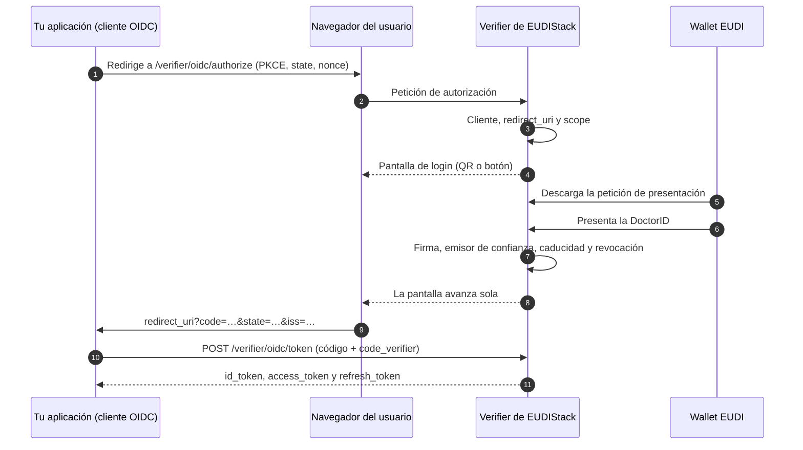

# OIDC IdP — Login con credencial verificable

El Verifier de EUDIStack es un proveedor de identidad (IdP) OpenID Connect estándar. Tu aplicación inicia un login OIDC normal y el Verifier se encarga del resto: pide al usuario que presente una credencial verificable desde su wallet EUDI, la verifica y devuelve a tu aplicación los atributos verificados en un ID Token firmado. Tu aplicación no habla nunca con el wallet.

Esta guía usa como ejemplo la **DoctorID**, la credencial profesional de los médicos colegiados, y una plataforma que la consume, como una plataforma de receta electrónica. El flujo es el mismo para cualquier otra credencial: solo cambian el scope y los atributos.

??? tip "¿Cuándo usar esta guía?"
    Utiliza esta guía si:

    - Tu aplicación ya sabe integrar un proveedor OIDC (Spring Security, Auth.js, NextAuth, una librería certificada por la OpenID Foundation…) o tienes un IAM corporativo (Keycloak, Entra ID) que admite proveedores externos.
    - Quieres que tus usuarios entren presentando una credencial verificable (eIDAS 2.0), sin usuario ni contraseña.
    - No quieres implementar OID4VP en tu backend.

    Si tu integración es un servicio backend sin usuario presente, consulta el [SDK Java M2M](verifier-m2m-sdk-java.md).

??? info "Requisitos previos"
    - Tu aplicación, **dada de alta como cliente OIDC** del tenant. Lo hace el equipo de EUDIStack a petición tuya: ver [Antes de empezar](#antes-de-empezar-el-alta-como-cliente).
    - Una **librería OIDC** que soporte Authorization Code con PKCE `S256` y firmas `ES256`.
    - Si tu aplicación tiene servidor: un **par de claves EC P-256** y una URL pública con su clave pública en formato JWKS.

!!! abstract "En resumen"
    1. **[Pide el alta](#antes-de-empezar-el-alta-como-cliente)** con los datos de tu aplicación. Recibes tu `client_id`, el discovery del tenant y usuarios de prueba.
    2. **[Lanza la autorización](#paso-1-lanzar-la-autorizacion)** con PKCE `S256`, un `state` nuevo y un `nonce`.
    3. **[Canjea el código](#paso-2-canjear-el-codigo)** por los tokens y valida su firma con las claves del discovery.
    4. **[Lee los atributos](#paso-3-leer-los-atributos-de-la-doctorid)** del ID Token.
    5. **[Mantén la sesión](#paso-4-mantener-y-cerrar-la-sesion)** con el Refresh Token y ciérrala a través del Verifier.

---

## Antes de empezar: el alta como cliente

El alta no es autoservicio. La hace el equipo de EUDIStack para cada aplicación y cada entorno: primero en el entorno de pruebas y, cuando hayas terminado, en producción.

**1. Envía los datos de tu aplicación.** [Contacta con soporte](../../support.md) con esta información:

| Dato | Ejemplo | Para qué sirve |
|---|---|---|
| Nombre de la aplicación | `Receta electrónica` | Identifica tu cliente. Se envía al wallet del médico en la petición de la credencial. |
| Tipo de cliente | Confidencial | Ver [Tipos de cliente](#tipos-de-cliente). |
| `redirect_uri` | `https://receta.example.com/oidc/callback` | Dirección exacta, con HTTPS, a la que vuelve el usuario con el código. Puedes dar varias. |
| `post_logout_redirect_uri` | `https://receta.example.com/` | A dónde vuelve el usuario tras el [cierre de sesión](#cerrar-la-sesion). |
| URL de tus claves públicas (JWKS) | `https://receta.example.com/.well-known/jwks.json` | Solo para un cliente confidencial. El Verifier comprueba con ella la firma de tus `client_assertion`. |
| Entorno | Pruebas | El alta de producción se pide aparte, al terminar las pruebas. |

**2. Recibe la respuesta del alta.** El equipo te envía:

- Tu `client_id`, distinto en cada entorno.
- La dirección del **documento de discovery** de tu tenant, con la forma `https://<tenant>.<dominio>/verifier/.well-known/openid-configuration`. De él salen todos los endpoints y las claves públicas del Verifier.
- Los **usuarios de prueba**: médicos sintéticos con su DoctorID en un wallet de pruebas.

!!! info "Nunca hay secretos compartidos"
    El Verifier no emite `client_secret`. Un cliente confidencial se autentica con su propia clave privada (`private_key_jwt`), que no sale nunca de tu servidor. Si cambias de clave, publícala en tu JWKS con un `kid` nuevo: no hace falta tocar el alta.

---

## Tipos de cliente

| Tipo | Para quién | Autenticación en el canje | PKCE |
|---|---|---|---|
| **Confidencial** | Aplicaciones con servidor propio e IAM corporativos (Keycloak, Entra ID…) | `private_key_jwt`: un JWT firmado en `ES256` con tu clave privada (RFC 7523) | Obligatorio, `S256` |
| **Público** | Aplicaciones sin servidor: SPA o aplicación móvil | Ninguna (`none`) | Obligatorio, `S256` |

Si tienes servidor, elige siempre el cliente confidencial. Los tokens quedan en tu servidor y el canje necesita tu clave privada, además del verificador PKCE.

Un **IAM corporativo** registra al Verifier como proveedor de identidad externo y es, para el Verifier, un cliente confidencial más. Tus aplicaciones siguen hablando con tu IAM, y el IAM gobierna su sesión. Ver [Keycloak como broker](#keycloak-como-broker).

---

## El flujo

Desde el punto de vista de tu aplicación es el Authorization Code Flow de OpenID Connect con PKCE. Lo que cambia es lo que ve el usuario: en lugar de un formulario, la pantalla de login del Verifier le pide que presente su credencial con el wallet. Lo hace escaneando un QR si el wallet está en otro dispositivo, o con un botón si está en el mismo.



El Verifier comprueba la credencial en el momento de la presentación, antes de emitir el código. Si está revocada, caducada o la emitió alguien que no es de confianza, el login no termina y tu aplicación no recibe ningún código.

---

## Paso 1: Lanzar la autorización

Redirige el navegador del usuario al `authorization_endpoint` del discovery:

```http
GET /verifier/oidc/authorize?
  response_type=code&
  client_id=<tu-client-id>&
  redirect_uri=https%3A%2F%2Freceta.example.com%2Foidc%2Fcallback&
  scope=openid%20doctorid%20offline_access&
  state=4f1c2a9e-7b3d-4c8e-9a51-2d6f0e8b7c13&
  nonce=b8e2d1f4-3a6c-4e9b-8d70-1c5a9f2e6b48&
  code_challenge=i2oTsSGNMAWUkSB6JyeIQCXdDX5gPVEN_N3XmccjYNo&
  code_challenge_method=S256
```

| Parámetro | Valor |
|---|---|
| `response_type` | Siempre `code`. |
| `client_id` | El de tu alta. |
| `redirect_uri` | Una de las de tu alta, exactamente igual: esquema, host, puerto y ruta. |
| `scope` | `openid doctorid offline_access`. `openid` siempre; `doctorid` pide la DoctorID; `offline_access` pide el Refresh Token. Pide solo scopes de tu alta. |
| `state` | Un valor aleatorio **nuevo en cada login**. Guárdalo en la sesión del navegador y compruébalo a la vuelta. El Verifier rechaza un `state` que ya está en uso. |
| `nonce` | Un valor aleatorio nuevo en cada login. Vuelve en el ID Token: compruébalo. |
| `code_challenge` y `code_challenge_method` | PKCE: `BASE64URL(SHA-256(code_verifier))` y siempre `S256`. Obligatorio para todos los clientes, también los confidenciales. `plain` se rechaza. |

---

## Paso 2: Canjear el código

Cuando el usuario presenta su credencial, el navegador vuelve a tu `redirect_uri`:

```
https://receta.example.com/oidc/callback?code=e7e168e7-6a02-42d8-ad9f-0b5edb51ba6f&state=4f1c2a9e-7b3d-4c8e-9a51-2d6f0e8b7c13&iss=https%3A%2F%2F<tenant>.<dominio>%2Fverifier
```

Antes de canjear el código:

1. Comprueba que `state` es el que guardaste para este navegador.
2. Comprueba que `iss` es igual al `issuer` del discovery (RFC 9207). Así detectas ataques de mezcla si trabajas con más de un proveedor.

Canjea el código en el `token_endpoint` cuanto antes: es de un solo uso.

=== "Cliente confidencial"
    ```http
    POST /verifier/oidc/token
    Content-Type: application/x-www-form-urlencoded

    grant_type=authorization_code&
    client_id=<tu-client-id>&
    code=e7e168e7-6a02-42d8-ad9f-0b5edb51ba6f&
    redirect_uri=https%3A%2F%2Freceta.example.com%2Foidc%2Fcallback&
    code_verifier=nCk4LYmjcikQMRfI7rNzci1wnC8sn6kuVfDxj5qvF6k&
    client_assertion_type=urn%3Aietf%3Aparams%3Aoauth%3Aclient-assertion-type%3Ajwt-bearer&
    client_assertion=eyJhbGciOiJFUzI1NiIsInR5cCI6IkpXVCIsImtpZCI6InJlY2V0YS0yMDI2In0…
    ```

    El `client_assertion` es un JWT firmado con tu clave privada en `ES256`, con el `kid` de tu JWKS en la cabecera:

    ```json
    {
      "iss": "<tu-client-id>",
      "sub": "<tu-client-id>",
      "aud": "https://<tenant>.<dominio>/verifier",
      "jti": "0b9d3c2e-5f61-4a8b-9e47-1d2c3b4a5f60",
      "iat": 1794304160,
      "exp": 1794304280
    }
    ```

    `aud` es el `issuer` del discovery; también se acepta el `token_endpoint`, que es lo que envían por defecto librerías como Keycloak. Usa un `jti` nuevo y una caducidad corta en cada canje.

=== "Cliente público"
    ```http
    POST /verifier/oidc/token
    Content-Type: application/x-www-form-urlencoded

    grant_type=authorization_code&
    client_id=<tu-client-id>&
    code=e7e168e7-6a02-42d8-ad9f-0b5edb51ba6f&
    redirect_uri=https%3A%2F%2Freceta.example.com%2Foidc%2Fcallback&
    code_verifier=nCk4LYmjcikQMRfI7rNzci1wnC8sn6kuVfDxj5qvF6k
    ```

La respuesta lleva los tres tokens:

```json
{
  "access_token": "eyJraWQiOiJkaWQ6a2V5Ono…",
  "id_token": "eyJraWQiOiJkaWQ6a2V5Ono…",
  "refresh_token": "FvqdvpiHzeroCq4f6VVdFJ1CvfMxDdWqpMx-3k0e4PI",
  "token_type": "Bearer",
  "expires_in": 899
}
```

**Valida el ID Token** antes de usarlo, como pide OpenID Connect Core §3.1.3.7:

- La firma, con la clave del `jwks_uri` del discovery cuyo `kid` coincide con el de la cabecera. Los tokens se firman en **`ES256`** (EC P-256).
- `iss` igual al `issuer` del discovery, `aud` igual a tu `client_id`, `exp` en el futuro y `nonce` igual al que enviaste.

!!! warning "Configura `ES256` en tu librería"
    El discovery anuncia hoy `RS256` en `id_token_signing_alg_values_supported`, pero los tokens van firmados en `ES256`. Si tu librería toma el algoritmo del discovery o usa `RS256` por defecto (por ejemplo, Spring Security), configura `ES256` explícitamente para el ID Token.

---

## Paso 3: Leer los atributos de la DoctorID

El ID Token lleva los atributos que el médico ha presentado. `sub` es su **número de colegiado**: es el mismo en todas las aplicaciones del tenant y no cambia entre logins, así que úsalo como identificador del usuario en tu aplicación.

| Claim | Significado | Tipo | ID Token | Access Token |
|---|---|---|---|---|
| `sub` | Número de colegiado | Texto, 9 dígitos | Sí | Sí |
| `personal_administrative_number` | Número de colegiado | Texto, 9 dígitos | Sí | Sí |
| `given_name`, `givenName` | Nombre | Texto | Sí; el renovado, solo `givenName` | Solo `givenName` |
| `family_name`, `familyName` | Apellidos | Texto | Sí; el renovado, solo `familyName` | Solo `familyName` |
| `name` | Nombre y apellidos | Texto | Sí, salvo en el renovado | No |
| `medical_board` | Colegio o colegios de médicos en los que está colegiado | Lista de textos | Sí, si la DoctorID lo lleva | Sí, si la DoctorID lo lleva |
| `medical_speciality` | Especialidad o especialidades | Lista de textos | Sí | Sí |
| `legally_entitled` | Habilitado para ejercer | Booleano | Sí, si la DoctorID lo lleva | Sí, si la DoctorID lo lleva |
| `credential_type` | Tipo de credencial presentada: `urn:es.cgcom:doctorid:1` | Texto | Sí | Sí |
| `auth_time` | Momento de la presentación | Segundos desde epoch | Sí | No |

Nombre, apellidos, número de colegiado y especialidad están siempre. Colegio y habilitación pueden faltar si la DoctorID del médico no los lleva: trata su ausencia como «desconocido», no como `false`.

=== "ID Token"
    ```json
    {
      "iss": "https://<tenant>.<dominio>/verifier",
      "sub": "282801234",
      "aud": "<tu-client-id>",
      "iat": 1794303714,
      "exp": 1794303774,
      "auth_time": 1794303714,
      "nonce": "b8e2d1f4-3a6c-4e9b-8d70-1c5a9f2e6b48",
      "acr": "0",
      "credential_type": "urn:es.cgcom:doctorid:1",
      "given_name": "María",
      "family_name": "García López",
      "name": "María García López",
      "givenName": "María",
      "familyName": "García López",
      "personal_administrative_number": "282801234",
      "medical_board": ["Colegio Oficial de Médicos de Barcelona"],
      "medical_speciality": ["Internal Medicine"],
      "legally_entitled": true,
      "vc_json": "…"
    }
    ```

=== "Access Token"
    ```json
    {
      "iss": "https://<tenant>.<dominio>/verifier",
      "sub": "282801234",
      "aud": "<tu-client-id>",
      "iat": 1794303714,
      "exp": 1794304614,
      "jti": "2076acfc-1d46-4152-b120-f19350ddfa08",
      "scope": "openid doctorid",
      "tenant": "<tenant>",
      "credential_type": "urn:es.cgcom:doctorid:1",
      "givenName": "María",
      "familyName": "García López",
      "personal_administrative_number": "282801234",
      "medical_board": ["Colegio Oficial de Médicos de Barcelona"],
      "medical_speciality": ["Internal Medicine"],
      "legally_entitled": true,
      "vc": { "…": "…" }
    }
    ```

    El Access Token es un JWT firmado con las mismas claves. Úsalo para llamar a tus propias APIs: valídalo igual que el ID Token y comprueba además que lleva `scope`. Los dos tokens tienen la misma firma y el mismo `aud`, y el ID Token no lleva `scope`: sin esa comprobación, tu API aceptaría también un ID Token. `scope` lleva el scope de la credencial, no todos los que pediste.

Los datos de los ejemplos son sintéticos.

!!! warning "No uses `vc_json` ni `vc`"
    El ID Token lleva hoy la credencial completa en `vc_json`, y el Access Token en `vc`. **Se quitarán**: la plataforma solo debe entregar los atributos, no la credencial entera. Lee siempre los claims de la tabla y no dependas de `vc_json` ni de `vc`.

!!! info "Datos del usuario (`userinfo`)"
    El discovery publica `userinfo_endpoint`, pero hoy no acepta los Access Tokens del Verifier y responde `401`. Lee los atributos del ID Token, que lleva todos los de la tabla. Esta guía se actualizará cuando el endpoint esté disponible.

### Nivel de seguridad: `acr` y `amr`

El ID Token lleva hoy `acr` con el valor fijo `"0"` y no lleva `amr`. No uses `acr` para decidir el nivel de seguridad del login: la DoctorID se presenta siempre desde el wallet y el Verifier comprueba su firma, su emisor, su caducidad y su revocación antes de emitir el código.

!!! info "Próximamente"
    `acr` llevará el nivel de seguridad eIDAS alcanzado (`http://eidas.europa.eu/LoA/substantial` o `http://eidas.europa.eu/LoA/high`) y `amr`, el método de autenticación según la RFC 8176. Esta guía se actualizará cuando esté desplegado.

---

## Paso 4: Mantener y cerrar la sesión

### Duración de los tokens

| Token | Duración | Qué hacer al caducar |
|---|---|---|
| Código de autorización | Un solo uso | Canjéalo en cuanto lo recibas. |
| ID Token | 60 segundos | Valídalo al recibirlo y abre tu propia sesión. No lo reenvíes a otras APIs. |
| Access Token | 15 minutos | Pide uno nuevo con el Refresh Token. |
| Refresh Token | 12 horas desde que se emite, de un solo uso. Cada renovación da uno nuevo de otras 12 horas. | Inicia un login nuevo. |

### Guardar los tokens

- **Con servidor (cliente confidencial).** Guarda los tokens solo en el servidor, junto a la sesión del médico. Al navegador envíale solo tu propia cookie de sesión con `HttpOnly`, `Secure` y `SameSite`.
- **Sin servidor (cliente público).** Guarda los tokens en memoria. No uses `localStorage` ni `sessionStorage`: cualquier script de la página los puede leer. En una aplicación móvil, usa el almacén seguro del sistema (Keychain o Keystore).
- **Nunca** envíes el Refresh Token a tus APIs ni lo escribas en logs. A tus APIs solo les llega el Access Token.

### Renovar con el Refresh Token

Mantén la sesión del médico durante su jornada con el Refresh Token. Cada canje devuelve un ID Token, un Access Token y **un Refresh Token nuevo**. Guarda siempre el último: el anterior deja de servir.

!!! warning "La duración máxima de la sesión la pones tú"
    - **Sin límite total.** Cada Refresh Token nuevo dura 12 horas desde la renovación, así que una aplicación que renueva sin parar mantiene la sesión indefinidamente. Fija en tu aplicación una duración máxima, por ejemplo la jornada, y pasado ese tiempo pide un login nuevo.
    - **Sin nueva comprobación de la credencial.** La renovación reutiliza la DoctorID presentada en el login: no vuelve a comprobar si se ha revocado ni si el médico sigue habilitado. `legally_entitled` y los demás atributos son los del login. Antes de una operación sensible, como firmar una receta, pide un login nuevo si el último es antiguo.

```http
POST /verifier/oidc/token
Content-Type: application/x-www-form-urlencoded

grant_type=refresh_token&
client_id=<tu-client-id>&
refresh_token=FvqdvpiHzeroCq4f6VVdFJ1CvfMxDdWqpMx-3k0e4PI&
client_assertion_type=urn%3Aietf%3Aparams%3Aoauth%3Aclient-assertion-type%3Ajwt-bearer&
client_assertion=eyJhbGciOiJFUzI1NiIs…
```

Un cliente público omite `client_assertion_type` y `client_assertion`. El ID Token renovado mantiene el `auth_time` del login original y no lleva `nonce`. Tampoco lleva `given_name`, `family_name` ni `name`: lee el nombre de `givenName` y `familyName`, que están en todos los ID Tokens, o guárdalo en el login.

Un Refresh Token caducado, ya usado o de otro cliente se rechaza. Ante cualquier respuesta que no sea `200`, inicia un login nuevo. Los Refresh Tokens se guardan en la memoria del Verifier: **un reinicio o un despliegue de la plataforma los invalida todos** antes de las 12 horas. Tu aplicación debe tratarlo igual que uno caducado.

!!! info "Revocación"
    El discovery publica `revocation_endpoint` (RFC 7009), pero hoy no invalida los Refresh Tokens. El [cierre de sesión](#cerrar-la-sesion) tampoco: un Refresh Token sigue sirviendo hasta que caduca o se usa. Para terminar la sesión, haz el cierre de sesión y **borra los tokens de tu aplicación**.

### Cerrar la sesión

Redirige el navegador al `end_session_endpoint` del discovery:

```http
GET /verifier/oidc/logout?
  id_token_hint=<último id_token>&
  post_logout_redirect_uri=https%3A%2F%2Freceta.example.com%2F&
  state=9c1e…
```

El Verifier vuelve a tu `post_logout_redirect_uri` con el `state`. Comprueba que es el que enviaste y borra la sesión y los tokens de tu aplicación. Borra los tokens también si no vuelve: el cierre en tu aplicación no depende del Verifier.

La petición va por `GET`, así que el `id_token_hint` viaja en la URL. No registres esa URL completa en tus logs ni en los de tu proxy.

Tu aplicación no comparte la sesión con las demás aplicaciones del tenant: el médico presenta su credencial en cada login. Si quieres compartirla, consulta [SSO entre aplicaciones del mismo tenant](sso-multi-app.md).

---

## Keycloak como broker

!!! note "Configuración de referencia"
    Estos pasos siguen la documentación de Keycloak y lo que acepta el Verifier, pero aún no se han probado de punta a punta con un Keycloak. Compruébalos en el entorno de pruebas antes de pasar a producción.

Si tus aplicaciones ya usan Keycloak, registra el Verifier como proveedor de identidad externo. Para el Verifier, tu Keycloak es un cliente confidencial con `private_key_jwt`.

1. **Clave del realm.** En *Realm settings › Keys*, añade un proveedor `ecdsa-generated` con la curva P-256 (`ES256`). La URL de claves que envías en el alta es la del realm: `https://<tu-keycloak>/realms/<realm>/protocol/openid-connect/certs`.
2. **Alta.** Como `redirect_uri`, envía la del broker: `https://<tu-keycloak>/realms/<realm>/broker/<alias>/endpoint`, donde `<alias>` es el nombre que darás al proveedor.
3. **Proveedor.** En *Identity providers*, añade *OpenID Connect v1.0* con estos valores:

    | Campo | Valor |
    |---|---|
    | Alias | El de la `redirect_uri`, por ejemplo `eudistack` |
    | Discovery endpoint | La dirección de discovery de la respuesta al alta |
    | Client authentication | *JWT signed with private key* |
    | Client assertion signature algorithm | `ES256` |
    | Client ID | El `client_id` del alta |
    | Use PKCE | Activado, método `S256` |
    | Validate signatures | Activado, con *Use JWKS URL* |
    | Default scopes | `openid doctorid` |
    | Pass nonce | Activado |

4. **Atributos.** En *Mappers* del proveedor, añade un *Attribute Importer* por cada claim que quieras guardar en el usuario de Keycloak: `personal_administrative_number`, `medical_board`, `medical_speciality` y `legally_entitled`. Usa `sub` como identificador del usuario federado.

Keycloak gobierna después la sesión de tus aplicaciones. Recibe `auth_time` para que decidas cuándo pedir un login nuevo.

---

## Del entorno de pruebas a producción

1. **Pruebas.** Integra contra el discovery del entorno de pruebas con los usuarios de prueba de la respuesta al alta. Comprueba el login, el canje, la validación de la firma, la lectura de los atributos, la renovación con el Refresh Token y el cierre de sesión.
2. **Alta de producción.** [Pide a soporte](../../support.md) el alta en producción con tus direcciones de producción. Recibes un `client_id` y un discovery nuevos. No reutilices nada del entorno de pruebas.
3. **Puesta en marcha.** Cambia el discovery y el `client_id` en tu configuración. Los médicos entran con su propia DoctorID: los usuarios de prueba no existen en producción.

---

## Errores frecuentes

| Situación | Qué pasa | Qué hacer |
|---|---|---|
| `redirect_uri` que no está en tu alta | El Verifier no vuelve a tu aplicación: muestra su página de error. | Usa la dirección exacta del alta, o pide que se añada. |
| `client_id` que no existe en el tenant | `403` sin redirigir. | Revisa el `client_id` y el discovery: cada entorno tiene los suyos. |
| Scope que no existe | `403` sin redirigir. | Pide `openid doctorid offline_access`. |
| Scope que no está en tu alta | Hoy no se rechaza, pero no está garantizado. | Pide solo los scopes de tu alta. |
| `state` repetido | Página de error del Verifier con `state already in use`. | Genera un `state` nuevo en cada login. |
| Sin PKCE o con `plain` | La autorización sigue, pero el canje responde `400 {"error":"invalid_grant"}`. | Envía siempre `code_challenge` con `S256` y su `code_verifier` en el canje. |
| `code_verifier` que no corresponde | `400 {"error":"invalid_grant"}` | Usa el verificador del mismo login. |
| Código ya canjeado o caducado | `400 {"error":"invalid_grant"}` | Inicia un login nuevo. |
| `client_assertion` mal firmado, caducado o con otro `aud` | `401 {"error":"invalid_client"}` | Firma con la clave de tu JWKS en `ES256`, con `aud` igual al `issuer` o al `token_endpoint`. |
| Refresh Token caducado o ya usado | `403` sin cuerpo | Inicia un login nuevo. |
| El usuario no presenta su credencial a tiempo | Tras 120 segundos, si la pantalla de login sigue abierta, tu `redirect_uri` recibe `error=access_denied&error_description=login_timeout` con tu `state`. Es el único caso en que llega `access_denied`. | Muestra al usuario la opción de volver a intentarlo. |
| La credencial está revocada, caducada o no es de confianza | El login no termina. Tu aplicación no recibe código ni error en ese momento; recibe `access_denied` solo si el usuario deja la pantalla abierta hasta que caduca. | Ofrece volver a intentarlo. El usuario debe renovar su credencial con su emisor. |
| El usuario vuelve a tu aplicación sin terminar el login (botón atrás, cierra la pestaña) | Tu `redirect_uri` no recibe nada. | Trata como abandonado un login sin respuesta y deja empezar uno nuevo, con `state` nuevo. |
| La firma del ID Token no valida | Tu librería rechaza el token. | Configura `ES256` y toma las claves del `jwks_uri` del discovery. |
