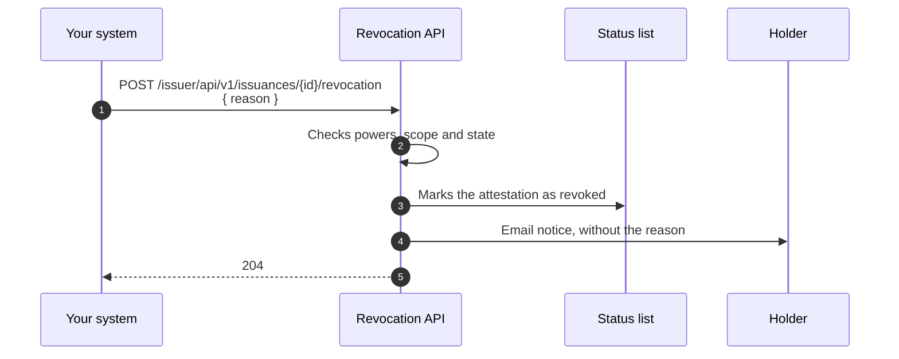

# Revocation API

Revoke from your backend an attestation your organization issued, before it expires: because someone leaves, the data was wrong, or the information was compromised. Without going through the Administration Portal.

!!! info "Coming soon"
    Revocation through the API is not available to systems yet. Today you can only revoke from the Administration Portal. This guide describes the contract so you can prepare the integration.

[:material-file-document: **Revocation OpenAPI contract**](../api-reference/issuer.en.md#revocation-api){ .md-button .md-button--primary }
[:material-magnify: Query API](query-api.en.md){ .md-button }

??? tip "When to use this guide"
    - Your system knows when an attestation stops being valid: an employee leaves, a professional deregisters, data is corrected.
    - You want to revoke from your own processes, with automatic retries.

??? info "Prerequisites"
    - An `access_token` from the Verifier, obtained with your system's machine credential, as in [step 1 of the Issuance API](issuance-api.en.md#step-1-get-the-access-token).
    - The `Onboarding · Execute` power in your tenant's domain. You revoke your organization's attestations; the tenant administrator, the whole tenant's.
    - The issuance process identifier of the attestation: the one the issuance returned in `Location`, or the `procedure_id` from the [Query API](query-api.en.md).

---

## What revocation does



- Marks the attestation as revoked in its **status list**: from then on, any verifier rejects it.
- Moves the issuance process to `REVOKED`.
- Notifies the holder by email, **without the reason**.
- It is **irreversible**. To give the attestation again, make a new issuance.

Only a `VALID` attestation can be revoked. An `ISSUED` one, whose validity has not started yet, can be revoked once it becomes `VALID`.

---

## Revoke an attestation

`POST /issuer/api/v1/issuances/{id}/revocation`

The body has a single required field, `reason`: free text of up to 280 characters. It is internal: it stays in the audit trail and is never sent to the holder.

```http
POST /issuer/api/v1/issuances/0b6f1d2e-8c4a-4b1f-9e2d-7a5c3f8e1b90/revocation HTTP/1.1
Host: sandbox.stg.eudistack.net
Authorization: Bearer <access_token>
Content-Type: application/json

{ "reason": "Employee left the company" }
```

```http
HTTP/1.1 204 No Content
```

If you do not know the process identifier, find it with the [Query API](query-api.en.md#search-by-a-person-identifier), filtering by `status=VALID`, and revoke each process it returns.

---

## Retries

Revocation is safe to retry without an idempotency header:

| Situation | Response | What to do |
|---|---|---|
| You revoke an already revoked attestation, for example when repeating the request after losing the response | 409 `already_revoked`. No effect is repeated, not even the holder notice. | Treat it as success. |
| Two requests revoke the same attestation at the same time | Only one is applied; the other gets `already_revoked`. | Treat it as success. |
| The status list is unavailable | 503 `status_list_unavailable`. Nothing changed: the attestation is still `VALID`. | Wait for `Retry-After` and retry. |

---

## Errors

Errors are returned as `application/problem+json` (RFC 9457). Build your logic on `type`, not on `title` or `detail`.

| HTTP | `type` | Cause | What to do |
|---|---|---|---|
| 400 | `BAD_REQUEST` | `{id}` is not a UUID, or `reason` is missing or longer than 280 characters. `violations` names the field. | Fix the request. |
| 401 | `invalid_token`, `authentication_error` | The token is missing, invalid or expired. | Get a new token. |
| 403 | `insufficient_permission` | Your credential's powers do not allow revocation. | Check the machine credential powers. |
| 404 | `issuance_not_found` | The process does not exist or is outside your scope. Both cases get the same response. | Check the identifier. |
| 409 | `already_revoked` | The attestation was already revoked. | Treat it as success. |
| 409 | `not_revocable` | The attestation is not `VALID`: draft, withdrawn, validity not started yet, expired or archived. | Nothing to revoke. If its validity has not started, revoke once it becomes `VALID`. |
| 429 | `rate_limited` | The rate limit was exceeded (300 requests per minute per organization for systems). | Wait for `Retry-After`. |
| 503 | `status_list_unavailable` | The status list could not be marked. Nothing changed. | Wait for `Retry-After` and retry. |

??? warning "Security considerations"
    - Revocation is irreversible: check that the identifier belongs to the attestation you want to revoke before calling.
    - Do not put personal data in `reason` beyond what is necessary: the reason stays in the audit trail.

---

## Full reference

The full revocation API contract is in the [Issuer API reference](../api-reference/issuer.en.md#revocation-api).
