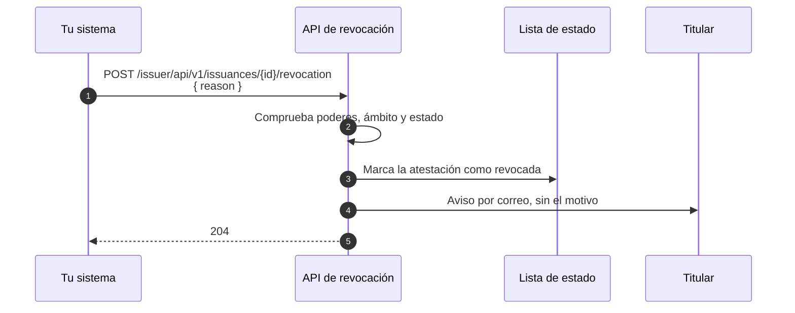

# API de revocación

Revoca desde tu backend una atestación que emitió tu organización, antes de que caduque: por una baja, un error en los datos o un compromiso de la información. Sin pasar por el Portal de Administración.

!!! info "Próximamente"
    La revocación por API aún no está disponible para sistemas. Hoy solo se puede revocar desde el Portal de Administración. Esta guía describe el contrato para que puedas preparar la integración.

[:material-file-document: **Contrato OpenAPI de revocación**](../api-reference/issuer.md#api-de-revocacion){ .md-button .md-button--primary }
[:material-magnify: API de consulta](query-api.md){ .md-button }

??? tip "¿Cuándo usar esta guía?"
    - Tu sistema sabe cuándo una atestación deja de ser válida: la baja de un empleado, la baja de un colegiado, una corrección de datos.
    - Quieres revocar desde tus propios procesos, con reintentos automáticos.

??? info "Requisitos previos"
    - Un `access_token` del Verifier, obtenido con la credencial de máquina de tu sistema, como en el [paso 1 de la API de emisión](issuance-api.md#paso-1-obten-el-token-de-acceso).
    - El poder `Onboarding · Execute` en el dominio de tu tenant. Revocas las atestaciones de tu organización; el administrador del tenant, las de todo el tenant.
    - El identificador del proceso de emisión de la atestación: el que devolvió la emisión en `Location`, o el `procedure_id` que te da la [API de consulta](query-api.md).

---

## Qué hace la revocación



- Marca la atestación como revocada en su **lista de estado**: desde ese momento, cualquier verificador la rechaza.
- Pasa el proceso de emisión a `REVOKED`.
- Avisa al titular por correo, **sin el motivo**.
- Es **irreversible**. Para volver a dar la atestación, haz una emisión nueva.

Solo se revoca una atestación en estado `VALID`. Una `ISSUED`, con la vigencia aún sin empezar, se podrá revocar cuando pase a `VALID`.

---

## Revoca una atestación

`POST /issuer/api/v1/issuances/{id}/revocation`

El cuerpo lleva un único campo obligatorio, `reason`: el motivo, en texto libre y de hasta 280 caracteres. Es interno: queda en la traza de auditoría y nunca se comunica al titular.

```http
POST /issuer/api/v1/issuances/0b6f1d2e-8c4a-4b1f-9e2d-7a5c3f8e1b90/revocation HTTP/1.1
Host: sandbox.stg.eudistack.net
Authorization: Bearer <access_token>
Content-Type: application/json

{ "reason": "Baja del empleado" }
```

```http
HTTP/1.1 204 No Content
```

Si no conoces el identificador del proceso, búscalo con la [API de consulta](query-api.md#buscar-por-un-identificador-de-la-persona), filtrando por `status=VALID`, y revoca cada proceso que devuelva.

---

## Reintentos

La revocación es segura de reintentar sin cabecera de idempotencia:

| Situación | Respuesta | Qué hacer |
|---|---|---|
| Revocas una atestación ya revocada, por ejemplo al repetir la petición tras perder la respuesta | 409 `already_revoked`. No se repite ningún efecto, tampoco el aviso al titular. | Trátalo como éxito. |
| Dos peticiones revocan la misma atestación a la vez | Se aplica una sola; la otra recibe `already_revoked`. | Trátalo como éxito. |
| La lista de estado no está disponible | 503 `status_list_unavailable`. No ha cambiado nada: la atestación sigue `VALID`. | Espera lo que indique `Retry-After` y reintenta. |

---

## Errores

Los errores se devuelven como `application/problem+json` (RFC 9457). Programa tu lógica sobre `type`, no sobre `title` ni `detail`.

| HTTP | `type` | Causa | Qué hacer |
|---|---|---|---|
| 400 | `BAD_REQUEST` | `{id}` no es un UUID, o falta `reason` o supera 280 caracteres. `violations` indica el campo. | Corrige la petición. |
| 401 | `invalid_token`, `authentication_error` | Falta el token, no es válido o ha caducado. | Pide un token nuevo. |
| 403 | `insufficient_permission` | Los poderes de tu credencial no permiten revocar. | Revisa los poderes de la credencial de máquina. |
| 404 | `issuance_not_found` | El proceso no existe o está fuera de tu ámbito. Los dos casos reciben la misma respuesta. | Revisa el identificador. |
| 409 | `already_revoked` | La atestación ya estaba revocada. | Trátalo como éxito. |
| 409 | `not_revocable` | La atestación no está `VALID`: borrador, retirada, con la vigencia aún sin empezar, caducada o archivada. | Nada que revocar. Si su vigencia no ha empezado, revoca cuando pase a `VALID`. |
| 429 | `rate_limited` | Se ha superado el límite de volumen (300 peticiones por minuto y organización para sistemas). | Espera lo que indique `Retry-After`. |
| 503 | `status_list_unavailable` | No se pudo marcar la lista de estado. No ha cambiado nada. | Espera `Retry-After` y reintenta. |

??? warning "Consideraciones de seguridad"
    - La revocación es irreversible: comprueba que el identificador corresponde a la atestación que quieres revocar antes de llamar.
    - No pongas datos personales en `reason` más allá de lo necesario: el motivo queda en la traza de auditoría.

---

## Referencia completa

El contrato completo de la API de revocación está en la [referencia de la API del Issuer](../api-reference/issuer.md#api-de-revocacion).
