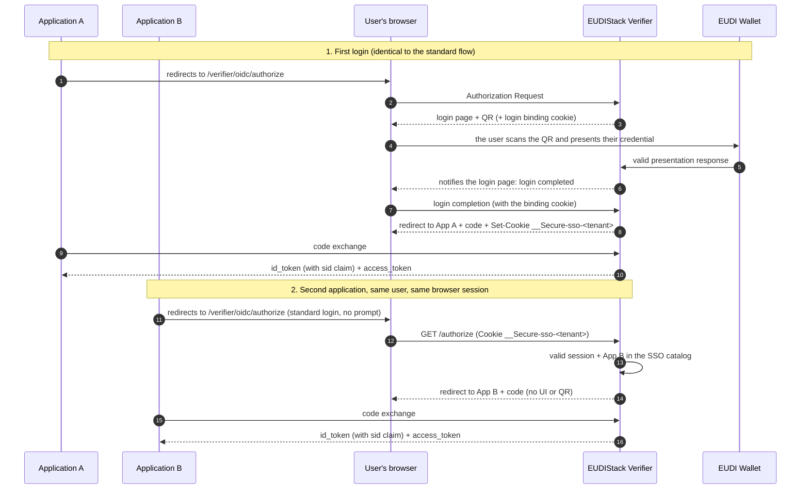
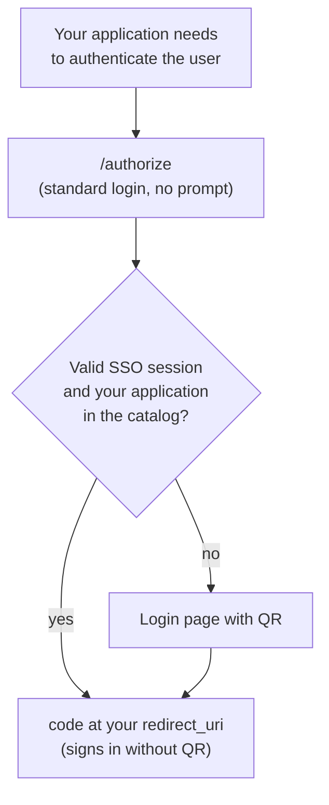
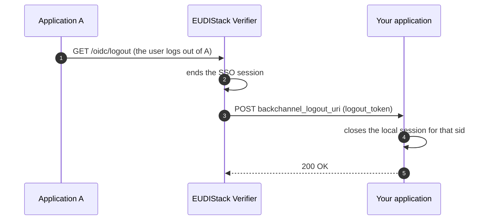

# SSO across applications in the same tenant

If several client applications are integrated with the Verifier of the same EUDIStack tenant —your own or third parties', such as your own management portal and a supplier's portal—, the Verifier can maintain a **tenant-level authentication session**: the user presents their credential once, and the other applications reuse that session instead of asking them to scan the QR code again. For this, each application must be added to the tenant's eligible applications catalog.

This guide assumes your application is already integrated with the Verifier as an OIDC IdP (credential login). SSO does not change the OIDC contract you already integrated: with the standard login, the Verifier reuses the session when there is one. It adds an optional silent session check (`prompt=none`) and coordinated logout across applications.

!!! abstract "In short"
    1. **Meet the [requirements](#requirements):** SSO enabled for the tenant and your `client_id` in the eligible applications catalog.
    2. **[Start the standard OIDC login](#integrating-the-login)**, without `prompt`: if there is an SSO session, the Verifier returns the `code` without the QR code; if not, it shows the QR code as usual. Use `prompt=none` only if you need to check the session without showing the login.
    3. **[Log out through the Verifier](#logging-out-single-logout)** and, if you can, listen for logout notifications from the other applications.

!!! info "Since Verifier version 3.4.0"
    Up to version 3.3, the Verifier only reused the session when the request carried `prompt=none`, so every application had to ask for a silent login first. Since 3.4.0 the standard login is enough. If your application already makes the `prompt=none` attempt, it keeps working as before.

---

## Requirements

| Requirement | Managed by | Details |
|---|---|---|
| SSO enabled for the tenant | EUDIStack team | `ssoEnabled` is turned on and the tenant's **root domain** (`rootDomain`) is configured: the session cookie is scoped to it, and it must cover the host the tenant's Verifier is served from. |
| Application registered as an OIDC client of the tenant | EUDIStack team | The same registration you need for credential login. |
| `client_id` in the eligible applications catalog | EUDIStack team | Added at your request. Without this step, your application never reuses the session: the user always sees the QR code (with `prompt=none`, you receive `interaction_required`). |

To request activation or the registration of an application, contact the EUDIStack team with the tenant and the `client_id`s involved.

!!! warning "Adding an application means trusting it with the user's session"
    While the SSO session is valid, any `client_id` in the catalog obtains an `id_token` for the user without them presenting their credential again or seeing any screen. This applies equally to third-party applications: only add those you trust as much as your own, and remove them from the catalog as soon as they no longer need access.

---

## How it works

Each tenant with SSO enabled maintains, in addition to each application's OIDC sessions, **a tenant-level authentication session** (an "OP-level session" in OIDC Core terminology). It is stored in an opaque cookie, scoped to the tenant's root domain, that the user's browser presents to the Verifier on every authorization request, whichever application it comes from.



The SSO session is established automatically after any credential login in a tenant with SSO enabled, whichever application it happens in. Which application comes "first" depends on where the user starts; since reuse happens within the standard login itself, every application in the catalog benefits from it without doing anything special.

The session cookie is issued in the **browser that started the login**, even when the user presents their credential from a wallet on another device (their phone): after the presentation, the login page sends the browser back to the Verifier to complete the login, and that is the step where the Verifier creates the session and redirects to your application. This step is transparent to your application, which receives the `code` at its `redirect_uri` as usual.

---

## Integrating the login

Send the standard authorization request (authorization code + PKCE), without `prompt`. The Verifier decides whether the QR code is needed:



```http
GET /verifier/oidc/authorize?
  response_type=code&
  client_id=my-second-app&
  scope=openid learcredential.employee&
  state=Xq7mZ2pL9vT4rN8sK3wY&
  redirect_uri=https://my-second-app.com/callback&
  code_challenge=E9Melhoa2OwvFrEMTJguCHaoeK1t8URWbuGJSstw-cM&
  code_challenge_method=S256
```

!!! warning "Generate a new, random `state` for every request"
    The Verifier identifies each login in progress by its `state`. If your application starts a QR login reusing a `state` that is still in progress (up to 10 minutes), the Verifier rejects it with `invalid_request: state already in use` and shows its error page, unless it is a retry from the same browser. Common OIDC libraries already generate a different `state` for each request; do not use fixed or predictable values.

### Behaviour by `prompt`

| `prompt` | Reusable SSO session | No reusable session |
|---|---|---|
| Absent | `code` without QR | QR login, as usual |
| `none` | `code` without QR | `error=login_required` or `error=interaction_required`, without showing any screen ([see below](#optional-checking-the-session-with-promptnone)) |
| `login` | QR login: the user presents their credential again. The SSO session is not ended | QR login |
| `none` together with another value (e.g. `none login`) | `error=invalid_request` | `error=invalid_request` |

The session is **reusable** when the browser presents a valid SSO session of the tenant, your `client_id` is in the catalog and, if you send `max_age`, the session is more recent than that limit. `prompt` values the Verifier does not support (`consent`, `select_account`) are treated as absent.

If the request carries a request object (`request` or `request_uri`), the Verifier reads `prompt` and `max_age` **only** from the claims of the signed JWT (RFC 9101 §6.3) and ignores those in the query.

### Forcing a fresh authentication

Before a sensitive operation you can require the user to present their credential even if there is an SSO session:

- `prompt=login`: always shows the QR code.
- `max_age=<seconds>`: shows the QR code if the credential login is older than that number of seconds. It must be a non-negative integer; a malformed value (negative, decimal or non-numeric) receives `error=invalid_request`.

In both cases, the `id_token` carries the `auth_time` of the credential login, so you can also check its age yourself.

### Response at your `redirect_uri`

Every response from the Verifier at your `redirect_uri`, success or error, keeps the query the registered `redirect_uri` already has and adds:

| Parameter | Success | Error |
|---|---|---|
| `code` | Yes | — |
| `error` | — | `login_required`, `interaction_required`, `invalid_request`, `access_denied` |
| `error_description` | — | Fixed English text (e.g. `max_age must be a non-negative integer`). It is informative: do not show it as is to the user |
| `state` | The one in your request | The one in your request |
| `iss` | Yes | Yes |

`iss` (RFC 9207) is the `issuer` published by the discovery document of the tenant's Verifier (`/.well-known/openid-configuration`), which advertises `authorization_response_iss_parameter_supported: true`. If your application works with several authorization servers, compare it with that `issuer` to detect mix-up attacks. Otherwise, you can ignore it.

In the QR login, your `redirect_uri` may also receive `?error=access_denied`: the login was not completed in the browser that started it (for example, because the browser blocks the Verifier's cookies or because someone tried to complete it from another browser). The Verifier delivers neither the `code` nor the SSO session in that case; your application must treat it as a failed login and let the user retry.

If the request fails the validation of the client, the registered `redirect_uri` or the request object signature, the Verifier shows its own error page and **never** redirects to your `redirect_uri`.

### Optional: checking the session with `prompt=none`

With `prompt=none` the Verifier never shows screens or the QR code: it resolves the request on the spot or returns an error immediately. You only need it if you want to know, when your application starts, whether the user has a session **without taking them to the login page** when they don't (for example, to show a public home page with a "Sign in" button). If your application goes to the login as soon as it starts, you don't need it.

Add `prompt=none` to the request above and handle the response:

| Result | What it means | What your application does |
|---|---|---|
| `?code=...` | There is a valid SSO session and your application is in the catalog. | Exchange the `code` as in the normal flow. |
| `?error=login_required` | No usable SSO session: it was never established, it expired, or it belongs to another tenant. | Treat the user as not signed in. When they need to sign in, start the login without `prompt`. |
| `?error=interaction_required` | There is a valid SSO session, but your `client_id` is not in the catalog. | Same as `login_required`, and check the [requirements](#requirements). |

!!! warning "A single attempt, with a full-page redirect"
    Make the `prompt=none` attempt **only once** per application load (store a flag, for example in `sessionStorage`), so you don't enter a redirect loop if the Verifier responds with an error. And use a normal browser redirect: the Verifier does not allow its pages to be loaded inside an iframe, so if your OIDC library does the silent login in a hidden iframe (*silent renew*), turn it off.

!!! tip "Tell the two errors apart in your logs"
    `login_required` and `interaction_required` mean different things (OIDC Core §3.1.2.6). The former is expected (new user, expired session). The latter points to a catalog configuration issue worth investigating if it keeps happening.

---

## Logging out (Single Logout)

To understand logout, you need to tell two sessions apart, each controlled by someone different:

| | Your application's session | Tenant SSO session |
|---|---|---|
| **Who controls it** | Your application | The Verifier |
| **What it is for** | Knowing whether the user is signed in to your application | Knowing whether the user can sign in to other applications without scanning the QR code |
| **When it ends** | When your application closes it or it expires, per your configuration | On logout in any application, or on expiry (see [Session lifetime](#session-lifetime)) |

!!! info "The Verifier cannot close your application's session"
    It only decides whether the next login needs the QR code or not. That is why logout has two parts: ending the SSO session through the Verifier and, when the logout starts in another application, your application closing its own when it receives the notification.

What your application has to do in each case:

| Situation | What your application does | Mandatory? |
|---|---|---|
| The user logs out **of your application** | Redirect them to the Verifier's logout endpoint ([case 1](#case-1-the-user-logs-out-of-your-application)) | Yes |
| The user logs out **of another application** | Receive the Verifier's notification and close its local session ([case 2](#case-2-the-user-logs-out-of-another-application)) | Recommended |

### Case 1: the user logs out of your application

1. Clear your local session.
2. Redirect the user to the Verifier's logout endpoint (OIDC RP-Initiated Logout 1.0):

    ```http
    GET /verifier/oidc/logout?
      id_token_hint=<id_token you received>&
      post_logout_redirect_uri=https://my-second-app.com/
    ```

3. The Verifier ends the SSO session immediately, notifies the other applications that used the session (see [case 2](#case-2-the-user-logs-out-of-another-application)) and sends the user back to your `post_logout_redirect_uri`, which must be registered for your `client_id`.

!!! warning "Clearing only your local session does not end SSO"
    If your application skips step 2, the SSO session stays valid and the next login will let the user back in without asking for their credential.

### Case 2: the user logs out of another application

The Verifier notifies your application via OIDC Back-Channel Logout 1.0: a server-to-server call to your `backchannel_logout_uri`, without going through the user's browser.



The request your endpoint receives:

```http
POST /backchannel-logout
Host: my-second-app.com
Content-Type: application/x-www-form-urlencoded

logout_token=eyJ...
```

And the `logout_token` contents once decoded:

```json
{
  "iss": "https://company.eudistack.net/verifier",
  "aud": "my-second-app",
  "sid": "f3a1c9e2b6d84f0a",
  "iat": 1715003600,
  "exp": 1715003720,
  "jti": "5b0c6e2a-8d1f-4a7e-9c3b-2f6d1e8a4b90",
  "events": { "http://schemas.openid.net/event/backchannel-logout": {} }
}
```

Your endpoint must:

1. **Validate the token:** signature with the keys at the Verifier's `jwks_uri`, `typ=logout+jwt` header, `iss`, `aud` (your `client_id`), `exp` (the token expires after 2 minutes) and that `events` contains `http://schemas.openid.net/event/backchannel-logout`.
2. **Close the local session** tied to the `sid`. It is the same `sid` you received in the `id_token`, so store it at sign-in.
3. **Respond `200 OK` within 5 seconds.** Any other response is treated as a failure and the Verifier retries the delivery.

The application that started the logout does not receive this notification.

!!! warning "Current limitation: the application of the QR login is not notified"
    The Verifier notifies the applications that signed in **by reusing the session**, with or without `prompt=none`. The application where the user did the QR login —the one that created the SSO session— is not registered as a recipient and does not receive the `logout_token`, unless it later signed in again by reusing the session. Until this is fixed, that application only learns about the logout when its local session expires (see the next warning).

!!! warning "If your application does not listen for the notification, the user stays signed in"
    The `backchannel_logout_uri` is optional (HTTPS required), but without it your application does not learn about logouts made in the others. If the user logs out of another application of the tenant:

    - **They stay signed in to your application** until your local session expires or they log out of it too.
    - When your local session expires, the next login will show them the QR code (with `prompt=none`, you will receive `login_required`): the logout does reach your application, but late.
    - **Tokens already issued are not revoked.** Your `access_token` stays valid until it expires, so it cannot be used to detect the logout either.

    The risk is that someone else using the same device, after the user believes they logged out, still has access to your application. If your application handles sensitive data, publish the `backchannel_logout_uri`.

---

## Reference

### id_token contents

In a tenant with SSO enabled, the `id_token` includes the `sid` claim on **every** login: both the first one, with the QR code, and those that reuse the session. Example with the claims relevant to SSO (the other claims of the standard login are omitted):

```json
{
  "iss": "https://company.eudistack.net/verifier",
  "sub": "juan.garcia@company.com",
  "aud": "my-second-app",
  "sid": "f3a1c9e2b6d84f0a",
  "auth_time": 1715000000,
  "acr": "0"
}
```

`sid` identifies the shared SSO session: every application using the session, including the one of the first login, receives the same value, and it is the one that arrives in the `logout_token`. It is not a secret (it travels in a signed JWT), but avoid exposing it in URLs or access logs.

`auth_time` is the moment of the credential login and does not change on logins that reuse the session. `acr` is always `"0"`: the Verifier does not declare an assurance level in the `id_token`.

### Session lifetime

The SSO session expires as soon as **either** of these two limits is reached. The defaults can be adjusted per tenant within the range, on request to the EUDIStack team:

| Limit | Default | Configurable range |
|---|---|---|
| Absolute lifetime | 8 hours from login | 1 h – 24 h |
| Inactivity | 30 minutes without use | 5 min – 60 min |

After expiry, the login shows the QR code again (and `prompt=none` receives `login_required`): your application must be ready for it at any time, not only on the first access of the day.

### Security

- **Session cookie.** It is named `__Secure-sso-<tenant>` and issued with `Secure`, `HttpOnly`, `SameSite=Lax` and `Domain=<tenant root domain>`. It is an opaque 256-bit identifier, not a JWT: it contains no user or credential data. Only the Verifier manages it; your application never reads or modifies it.
- **Login binding cookie.** When it shows the QR code, the Verifier also issues `__Host-sso-tx` (`Secure`, `HttpOnly`, `SameSite=Lax`, no `Domain`: only for the Verifier's host; 10-minute lifetime). It binds the login to the browser that started it: the Verifier only creates the SSO session and delivers the `code` to that browser, so someone watching the login from outside cannot take it over. Your application does not manage it either.
- **Tenant isolation.** An SSO session from one tenant is never reused in another, even if they share a browser: the login shows the QR code (with `prompt=none`, the Verifier responds `login_required`).
- **Reuse is only attempted once the request is validated.** The Verifier checks the client, the registered `redirect_uri`, the scope and, if present, the request object signature before deciding whether to reuse the session, so a malformed request never obtains a `code` through SSO.
- **One application's errors do not affect the others.** If your application is not in the catalog or sends a malformed request, the user's SSO session stays intact for the rest.
