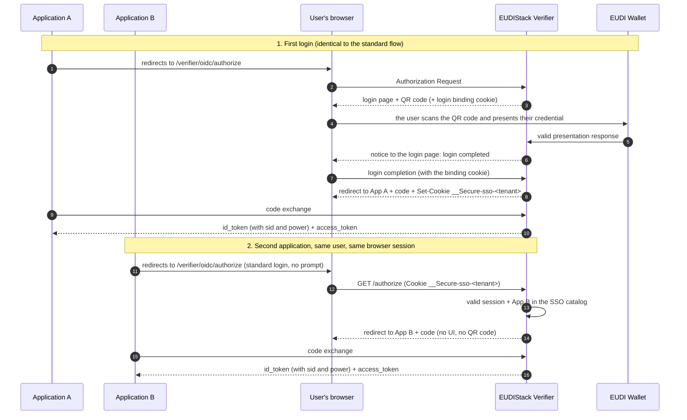
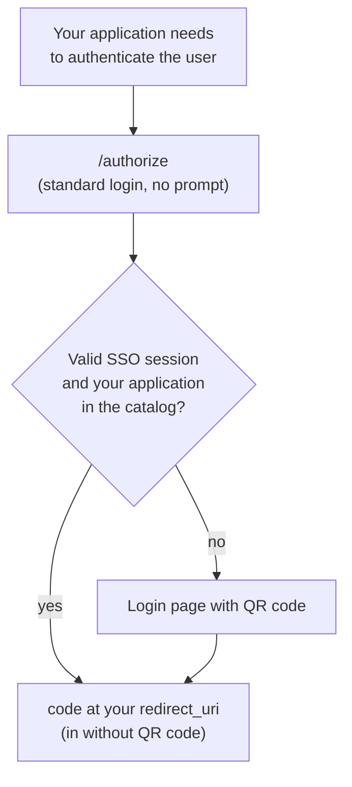
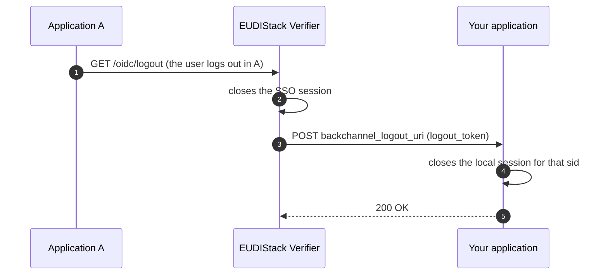

# SSO across applications in the same tenant

With SSO, the user presents their credential once and the other applications of the same tenant let them in without scanning the QR code again. It works for your own applications and for third-party ones, for example your own management portal and a supplier's portal.

The Verifier keeps a **tenant authentication session** and shares it with the applications the tenant has authorised. SSO does not change the OIDC contract you already integrated: the login is the same, and the Verifier decides whether the QR code is needed.

??? tip "When to use this guide"
    Use this guide if:

    - Your application **already signs users in with the Verifier** as an OIDC IdP (credential login). If it does not yet, start with [OIDC IdP](oidc-idp.en.md).
    - You want your users to **get in without the QR code** when they already signed in to another application of the same tenant.
    - You need to decide **who can use your application** based on the powers in their credential.

    If your integration is a backend service with no user present, see the [Java M2M SDK](verifier-m2m-sdk-java.en.md) instead.

??? info "Prerequisites"
    - Your application, registered as an **OIDC client** of the tenant and working with the credential login.
    - **SSO enabled** for the tenant and your `client_id` in its **eligible applications catalog**. The EUDIStack team does this at your request: see [Before you start](#before-you-start-enabling-sso).
    - An **OIDC library** that supports authorization code with PKCE and lets you add `prompt` and `max_age` to the request.

!!! abstract "In short"
    1. **[Request activation](#before-you-start-enabling-sso)** from the EUDIStack team with your application's details.
    2. **[Start the standard OIDC login](#step-1-start-the-login)**, without `prompt`. If there is an SSO session, you receive the `code` without the QR code.
    3. **[Decide access with the powers in the token](#step-2-authorise-with-the-powers-in-the-token)**. The Verifier authenticates, but it does not decide who gets into your application.
    4. **[Log out through the Verifier](#step-3-log-out)** and listen for logout notifications from the other applications.

!!! info "Since Verifier version 3.4.0"
    Up to version 3.3, the Verifier only reused the session when the request carried `prompt=none`, so every application had to ask for a silent login first. Since 3.4.0 the standard login is enough. If your application already makes the `prompt=none` attempt, it keeps working as before.

---

## SSO at a glance

The SSO session is created on the first credential login, whichever application it happens in. It is stored in a cookie scoped to the tenant's root domain. The browser presents it to the Verifier on every login, whichever application it comes from.



What each party does:

| Party | Does | Does not |
|---|---|---|
| **Verifier** | Authenticates the user with their credential, keeps the SSO session and delivers in the token who they are and which powers they hold. | Decide whether the user may use your application. Close your application's local session. |
| **Your application** | Starts the login, decides access from the powers in the token, manages its own session and tells the Verifier about logouts. | Read or modify the SSO cookie. |
| **EUDIStack team** | Enables SSO for the tenant and adds your application to the catalog. | Define the powers your application requires. |

If the user presents the credential from their phone, the cookie is still issued in the browser that started the login. Your application does not need to do anything special: it receives the `code` at its `redirect_uri` as usual.

---

## Before you start: enabling SSO

SSO is not self-service. The EUDIStack team enables it for each tenant and each application.

**1. Gather your application's details.** [Contact support](../../support.en.md) and send this information:

| Item | Example | What it is for |
|---|---|---|
| Tenant | `myorganisation` | The SSO session is per tenant. |
| Root domain | `myorganisation.eudistack.net` | The session cookie's domain. The host of the tenant's Verifier must sit under it. If the tenant already has SSO, it is already configured. |
| `client_id` of each application | `management-portal` | To add it to the eligible applications catalog. |
| `redirect_uri` | `https://management.myorganisation.eudistack.net/callback` | Already registered for the credential login. Review it if it changed. |
| `post_logout_redirect_uri` | `https://management.myorganisation.eudistack.net/` | Where the user returns after [logout](#step-3-log-out). |
| `backchannel_logout_uri` (recommended) | `https://management.myorganisation.eudistack.net/backchannel-logout` | To receive logouts made in other applications. HTTPS required. |
| Session duration (optional) | 4 h lifetime, 15 min idle | Only if the [defaults](#session-duration) do not suit you. |
| Powers your application requires | `domain · MYORGANISATION · Support · Read` | We do not configure them, but it helps to check that your users hold credentials with those powers. See [Step 2](#step-2-authorise-with-the-powers-in-the-token). |

**2. Wait for confirmation.** The team turns on `ssoEnabled` for the tenant, configures the root domain and adds your `client_id` to the catalog.

**3. Check that it works.** Sign in to another application in the catalog and open yours in the same browser. You should get in without seeing the QR code.

!!! warning "Adding an application means trusting it with the user's session"
    While the SSO session is valid, any `client_id` in the catalog obtains an `id_token` for the user without them presenting their credential again or seeing any screen. This applies equally to third-party applications: only add those you trust as much as your own, and ask for them to be removed from the catalog as soon as they no longer need access. The EUDIStack team manages the catalog.

---

## Step 1: start the login

Send the standard authorization request (authorization code + PKCE), without `prompt`. The Verifier decides whether the QR code is needed:



```http
GET /verifier/oidc/authorize?
  response_type=code&
  client_id=management-portal&
  scope=openid learcredential&
  state=Xq7mZ2pL9vT4rN8sK3wY&
  redirect_uri=https://management.myorganisation.eudistack.net/callback&
  code_challenge=E9Melhoa2OwvFrEMTJguCHaoeK1t8URWbuGJSstw-cM&
  code_challenge_method=S256
```

Exchange the `code` at the token endpoint as in the credential login. You receive an `id_token` and an `access_token`. Keep the `sid` from the `id_token`: you will need it for [logout](#step-3-log-out).

!!! warning "Generate a new random `state` for every request"
    The Verifier identifies each login in progress by its `state`. If your application starts a QR-code login reusing a `state` that is still in progress (up to 10 minutes), the Verifier rejects it with `invalid_request: state already in use` and shows its error page. In a tenant with SSO, a retry from the same browser, with the same `client_id` and the same `redirect_uri`, is allowed as an exception. Common OIDC libraries already generate a different `state` for each request; do not use fixed or predictable values.

### Behaviour by `prompt`

| `prompt` | Reusable SSO session | No reusable session |
|---|---|---|
| Absent | `code` without QR code | QR-code login, as usual |
| `none` | `code` without QR code | `error=login_required` or `error=interaction_required`, with no screen shown ([see below](#optional-check-the-session-with-promptnone)) |
| `login` | QR-code login: the user presents their credential again and the SSO session is replaced by a new one, with a different `sid` | QR-code login |
| `none` with another value (e.g. `none login`) | `error=invalid_request` | `error=invalid_request` |

The session is **reusable** when the browser presents a valid SSO session of the tenant, your `client_id` is in the catalog and, if you send `max_age`, the session is more recent than that limit. `prompt` values the Verifier does not support (`consent`, `select_account`) are treated as absent.

If the request carries a request object (`request` or `request_uri`), the Verifier reads `prompt` and `max_age` **only** from the signed JWT's claims (RFC 9101 §6.3) and ignores those in the query.

### Forcing a fresh authentication

Before a sensitive operation you can require the user to present their credential even if there is an SSO session:

- **Always:** add `prompt=login`. The Verifier always shows the QR code.
- **If the login is old:** add `max_age=<seconds>`. The Verifier shows the QR code if the credential login is older than that number of seconds. It must be a non-negative integer; a malformed value (negative, decimal or non-numeric) receives `error=invalid_request`. A value above 86400 (24 hours) is ignored.

In both cases, the `id_token` carries the `auth_time` of the credential login, so you can also check its age yourself. After the new login, the previous SSO session is replaced by a new one with a different `sid` (see the [current logout limitation](#3b-the-user-logs-out-in-another-application)).

### Optional: check the session with `prompt=none`

With `prompt=none` the Verifier never shows screens or a QR code: it resolves the request on the spot or returns an error immediately. You only need it if you want to know, when your application starts, whether the user has a session **without sending them to the login page** when they do not (for example, to show a public home page with a "Sign in" button). If your application goes to the login straight away, you do not need it.

Add `prompt=none` to the request above and handle the response:

| Result | Meaning | What your application does |
|---|---|---|
| `?code=...` | There is a valid SSO session and your application is in the catalog. | Exchange the `code` as in the normal flow. |
| `?error=login_required` | There is no usable SSO session: it was never established, it expired, it belongs to another tenant, it is older than the `max_age` you sent, or the tenant has no SSO. | Treat the user as not authenticated. When they need to sign in, start the login without `prompt`. |
| `?error=interaction_required` | There is a valid SSO session, but your `client_id` is not in the catalog. | Same as `login_required`, and review the [requirements](#before-you-start-enabling-sso). |

!!! warning "A single attempt, with a full-page redirect"
    Make the `prompt=none` attempt **only once** per application load (store a flag, for example in `sessionStorage`), so you do not enter a redirect loop if the Verifier responds with an error. And do it with a normal browser redirect: the Verifier does not allow its pages to be loaded inside an iframe, so if your OIDC library performs the silent login in a hidden iframe (*silent renew*), turn it off.

---

## Step 2: authorise with the powers in the token

The Verifier **authenticates** the user: on the QR-code login it checks that their credential is valid, was issued by a trusted issuer and is not revoked. It **does not decide** whether they may use your application. Anyone with a valid credential of the tenant can complete the login, and with SSO they will do so without the QR code. Each application decides who gets in and what they can do, based on the powers in the token.

!!! warning "Reusing the session does not re-check the credential"
    When the user gets in through SSO, the Verifier delivers the credential data as it checked it on the QR-code login. It does not check again whether it has been revoked or has expired since. If an operation needs that recent check, force a new login with `prompt=login` or `max_age`.

### Where the powers are

The powers are in the `power` claim, in both the `id_token` and the `access_token`. It is the list of powers of the credential's mandate, as the issuer signed it:

```json
{
  "iss": "https://myorganisation.eudistack.net/verifier",
  "sub": "john.smith@company.com",
  "aud": "management-portal",
  "sid": "lB5MkWLQFqqjC46kaVZaPc2Hj8hfmJSdmDusGH6FV2k",
  "mandator": {
    "organization": "Company Ltd.",
    "organizationIdentifier": "VATES-12345678",
    "country": "ES"
  },
  "power": [
    { "type": "domain", "domain": "MYORGANISATION", "function": "Onboarding", "action": ["Execute"] },
    { "type": "domain", "domain": "MYORGANISATION", "function": "Support", "action": ["Read", "Create"] }
  ]
}
```

`mandator` is the organisation granting the powers. `mandatee` (not shown in the example) is the person receiving them.

### How to read a power

A power says what its holder can do and where. It has four parts:

| Field | Meaning | Example |
|---|---|---|
| `type` | What the power is exercised over. `organization`: governing the tenant or organisation itself. `domain`: acting within it on behalf of the user's organisation. | `domain` |
| `domain` | Which tenant or organisation it applies to. | `MYORGANISATION` |
| `function` | Which area it acts on. Each application defines its own. | `Support` |
| `action` | Which operations it allows in that area. It can be a string or a list. | `["Read", "Create"]` |

The example above reads: *John can read and create in the Support area of the MYORGANISATION tenant, on behalf of Company Ltd.*

### What your application checks

1. **Validate the token before reading it.** Signature with the keys from the Verifier's `jwks_uri`, `iss`, `aud` (your `client_id`) and `exp`. A power that does not come in a signed token is worthless.
2. **Look for a matching power.** Go through `power` and look for one whose `domain` is your tenant or organisation (compare it **case-insensitively**: `MYORGANISATION` and `myorganisation` are the same) and whose `function` and `action` are those the operation requires. Treat `action` as a list even when it arrives as a string.
3. **If there is none, deny.** The user is authenticated but not authorised: show them an access denied message and do not send them back to the login, because they would get in again without the QR code and the result would be the same.
4. **Do the check in the backend.** In a single-page application, use the `id_token` to show or hide options, but check the powers of the `access_token` in your API before each operation.

The same check in Java:

```java
boolean hasPower(List<Map<String, Object>> powers, String tenant, String function, String action) {
    return powers.stream().anyMatch(p ->
        tenant.equalsIgnoreCase((String) p.get("domain"))
            && function.equals(p.get("function"))
            && asList(p.get("action")).contains(action));
}

List<?> asList(Object value) {
    return value instanceof List<?> list ? list : List.of(value);
}
```

And in TypeScript:

```typescript
function hasPower(powers: Power[], tenant: string, fn: string, action: string): boolean {
  return powers.some(p =>
    p.domain?.toLowerCase() === tenant.toLowerCase()
      && p.function === fn
      && [p.action].flat().includes(action));
}
```

!!! tip "Define your application's powers and publish them"
    You decide the `function` and `action` values each operation requires. Publish them so the tenant administrator knows which powers to put in the credentials of those who should use your application. For example: "to open tickets, `domain · <tenant> · Support · Create`".

??? note "Credentials with `tmf_` fields"
    Some older credentials carry the power fields with the `tmf_` prefix (`tmf_type`, `tmf_domain`, `tmf_function`, `tmf_action`). The Verifier delivers them as they are in the credential. If your users may hold such credentials, read those names too.

---

## Step 3: log out

There are two sessions, each controlled by a different party:

| | Your application's session | The tenant's SSO session |
|---|---|---|
| **Controlled by** | Your application | The Verifier |
| **Purpose** | Knowing whether the user is signed in to your application | Knowing whether the user can get into other applications without scanning the QR code |
| **Ends** | When your application closes it or it expires, per your configuration | On logout in any application, or on expiry (see [Session duration](#session-duration)) |

The Verifier cannot close your application's session. That is why logout has two parts:

| Situation | What your application does | Required? |
|---|---|---|
| The user logs out **in your application** | Redirect them to the Verifier's logout endpoint ([3a](#3a-the-user-logs-out-in-your-application)) | Yes |
| The user logs out **in another application** | Receive the Verifier's notification and close its local session ([3b](#3b-the-user-logs-out-in-another-application)) | Recommended |

### 3a. The user logs out in your application

1. Delete your local session.
2. Redirect the user to the Verifier's logout endpoint (OIDC RP-Initiated Logout 1.0):

    ```http
    GET /verifier/oidc/logout?
      id_token_hint=<the id_token you received>&
      post_logout_redirect_uri=https://management.myorganisation.eudistack.net/
    ```

3. The Verifier closes the SSO session immediately, notifies the other applications that used the session (see [3b](#3b-the-user-logs-out-in-another-application)) and returns the user to your `post_logout_redirect_uri`, which must be registered for your `client_id`.

!!! warning "Deleting only your local session does not end SSO"
    If your application skips step 2, the SSO session remains valid and the next login will let the user in again without asking for the credential.

### 3b. The user logs out in another application

The Verifier notifies your application with OIDC Back-Channel Logout 1.0: a server-to-server call to your `backchannel_logout_uri`, without going through the user's browser.



Your endpoint receives a `POST` with the `logout_token` in the body (see [logout_token contents](#logout_token-contents)) and must:

1. **Validate the token:** signature with the keys from the Verifier's `jwks_uri`, header `typ=logout+jwt`, `iss`, `aud` (your `client_id`), `exp` (the token expires after 2 minutes) and that `events` contains `http://schemas.openid.net/event/backchannel-logout`.
2. **Close the local session** associated with the `sid`. It is the same `sid` you received in the `id_token`.
3. **Respond `200 OK` within 5 seconds.** Any other response is treated as a failure and the Verifier retries the delivery.

The application that started the logout does not receive this notification.

!!! warning "Current limitation: not every application is notified"
    The Verifier notifies the applications that got in **by reusing the session**, with or without `prompt=none`. Today there are three cases in which an application does not receive the `logout_token`:

    - **The application of the QR-code login**, the one that created the SSO session, is not registered as a recipient, unless it later gets in again by reusing the session.
    - **An application that gets in through SSO less than 1 minute after** the login or the session's last reuse is not registered either.
    - **After a new QR-code login** (`prompt=login`, `max_age` or an application outside the catalog), the previous session is replaced by another one with a different `sid`. Applications holding the previous `sid` are not notified.

    Until this is fixed, these applications only learn about the logout when their local session expires. Use a short local session if your application handles sensitive data.

??? warning "If your application does not listen for the notification, the user stays signed in"
    The `backchannel_logout_uri` is optional, but without it your application does not learn about logouts made in others. If the user logs out in another application of the tenant:

    - **They stay signed in to your application** until your local session expires or they log out of it too.
    - When your local session expires, the next login will show them the QR code (with `prompt=none`, you will receive `login_required`): the logout eventually reaches your application, but late.
    - **Tokens already issued are not revoked.** Your `access_token` remains valid until it expires, so it cannot be used to detect the logout either.

    The risk is that someone else using the same computer, after the user believes they have logged out, still has access to your application. If your application handles sensitive data, publish the `backchannel_logout_uri`.

---

## Error handling

Every response from the Verifier at your `redirect_uri`, success or error, keeps any query the registered `redirect_uri` already has and adds `state` (the one from your request) and `iss`. On error, it also adds `error` and `error_description`:

| `error` | When it arrives | What your application does |
|---|---|---|
| `login_required` | With `prompt=none`: there is no usable SSO session. | Treat the user as not authenticated. |
| `interaction_required` | With `prompt=none`: there is a session, but your `client_id` is not in the catalog. | Same as `login_required`, and review the catalog registration. |
| `invalid_request` | `prompt` combines `none` with another value, or `max_age` is malformed. | Fix the request. |
| `access_denied` | On the QR-code login: the user did not present the credential in time (120 seconds by default) or, in a tenant with SSO, the login was not completed in the browser that started it (blocked cookies, or it was completed from another browser). The Verifier delivers neither the `code` nor the SSO session. | Treat it as a failed login and allow a retry. |

`error_description` is a fixed English text (e.g. `max_age must be a non-negative integer`). It is informational: do not show it to the user as is.

`iss` (RFC 9207) is the `issuer` published by the tenant's Verifier discovery (`/.well-known/openid-configuration`). If your application works with several authorization servers, compare it with that `issuer` to detect mix-up attacks. Otherwise, you can ignore it.

If the request fails validation of the client, the registered `redirect_uri` or the request object, the Verifier responds with its own error and **never** redirects to your `redirect_uri`. An unknown `client_id` receives an HTTP 400 error; an unregistered `redirect_uri` or an inconsistent request object, the Verifier's error page.

??? question "Troubleshooting"

    | Symptom | Likely cause | Resolution |
    |---|---|---|
    | Your application always shows the QR code (or receives `interaction_required`) | Your `client_id` is not in the catalog, or does not match exactly (case included) | Ask the EUDIStack team to add it and check the `client_id` in the request |
    | Your application shows the QR code even though the user just signed in to another one (or receives `login_required`) | SSO is not enabled for the tenant, or its Verifier's host is not under the configured root domain and the browser does not send the cookie | Ask the EUDIStack team to review the tenant's SSO configuration |
    | The user gets in without the QR code but your application denies access | Their credential lacks the power your application requires | Expected behaviour: the tenant administrator must issue them a credential with that power |
    | After denying access, the application enters a redirect loop | On denial, the application starts the login again, which gets in again without the QR code | On denial, show an access denied message; do not restart the login |
    | `invalid_request: state already in use` | A `state` from a QR-code login in progress is reused | Generate a random `state` for every request |
    | The user logged out in another application and is still signed in to yours | You have no `backchannel_logout_uri`, or your application is in one of the cases of the [current limitation](#3b-the-user-logs-out-in-another-application) | Publish the `backchannel_logout_uri` and use a short local session |
    | Users have to scan the QR code more often than expected | The session expired from inactivity, or some application sends `prompt=login` or a short `max_age` | Review the [session duration](#session-duration) and your request parameters |

??? warning "Security considerations"
    - **Session cookie.** It is named `__Secure-sso-<tenant>` and is issued with `Secure`, `HttpOnly`, `SameSite=Lax` and `Domain=<tenant root domain>`. It is an opaque 256-bit identifier, not a JWT: it contains no user or credential data. Only the Verifier manages it; your application never reads or modifies it.
    - **Login binding cookie.** When showing the QR code, the Verifier also issues `__Host-sso-tx` (`Secure`, `HttpOnly`, `SameSite=Lax`, no `Domain`: only for the Verifier's host; 10-minute lifetime). It binds the login to the browser that started it: the Verifier only creates the SSO session and delivers the `code` to that browser, so someone observing the login from outside cannot take it over. Your application does not manage it either.
    - **Tenant isolation.** An SSO session of one tenant is never reused in another, even if they share a browser: the login shows the QR code (with `prompt=none`, the Verifier responds `login_required`).
    - **Reuse is only attempted once the request is validated.** The Verifier checks the client, the registered `redirect_uri`, the scope and, if present, the request object's signature before deciding whether to reuse the session, so a malformed request never obtains a `code` through SSO.
    - **One application's errors do not affect the others.** If your application is not in the catalog or sends a malformed request, the user's SSO session remains intact for the rest.
    - **SSO does not grant access by itself.** Getting in without the QR code does not mean being authorised: always check the powers in the token in your backend.

---

## Reference

### id_token contents

In a tenant with SSO enabled, the `id_token` includes the `sid` claim on **every** login: both the first one, with the QR code, and those that reuse the session. The claims relevant to SSO:

```json
{
  "iss": "https://myorganisation.eudistack.net/verifier",
  "sub": "john.smith@company.com",
  "aud": "management-portal",
  "sid": "lB5MkWLQFqqjC46kaVZaPc2Hj8hfmJSdmDusGH6FV2k",
  "auth_time": 1715000000,
  "acr": "0",
  "power": [ { "type": "domain", "domain": "MYORGANISATION", "function": "Support", "action": ["Read"] } ]
}
```

| Claim | Meaning |
|---|---|
| `sid` | Identifies the shared SSO session. Every application using the session, including the one of the first login, receives the same value, and it is the one in the `logout_token`. **Treat it as a secret**: today it matches the value of the SSO session cookie. Do not expose it in URLs, logs or the browser. |
| `auth_time` | The time of the credential login. It does not change on logins that reuse the session. |
| `acr` | Always `"0"`: the Verifier does not declare a level of assurance in the `id_token`. |
| `power` | The mandate's powers. See [Step 2](#step-2-authorise-with-the-powers-in-the-token). |

### logout_token contents

The request your `backchannel_logout_uri` receives:

```http
POST /backchannel-logout
Host: management.myorganisation.eudistack.net
Content-Type: application/x-www-form-urlencoded

logout_token=eyJ...
```

The decoded `logout_token`:

```json
{
  "iss": "https://myorganisation.eudistack.net/verifier",
  "aud": "management-portal",
  "sid": "lB5MkWLQFqqjC46kaVZaPc2Hj8hfmJSdmDusGH6FV2k",
  "iat": 1715003600,
  "exp": 1715003720,
  "jti": "5b0c6e2a-8d1f-4a7e-9c3b-2f6d1e8a4b90",
  "events": { "http://schemas.openid.net/event/backchannel-logout": {} }
}
```

### Session duration

The SSO session expires as soon as **either** of these two limits is reached. The defaults can be adjusted per tenant within the range, on request to the EUDIStack team:

| Limit | Default | Configurable range |
|---|---|---|
| Absolute lifetime | 8 hours from login | 1 h – 24 h |
| Inactivity | 30 minutes without use | 5 min – 60 min |

After expiry, the login shows the QR code again (and `prompt=none` receives `login_required`): your application must be ready for this at any time, not only on the first access of the day.
