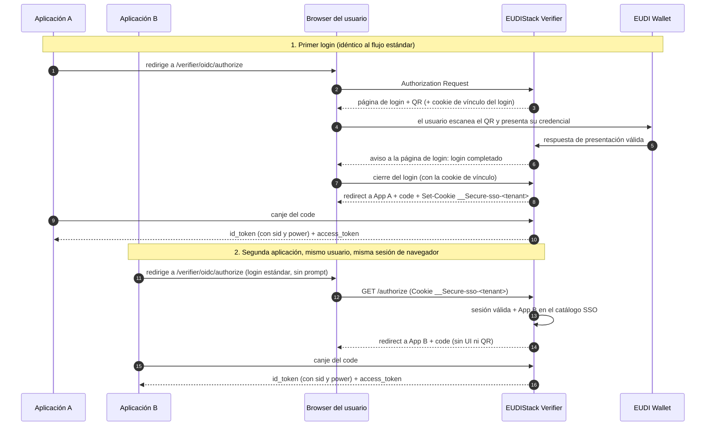
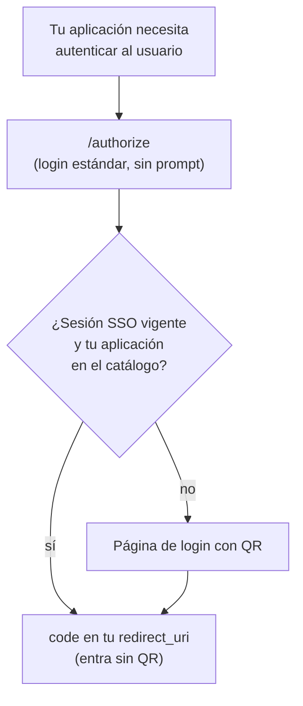
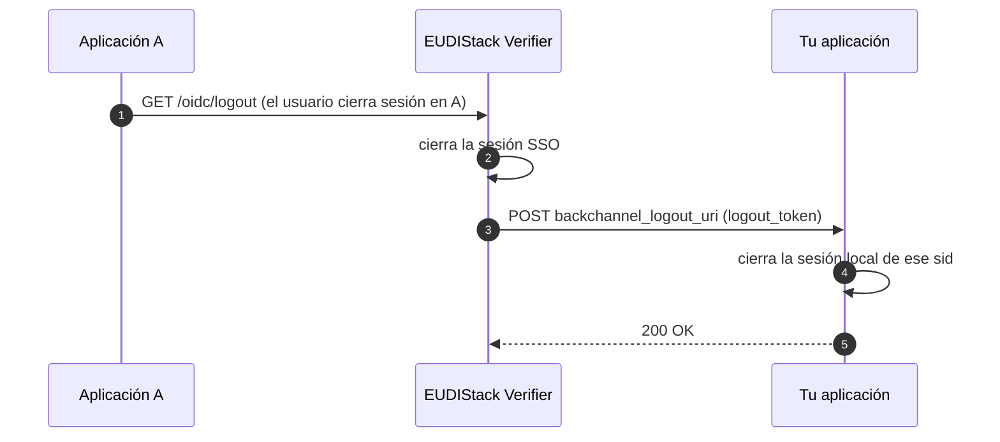

# SSO entre aplicaciones del mismo tenant

Con el SSO, el usuario presenta su credencial una sola vez y las demás aplicaciones del mismo tenant le dejan entrar sin volver a escanear el QR. Funciona para tus aplicaciones y para las de terceros, por ejemplo un portal de gestión propio y el portal de un proveedor.

El Verifier mantiene una **sesión de autenticación del tenant** y la comparte con las aplicaciones que el tenant ha autorizado. El SSO no cambia el contrato OIDC que ya integraste: el login es el mismo y el Verifier decide si hace falta el QR.

??? tip "¿Cuándo usar esta guía?"
    Utiliza esta guía si:

    - Tu aplicación **ya inicia sesión con el Verifier** como OIDC IdP (login con credencial). Si todavía no lo hace, empieza por [OIDC IdP](oidc-idp.md).
    - Quieres que tus usuarios **entren sin QR** cuando ya se identificaron en otra aplicación del mismo tenant.
    - Necesitas decidir **quién puede entrar en tu aplicación** según los poderes de su credencial.

    Si tu integración es un servicio backend sin usuario presente, consulta en su lugar el [SDK Java M2M](verifier-m2m-sdk-java.md).

??? info "Requisitos previos"
    - Tu aplicación, registrada como **cliente OIDC** del tenant y funcionando con el login con credencial.
    - El **SSO activado** en el tenant y tu `client_id` en su **catálogo de aplicaciones elegibles**. Lo hace el equipo de EUDIStack a petición tuya: ver [Antes de empezar](#antes-de-empezar-activar-el-sso).
    - Una **librería OIDC** que soporte authorization code con PKCE y que permita añadir `prompt` y `max_age` a la petición.

!!! abstract "En resumen"
    1. **[Pide la activación](#antes-de-empezar-activar-el-sso)** al equipo de EUDIStack con los datos de tu aplicación.
    2. **[Lanza el login OIDC estándar](#paso-1-lanzar-el-login)**, sin `prompt`. Si hay sesión SSO, recibes el `code` sin QR.
    3. **[Decide el acceso con los poderes del token](#paso-2-autorizar-con-los-poderes-del-token)**. El Verifier autentica, pero no decide quién entra en tu aplicación.
    4. **[Cierra sesión a través del Verifier](#paso-3-cerrar-sesion)** y escucha los avisos de logout de las demás aplicaciones.

!!! info "Desde la versión 3.4.0 del Verifier"
    Hasta la versión 3.3, el Verifier solo reutilizaba la sesión cuando la petición llevaba `prompt=none`, y por eso cada aplicación tenía que pedir primero el login en silencio. Desde la 3.4.0 basta con el login estándar. Si tu aplicación ya hace el intento con `prompt=none`, sigue funcionando igual.

---

## El SSO, en resumen

La sesión SSO se crea en el primer login con credencial, sea en la aplicación que sea. Se guarda en una cookie asociada al dominio raíz del tenant. El navegador la presenta al Verifier en cada login, venga de la aplicación que venga.



Qué hace cada parte:

| Parte | Qué hace | Qué no hace |
|---|---|---|
| **Verifier** | Autentica al usuario con su credencial, mantiene la sesión SSO y entrega en el token quién es y qué poderes tiene. | Decidir si el usuario puede entrar en tu aplicación. Cerrar la sesión local de tu aplicación. |
| **Tu aplicación** | Lanza el login, decide el acceso según los poderes del token, gestiona su propia sesión y avisa al Verifier del logout. | Leer o modificar la cookie SSO. |
| **Equipo de EUDIStack** | Activa el SSO en el tenant y da de alta tu aplicación en el catálogo. | Definir los poderes que exige tu aplicación. |

Si el usuario presenta la credencial desde el móvil, la cookie se emite igualmente en el navegador que inició el login. Tu aplicación no tiene que hacer nada especial: recibe el `code` en su `redirect_uri` como siempre.

---

## Antes de empezar: activar el SSO

El SSO no es autoservicio. Lo activa el equipo de EUDIStack para cada tenant y cada aplicación.

**1. Prepara los datos de tu aplicación.** [Contacta con soporte](../../support.md) y envía esta información:

| Dato | Ejemplo | Para qué sirve |
|---|---|---|
| Tenant | `miorganizacion` | La sesión SSO es por tenant. |
| Dominio raíz | `miorganizacion.eudistack.net` | Es el dominio de la cookie de sesión. El host del Verifier del tenant debe colgar de él. Si el tenant ya tiene SSO, ya está configurado. |
| `client_id` de cada aplicación | `portal-gestion` | Para darla de alta en el catálogo de aplicaciones elegibles. |
| `redirect_uri` | `https://gestion.miorganizacion.eudistack.net/callback` | Ya registrado para el login con credencial. Revísalo si ha cambiado. |
| `post_logout_redirect_uri` | `https://gestion.miorganizacion.eudistack.net/` | A dónde vuelve el usuario tras el [logout](#paso-3-cerrar-sesion). |
| `backchannel_logout_uri` (recomendado) | `https://gestion.miorganizacion.eudistack.net/backchannel-logout` | Para recibir los logouts hechos en otras aplicaciones. HTTPS obligatorio. |
| Duración de la sesión (opcional) | 4 h de vida, 15 min de inactividad | Solo si no te sirven los [valores por defecto](#duracion-de-la-sesion). |
| Poderes que exige tu aplicación | `domain · MIORGANIZACION · Support · Read` | No lo configuramos nosotros, pero ayuda a comprobar que tus usuarios tienen credenciales con esos poderes. Ver [Paso 2](#paso-2-autorizar-con-los-poderes-del-token). |

**2. Espera la confirmación.** El equipo activa `ssoEnabled` en el tenant, configura el dominio raíz y da de alta tu `client_id` en el catálogo.

**3. Comprueba que funciona.** Inicia sesión en otra aplicación del catálogo y abre la tuya en el mismo navegador. Debes entrar sin ver el QR.

!!! warning "Dar de alta una aplicación es confiarle la sesión del usuario"
    Mientras la sesión SSO esté vigente, cualquier `client_id` del catálogo obtiene un `id_token` del usuario sin que este vuelva a presentar su credencial ni vea ninguna pantalla. Esto aplica igual a las aplicaciones de terceros: da de alta solo aquellas en las que confíes como en las tuyas, y pide que se retiren del catálogo en cuanto dejen de necesitar el acceso. El catálogo lo gestiona el equipo de EUDIStack.

---

## Paso 1: lanzar el login

Lanza la petición de autorización estándar (authorization code + PKCE), sin `prompt`. El Verifier decide si hace falta el QR:



```http
GET /verifier/oidc/authorize?
  response_type=code&
  client_id=portal-gestion&
  scope=openid learcredential&
  state=Xq7mZ2pL9vT4rN8sK3wY&
  redirect_uri=https://gestion.miorganizacion.eudistack.net/callback&
  code_challenge=E9Melhoa2OwvFrEMTJguCHaoeK1t8URWbuGJSstw-cM&
  code_challenge_method=S256
```

Canjea el `code` en el endpoint de token como en el login con credencial. Recibes un `id_token` y un `access_token`. Guarda el `sid` del `id_token`: lo necesitarás para el [logout](#paso-3-cerrar-sesion).

!!! warning "Genera un `state` nuevo y aleatorio en cada petición"
    El Verifier identifica cada login en curso por su `state`. Si tu aplicación lanza un login con QR reutilizando un `state` que todavía está en curso (hasta 10 minutos), el Verifier lo rechaza con `invalid_request: state already in use` y muestra su página de error. En un tenant con SSO, se admite como excepción el reintento desde el mismo navegador, con el mismo `client_id` y el mismo `redirect_uri`. Las librerías OIDC habituales ya generan un `state` distinto en cada petición; no uses valores fijos ni predecibles.

### Comportamiento según `prompt`

| `prompt` | Sesión SSO reutilizable | Sin sesión reutilizable |
|---|---|---|
| Ausente | `code` sin QR | Login con QR, como siempre |
| `none` | `code` sin QR | `error=login_required` o `error=interaction_required`, sin mostrar ninguna pantalla ([ver abajo](#opcional-comprobar-la-sesion-con-promptnone)) |
| `login` | Login con QR: el usuario presenta su credencial de nuevo y la sesión SSO se sustituye por una nueva, con otro `sid` | Login con QR |
| `none` junto a otro valor (p.ej. `none login`) | `error=invalid_request` | `error=invalid_request` |

La sesión es **reutilizable** cuando el navegador presenta una sesión SSO vigente del tenant, tu `client_id` está en el catálogo y, si envías `max_age`, la sesión es más reciente que ese límite. Los valores de `prompt` que el Verifier no soporta (`consent`, `select_account`) se tratan como ausentes.

Si la petición lleva un request object (`request` o `request_uri`), el Verifier lee `prompt` y `max_age` **solo** de los claims del JWT firmado (RFC 9101 §6.3) e ignora los de la query.

### Forzar una autenticación nueva

Antes de una operación sensible puedes exigir que el usuario presente su credencial aunque haya sesión SSO:

- **Siempre:** añade `prompt=login`. El Verifier muestra siempre el QR.
- **Si el login es antiguo:** añade `max_age=<segundos>`. El Verifier muestra el QR si el login con credencial es más antiguo que ese número de segundos. Debe ser un entero no negativo; un valor mal formado (negativo, decimal o no numérico) recibe `error=invalid_request`. Un valor mayor de 86400 (24 horas) se ignora.

En ambos casos, el `id_token` trae el `auth_time` del login con credencial, así que también puedes comprobar la antigüedad tú mismo. Tras el nuevo login, la sesión SSO anterior se sustituye por una nueva con otro `sid` (ver la [limitación actual del logout](#3b-el-usuario-cierra-sesion-en-otra-aplicacion)).

### Opcional: comprobar la sesión con `prompt=none`

Con `prompt=none` el Verifier nunca muestra pantallas ni QR: resuelve la petición en el momento o devuelve un error de inmediato. Solo te hace falta si quieres saber, al arrancar tu aplicación, si el usuario tiene sesión **sin llevarlo a la página de login** cuando no la tiene (por ejemplo, para mostrar una portada pública con un botón "Entrar"). Si tu aplicación lleva al login nada más arrancar, no lo necesitas.

Añade `prompt=none` a la petición anterior y gestiona la respuesta:

| Resultado | Qué significa | Qué hace tu aplicación |
|---|---|---|
| `?code=...` | Hay sesión SSO vigente y tu aplicación está en el catálogo. | Canjea el `code` como en el flujo normal. |
| `?error=login_required` | No hay sesión SSO utilizable: nunca se estableció, caducó, es de otro tenant, es más antigua que el `max_age` que enviaste o el tenant no tiene SSO. | Trata al usuario como no autenticado. Cuando tenga que entrar, lanza el login sin `prompt`. |
| `?error=interaction_required` | Hay sesión SSO vigente, pero tu `client_id` no está en el catálogo. | Igual que `login_required`, y revisa los [requisitos](#antes-de-empezar-activar-el-sso). |

!!! warning "Un solo intento, con redirección de página completa"
    Lanza el intento con `prompt=none` **una sola vez** por carga de la aplicación (guarda una marca, por ejemplo en `sessionStorage`), para no entrar en un bucle de redirecciones si el Verifier responde con error. Y hazlo con una redirección normal del navegador: el Verifier no permite que sus páginas se carguen dentro de un iframe, así que si tu librería OIDC hace el login silencioso en un iframe oculto (*silent renew*), desactívalo.

---

## Paso 2: autorizar con los poderes del token

El Verifier **autentica** al usuario: en el login con QR comprueba que su credencial es válida, que la emitió un emisor de confianza y que no está revocada. **No decide** si puede entrar en tu aplicación. Cualquier persona con una credencial válida del tenant puede completar el login, y con SSO lo hará además sin QR. Cada aplicación decide quién entra y qué puede hacer, según los poderes que trae el token.

!!! warning "Al reutilizar la sesión no se vuelve a comprobar la credencial"
    Cuando el usuario entra por SSO, el Verifier entrega los datos de la credencial tal como los comprobó en el login con QR. No vuelve a comprobar si se ha revocado o ha caducado desde entonces. Si una operación necesita esa comprobación reciente, fuerza un login nuevo con `prompt=login` o `max_age`.

### Dónde vienen los poderes

Los poderes van en el claim `power`, tanto en el `id_token` como en el `access_token`. Es la lista de poderes del mandato de la credencial, tal como la firmó el emisor:

```json
{
  "iss": "https://miorganizacion.eudistack.net/verifier",
  "sub": "juan.garcia@empresa.com",
  "aud": "portal-gestion",
  "sid": "lB5MkWLQFqqjC46kaVZaPc2Hj8hfmJSdmDusGH6FV2k",
  "mandator": {
    "organization": "Empresa S.A.",
    "organizationIdentifier": "VATES-12345678",
    "country": "ES"
  },
  "power": [
    { "type": "domain", "domain": "MIORGANIZACION", "function": "Onboarding", "action": ["Execute"] },
    { "type": "domain", "domain": "MIORGANIZACION", "function": "Support", "action": ["Read", "Create"] }
  ]
}
```

`mandator` es la organización que da los poderes. `mandatee` (no se muestra en el ejemplo) es la persona que los recibe.

### Cómo se lee un poder

Un poder dice qué puede hacer quien lo tiene y dónde. Tiene cuatro partes:

| Campo | Qué dice | Ejemplo |
|---|---|---|
| `type` | Sobre qué se ejerce. `organization`: gobernar el propio tenant u organización. `domain`: actuar dentro de él en nombre de la organización del usuario. | `domain` |
| `domain` | A qué tenant u organización se aplica. | `MIORGANIZACION` |
| `function` | Sobre qué área actúa. Cada aplicación define las suyas. | `Support` |
| `action` | Qué operaciones permite en esa área. Puede ser un texto o una lista. | `["Read", "Create"]` |

El ejemplo anterior se lee: *Juan puede leer y crear en el área Support del tenant MIORGANIZACION, en nombre de Empresa S.A.*

### Qué comprueba tu aplicación

1. **Valida el token antes de leerlo.** Firma con las claves del `jwks_uri` del Verifier, `iss`, `aud` (tu `client_id`) y `exp`. Un poder que no viene en un token firmado no vale nada.
2. **Busca un poder que encaje.** Recorre `power` y busca uno cuyo `domain` sea tu tenant u organización (compáralo **sin distinguir mayúsculas**: `MIORGANIZACION` y `miorganizacion` son el mismo) y cuya `function` y `action` sean las que exige la operación. Trata `action` como lista aunque llegue como texto.
3. **Si no lo encuentra, deniega.** El usuario está autenticado, pero no autorizado: muéstrale un mensaje de acceso denegado y no lo devuelvas al login, porque entraría de nuevo sin QR y el resultado sería el mismo.
4. **Haz la comprobación en el backend.** En una aplicación de una sola página, usa el `id_token` para mostrar u ocultar opciones, pero comprueba los poderes del `access_token` en tu API antes de cada operación.

La misma comprobación en Java:

```java
boolean hasPower(List<Map<String, Object>> powers, String tenant, String function, String action) {
    return powers.stream().anyMatch(p ->
        tenant.equalsIgnoreCase((String) p.get("domain"))
            && function.equals(p.get("function"))
            && asList(p.get("action")).contains(action));
}

List<?> asList(Object value) {
    return value instanceof List<?> list ? list : List.of(value);
}
```

Y en TypeScript:

```typescript
function hasPower(powers: Power[], tenant: string, fn: string, action: string): boolean {
  return powers.some(p =>
    p.domain?.toLowerCase() === tenant.toLowerCase()
      && p.function === fn
      && [p.action].flat().includes(action));
}
```

!!! tip "Define los poderes de tu aplicación y publícalos"
    Los valores de `function` y `action` que exige cada operación los decides tú. Publícalos para que el administrador del tenant sepa qué poderes poner en las credenciales de quienes deben usar tu aplicación. Por ejemplo: «para abrir incidencias, `domain · <tenant> · Support · Create`».

??? note "Credenciales con campos `tmf_`"
    Algunas credenciales antiguas traen los campos del poder con el prefijo `tmf_` (`tmf_type`, `tmf_domain`, `tmf_function`, `tmf_action`). El Verifier los entrega tal como vienen en la credencial. Si tus usuarios pueden tener credenciales de ese tipo, lee también esos nombres.

---

## Paso 3: cerrar sesión

Hay dos sesiones, y cada una la controla alguien distinto:

| | Sesión de tu aplicación | Sesión SSO del tenant |
|---|---|---|
| **Quién la controla** | Tu aplicación | El Verifier |
| **Para qué sirve** | Saber si el usuario está dentro de tu aplicación | Saber si el usuario puede entrar en otras aplicaciones sin escanear el QR |
| **Cuándo termina** | Cuando tu aplicación la cierra o caduca, según tu configuración | Al hacer logout en cualquier aplicación, o al caducar (ver [Duración de la sesión](#duracion-de-la-sesion)) |

El Verifier no puede cerrar la sesión de tu aplicación. Por eso el logout tiene dos partes:

| Situación | Qué hace tu aplicación | ¿Obligatorio? |
|---|---|---|
| El usuario cierra sesión **en tu aplicación** | Redirigirlo al endpoint de logout del Verifier ([3a](#3a-el-usuario-cierra-sesion-en-tu-aplicacion)) | Sí |
| El usuario cierra sesión **en otra aplicación** | Recibir el aviso del Verifier y cerrar su sesión local ([3b](#3b-el-usuario-cierra-sesion-en-otra-aplicacion)) | Recomendado |

### 3a. El usuario cierra sesión en tu aplicación

1. Borra tu sesión local.
2. Redirige al usuario al endpoint de logout del Verifier (OIDC RP-Initiated Logout 1.0):

    ```http
    GET /verifier/oidc/logout?
      id_token_hint=<id_token que recibiste>&
      post_logout_redirect_uri=https://gestion.miorganizacion.eudistack.net/
    ```

3. El Verifier cierra la sesión SSO al instante, avisa a las demás aplicaciones que usaron la sesión (ver [3b](#3b-el-usuario-cierra-sesion-en-otra-aplicacion)) y devuelve al usuario a tu `post_logout_redirect_uri`, que debe estar registrado para tu `client_id`.

!!! warning "Borrar solo tu sesión local no cierra el SSO"
    Si tu aplicación se salta el paso 2, la sesión SSO sigue vigente y el siguiente login volverá a dar acceso al usuario sin pedirle la credencial.

### 3b. El usuario cierra sesión en otra aplicación

El Verifier avisa a tu aplicación con OIDC Back-Channel Logout 1.0: una llamada de servidor a servidor a tu `backchannel_logout_uri`, sin pasar por el navegador del usuario.



Tu endpoint recibe un `POST` con el `logout_token` en el cuerpo (ver [Contenido del logout_token](#contenido-del-logout_token)) y debe:

1. **Validar el token:** firma con las claves del `jwks_uri` del Verifier, cabecera `typ=logout+jwt`, `iss`, `aud` (tu `client_id`), `exp` (el token caduca a los 2 minutos) y que `events` contiene `http://schemas.openid.net/event/backchannel-logout`.
2. **Cerrar la sesión local** asociada al `sid`. Es el mismo `sid` que recibiste en el `id_token`.
3. **Responder `200 OK` en menos de 5 segundos.** Cualquier otra respuesta se trata como fallo y el Verifier reintenta la entrega.

La aplicación que inició el logout no recibe este aviso.

!!! warning "Limitación actual: no todas las aplicaciones reciben el aviso"
    El Verifier avisa a las aplicaciones que entraron **reutilizando la sesión**, con o sin `prompt=none`. Hoy hay tres casos en los que una aplicación no recibe el `logout_token`:

    - **La aplicación del login con QR**, la que creó la sesión SSO, no queda registrada como destinataria, salvo que después vuelva a entrar reutilizando la sesión.
    - **Una aplicación que entra por SSO menos de 1 minuto después** del login o de la última reutilización de la sesión tampoco queda registrada.
    - **Tras un login nuevo con QR** (`prompt=login`, `max_age` o una aplicación fuera del catálogo), la sesión anterior se sustituye por otra con un `sid` distinto. Las aplicaciones que tenían el `sid` anterior no reciben aviso.

    Hasta que se corrija, estas aplicaciones solo se enteran del logout cuando caduca su sesión local. Usa una sesión local corta si tu aplicación maneja datos sensibles.

??? warning "Si tu aplicación no escucha el aviso, el usuario sigue dentro"
    El `backchannel_logout_uri` es opcional, pero sin él tu aplicación no se entera de los logouts hechos en otras. Si el usuario cierra sesión en otra aplicación del tenant:

    - **Sigue dentro de tu aplicación** hasta que caduque tu sesión local o cierre sesión también en ella.
    - Cuando tu sesión local caduque, el siguiente login le mostrará el QR (con `prompt=none`, recibirás `login_required`): el logout acaba afectando a tu aplicación, pero tarde.
    - **Los tokens ya emitidos no se revocan.** Tu `access_token` sigue siendo válido hasta que expire, así que tampoco sirve para detectar el logout.

    El riesgo es que otra persona que use el mismo equipo, después de que el usuario crea haber cerrado sesión, siga teniendo acceso a tu aplicación. Si tu aplicación maneja datos sensibles, publica el `backchannel_logout_uri`.

---

## Manejo de errores

Toda respuesta del Verifier en tu `redirect_uri`, de éxito o de error, conserva la query que ya tenga el `redirect_uri` registrado y añade `state` (el de tu petición) e `iss`. En caso de error, añade también `error` y `error_description`:

| `error` | Cuándo llega | Qué hace tu aplicación |
|---|---|---|
| `login_required` | Con `prompt=none`: no hay sesión SSO utilizable. | Tratar al usuario como no autenticado. |
| `interaction_required` | Con `prompt=none`: hay sesión, pero tu `client_id` no está en el catálogo. | Igual que `login_required`, y revisar el alta en el catálogo. |
| `invalid_request` | `prompt` combina `none` con otro valor, o `max_age` está mal formado. | Corregir la petición. |
| `access_denied` | En el login con QR: el usuario no presentó la credencial a tiempo (120 segundos por defecto) o, en un tenant con SSO, el login no se cerró en el navegador que lo inició (cookies bloqueadas o se completó desde otro navegador). El Verifier no entrega ni el `code` ni la sesión SSO. | Tratarlo como un login fallido y permitir reintentarlo. |

`error_description` es un texto fijo en inglés (p.ej. `max_age must be a non-negative integer`). Es informativo: no lo muestres tal cual al usuario.

`iss` (RFC 9207) es el `issuer` que publica el discovery del Verifier del tenant (`/.well-known/openid-configuration`). Si tu aplicación trabaja con varios servidores de autorización, compáralo con ese `issuer` para detectar ataques de mezcla (*mix-up*). Si no, puedes ignorarlo.

Si la petición no supera la validación del cliente, del `redirect_uri` registrado o del request object, el Verifier responde con un error propio y **nunca** redirige a tu `redirect_uri`. Un `client_id` desconocido recibe un error HTTP 400; un `redirect_uri` no registrado o un request object incoherente, la página de error del Verifier.

??? question "Troubleshooting"

    | Síntoma | Causa probable | Resolución |
    |---|---|---|
    | Tu aplicación muestra siempre el QR (o recibe `interaction_required`) | Tu `client_id` no está en el catálogo, o no coincide exactamente (mayúsculas incluidas) | Pide el alta al equipo de EUDIStack y comprueba el `client_id` de la petición |
    | Tu aplicación muestra el QR aunque el usuario acaba de entrar en otra (o recibe `login_required`) | El SSO no está activado en el tenant, o el host de su Verifier no cuelga del dominio raíz configurado y el navegador no envía la cookie | Pide al equipo de EUDIStack que revise la configuración del SSO del tenant |
    | El usuario entra sin QR pero tu aplicación le deniega el acceso | Su credencial no tiene el poder que exige tu aplicación | Es el comportamiento esperado: el administrador del tenant debe emitirle una credencial con ese poder |
    | Tras denegar el acceso, la aplicación entra en un bucle de redirecciones | Al denegar, la aplicación vuelve a lanzar el login, que entra otra vez sin QR | Al denegar, muestra un mensaje de acceso denegado; no relances el login |
    | `invalid_request: state already in use` | Se reutiliza un `state` de un login con QR en curso | Genera un `state` aleatorio en cada petición |
    | El usuario cerró sesión en otra aplicación y sigue dentro de la tuya | No tienes `backchannel_logout_uri`, o tu aplicación está en uno de los casos de la [limitación actual](#3b-el-usuario-cierra-sesion-en-otra-aplicacion) | Publica el `backchannel_logout_uri` y usa una sesión local corta |
    | Los usuarios tienen que volver a escanear el QR más a menudo de lo esperado | La sesión caducó por inactividad, o alguna aplicación envía `prompt=login` o un `max_age` corto | Revisa la [duración de la sesión](#duracion-de-la-sesion) y los parámetros de tus peticiones |

??? warning "Consideraciones de seguridad"
    - **Cookie de sesión.** Se llama `__Secure-sso-<tenant>` y se emite con `Secure`, `HttpOnly`, `SameSite=Lax` y `Domain=<dominio raíz del tenant>`. Es un identificador opaco de 256 bits, no un JWT: no contiene datos del usuario ni de la credencial. Solo la gestiona el Verifier; tu aplicación nunca la lee ni la modifica.
    - **Cookie de vínculo del login.** Al mostrar el QR, el Verifier emite además `__Host-sso-tx` (`Secure`, `HttpOnly`, `SameSite=Lax`, sin `Domain`: solo para el host del Verifier; vida de 10 minutos). Liga el login al navegador que lo inició: el Verifier solo crea la sesión SSO y entrega el `code` a ese navegador, de modo que quien observe el login desde fuera no puede apropiarse de él. Tampoco la gestiona tu aplicación.
    - **Aislamiento por tenant.** Una sesión SSO de un tenant nunca se reutiliza en otro, aunque compartan navegador: el login muestra el QR (con `prompt=none`, el Verifier responde `login_required`).
    - **La reutilización solo se intenta con la petición ya validada.** El Verifier comprueba el cliente, el `redirect_uri` registrado, el scope y, si lo hay, la firma del request object antes de decidir si reutiliza la sesión, así que una petición mal formada nunca obtiene un `code` por SSO.
    - **Los errores de una aplicación no afectan a las demás.** Si tu aplicación no está en el catálogo o envía una petición mal formada, la sesión SSO del usuario sigue intacta para el resto.
    - **El SSO no da acceso por sí mismo.** Entrar sin QR no significa estar autorizado: comprueba siempre los poderes del token en tu backend.

---

## Referencia

### Contenido del id_token

En un tenant con SSO activado, el `id_token` incluye el claim `sid` en **cualquier** login: tanto en el primero, con QR, como en los que reutilizan la sesión. Los claims relevantes para el SSO:

```json
{
  "iss": "https://miorganizacion.eudistack.net/verifier",
  "sub": "juan.garcia@empresa.com",
  "aud": "portal-gestion",
  "sid": "lB5MkWLQFqqjC46kaVZaPc2Hj8hfmJSdmDusGH6FV2k",
  "auth_time": 1715000000,
  "acr": "0",
  "power": [ { "type": "domain", "domain": "MIORGANIZACION", "function": "Support", "action": ["Read"] } ]
}
```

| Claim | Qué es |
|---|---|
| `sid` | Identifica la sesión SSO compartida. Todas las aplicaciones que usan la sesión, incluida la del primer login, reciben el mismo valor, y es el que llega en el `logout_token`. **Trátalo como un secreto**: hoy coincide con el valor de la cookie de sesión SSO. No lo expongas en URLs, logs ni en el navegador. |
| `auth_time` | El momento del login con credencial. No cambia en los logins que reutilizan la sesión. |
| `acr` | Vale siempre `"0"`: el Verifier no declara un nivel de garantía en el `id_token`. |
| `power` | Los poderes del mandato. Ver [Paso 2](#paso-2-autorizar-con-los-poderes-del-token). |

### Contenido del logout_token

La petición que recibe tu `backchannel_logout_uri`:

```http
POST /backchannel-logout
Host: gestion.miorganizacion.eudistack.net
Content-Type: application/x-www-form-urlencoded

logout_token=eyJ...
```

El `logout_token` decodificado:

```json
{
  "iss": "https://miorganizacion.eudistack.net/verifier",
  "aud": "portal-gestion",
  "sid": "lB5MkWLQFqqjC46kaVZaPc2Hj8hfmJSdmDusGH6FV2k",
  "iat": 1715003600,
  "exp": 1715003720,
  "jti": "5b0c6e2a-8d1f-4a7e-9c3b-2f6d1e8a4b90",
  "events": { "http://schemas.openid.net/event/backchannel-logout": {} }
}
```

### Duración de la sesión

La sesión SSO caduca en cuanto se cumple **cualquiera** de estos dos límites. Los valores por defecto se pueden ajustar por tenant dentro del rango, a petición al equipo de EUDIStack:

| Límite | Por defecto | Rango configurable |
|---|---|---|
| Tiempo de vida absoluto | 8 horas desde el login | 1 h – 24 h |
| Inactividad | 30 minutos sin uso | 5 min – 60 min |

Tras la caducidad, el login vuelve a mostrar el QR (y `prompt=none` recibe `login_required`): tu aplicación debe estar preparada para ello en cualquier momento, no solo en el primer acceso del día.
