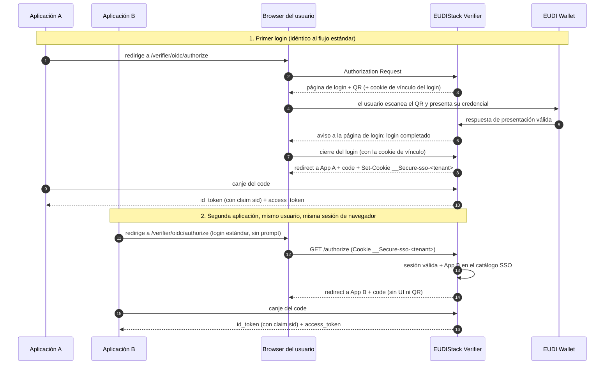
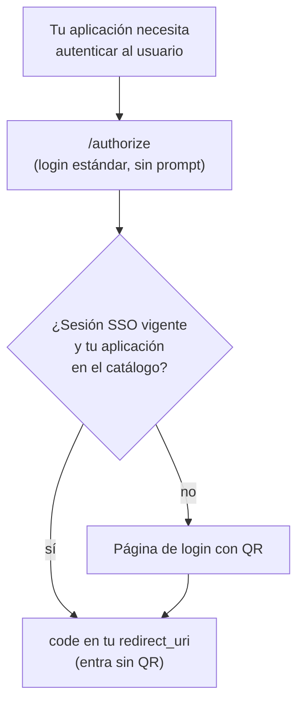
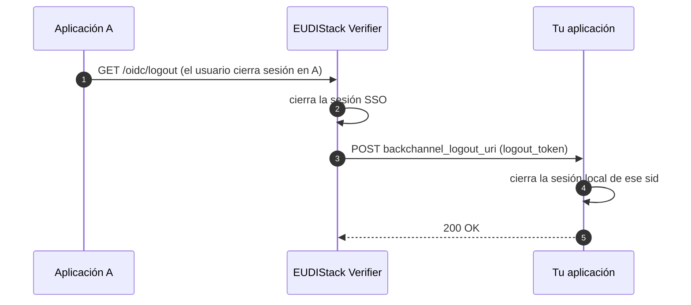

# SSO entre aplicaciones del mismo tenant

Si varias aplicaciones cliente están integradas con el Verifier de un mismo tenant de EUDIStack —tuyas o de terceros, como un portal de gestión propio y el portal de un proveedor—, el Verifier puede mantener una **sesión de autenticación a nivel de tenant**: el usuario presenta su credencial una sola vez y las demás aplicaciones reutilizan esa sesión sin pedirle que vuelva a escanear el QR. Para ello, cada aplicación debe estar dada de alta en el catálogo de aplicaciones elegibles del tenant.

Esta guía parte de que tu aplicación ya está integrada con el Verifier como OIDC IdP (login con credencial). El SSO no cambia el contrato OIDC que ya integraste: con el login estándar, el Verifier reutiliza la sesión si existe. Añade, de forma opcional, una comprobación silenciosa de la sesión (`prompt=none`) y el cierre de sesión coordinado entre aplicaciones.

!!! abstract "En resumen"
    1. **Cumple los [requisitos](#requisitos):** SSO activado en el tenant y tu `client_id` en el catálogo de aplicaciones elegibles.
    2. **[Lanza el login OIDC estándar](#integrar-el-login)**, sin `prompt`: si hay sesión SSO, el Verifier devuelve el `code` sin QR; si no, muestra el QR como siempre. Usa `prompt=none` solo si necesitas comprobar la sesión sin mostrar el login.
    3. **[Cierra sesión a través del Verifier](#cerrar-sesion-single-logout)** y, si puedes, escucha los avisos de logout de las demás aplicaciones.

!!! info "Desde la versión 3.4.0 del Verifier"
    Hasta la versión 3.3, el Verifier solo reutilizaba la sesión cuando la petición llevaba `prompt=none`, y por eso cada aplicación tenía que pedir primero el login en silencio. Desde la 3.4.0 basta con el login estándar. Si tu aplicación ya hace el intento con `prompt=none`, sigue funcionando igual.

---

## Requisitos

| Requisito | Quién lo gestiona | Detalle |
|---|---|---|
| SSO activado en el tenant | Equipo de EUDIStack | Se habilita `ssoEnabled` y se configura el **dominio raíz** (`rootDomain`) del tenant, al que se asocia la cookie de sesión y que debe abarcar el host en el que se sirve su Verifier. |
| Aplicación registrada como cliente OIDC del tenant | Equipo de EUDIStack | Es el mismo alta que necesitas para el login con credencial. |
| `client_id` en el catálogo de aplicaciones elegibles | Equipo de EUDIStack | Se da de alta a petición tuya. Sin este paso, tu aplicación nunca reutiliza la sesión: el usuario ve siempre el QR (con `prompt=none`, recibes `interaction_required`). |

Para solicitar la activación o el alta de una aplicación, contacta con el equipo de EUDIStack indicando el tenant y los `client_id` implicados.

!!! warning "Dar de alta una aplicación es confiarle la sesión del usuario"
    Mientras la sesión SSO esté vigente, cualquier `client_id` del catálogo obtiene un `id_token` del usuario sin que este vuelva a presentar su credencial ni vea ninguna pantalla. Esto aplica igual a las aplicaciones de terceros: da de alta solo aquellas en las que confíes como en las tuyas, y retíralas del catálogo en cuanto dejen de necesitar el acceso.

---

## Cómo funciona

Cada tenant con SSO activado mantiene, además de las sesiones OIDC de cada aplicación, **una sesión de autenticación propia del tenant** ("OP-level session" en la terminología de OIDC Core). Se guarda en una cookie opaca, asociada al dominio raíz del tenant, que el navegador del usuario presenta al Verifier en cada petición de autorización, venga de la aplicación que venga.



La sesión SSO se establece automáticamente tras cualquier login con credencial en un tenant con SSO activado, sea cual sea la aplicación. Qué aplicación es la "primera" depende de por dónde entre el usuario; como la reutilización ocurre en el propio login estándar, todas las aplicaciones del catálogo la aprovechan sin hacer nada especial.

La cookie de sesión se emite en el **navegador que inició el login**, aunque el usuario presente su credencial desde la wallet de otro dispositivo (el móvil): tras la presentación, la página de login devuelve el navegador al Verifier para cerrar el login, y es en ese paso donde el Verifier crea la sesión y redirige a tu aplicación. Este paso es transparente para tu aplicación, que recibe el `code` en su `redirect_uri` como siempre.

---

## Integrar el login

Lanza la petición de autorización estándar (authorization code + PKCE), sin `prompt`. El Verifier decide si hace falta el QR:



```http
GET /verifier/oidc/authorize?
  response_type=code&
  client_id=mi-segunda-app&
  scope=openid learcredential.employee&
  state=Xq7mZ2pL9vT4rN8sK3wY&
  redirect_uri=https://mi-segunda-app.com/callback&
  code_challenge=E9Melhoa2OwvFrEMTJguCHaoeK1t8URWbuGJSstw-cM&
  code_challenge_method=S256
```

!!! warning "Genera un `state` nuevo y aleatorio en cada petición"
    El Verifier identifica cada login en curso por su `state`. Si tu aplicación lanza un login con QR reutilizando un `state` que todavía está en curso (hasta 10 minutos), el Verifier lo rechaza con `invalid_request: state already in use` y muestra su página de error, salvo que sea un reintento desde el mismo navegador. Las librerías OIDC habituales ya generan un `state` distinto en cada petición; no uses valores fijos ni predecibles.

### Comportamiento según `prompt`

| `prompt` | Sesión SSO reutilizable | Sin sesión reutilizable |
|---|---|---|
| Ausente | `code` sin QR | Login con QR, como siempre |
| `none` | `code` sin QR | `error=login_required` o `error=interaction_required`, sin mostrar ninguna pantalla ([ver abajo](#opcional-comprobar-la-sesion-con-promptnone)) |
| `login` | Login con QR: el usuario presenta su credencial de nuevo. La sesión SSO no se cierra | Login con QR |
| `none` junto a otro valor (p.ej. `none login`) | `error=invalid_request` | `error=invalid_request` |

La sesión es **reutilizable** cuando el navegador presenta una sesión SSO vigente del tenant, tu `client_id` está en el catálogo y, si envías `max_age`, la sesión es más reciente que ese límite. Los valores de `prompt` que el Verifier no soporta (`consent`, `select_account`) se tratan como ausentes.

Si la petición lleva un request object (`request` o `request_uri`), el Verifier lee `prompt` y `max_age` **solo** de los claims del JWT firmado (RFC 9101 §6.3) e ignora los de la query.

### Forzar una autenticación nueva

Antes de una operación sensible puedes exigir que el usuario presente su credencial aunque haya sesión SSO:

- `prompt=login`: siempre muestra el QR.
- `max_age=<segundos>`: muestra el QR si el login con credencial es más antiguo que ese número de segundos. Debe ser un entero no negativo; un valor mal formado (negativo, decimal o no numérico) recibe `error=invalid_request`.

En ambos casos, el `id_token` trae el `auth_time` del login con credencial, así que también puedes comprobar la antigüedad tú mismo.

### Respuesta en tu `redirect_uri`

Toda respuesta del Verifier en tu `redirect_uri`, de éxito o de error, conserva la query que ya tenga el `redirect_uri` registrado y añade:

| Parámetro | Éxito | Error |
|---|---|---|
| `code` | Sí | — |
| `error` | — | `login_required`, `interaction_required`, `invalid_request`, `access_denied` |
| `error_description` | — | Texto fijo en inglés (p.ej. `max_age must be a non-negative integer`). Es informativo: no lo muestres tal cual al usuario |
| `state` | El de tu petición | El de tu petición |
| `iss` | Sí | Sí |

`iss` (RFC 9207) es el `issuer` que publica el discovery del Verifier del tenant (`/.well-known/openid-configuration`), que anuncia `authorization_response_iss_parameter_supported: true`. Si tu aplicación trabaja con varios servidores de autorización, compáralo con ese `issuer` para detectar ataques de mezcla (*mix-up*). Si no, puedes ignorarlo.

En el login con QR, tu `redirect_uri` también puede recibir `?error=access_denied`: el login no se cerró en el navegador que lo inició (por ejemplo, porque el navegador bloquea las cookies del Verifier o porque se intentó completar desde otro navegador). El Verifier no entrega ni el `code` ni la sesión SSO en ese caso; tu aplicación debe tratarlo como un login fallido y permitir reintentarlo.

Si la petición no supera la validación del cliente, del `redirect_uri` registrado o de la firma del request object, el Verifier muestra su propia página de error y **nunca** redirige a tu `redirect_uri`.

### Opcional: comprobar la sesión con `prompt=none`

Con `prompt=none` el Verifier nunca muestra pantallas ni QR: resuelve la petición en el momento o devuelve un error de inmediato. Solo te hace falta si quieres saber, al arrancar tu aplicación, si el usuario tiene sesión **sin llevarlo a la página de login** cuando no la tiene (por ejemplo, para mostrar una portada pública con un botón "Entrar"). Si tu aplicación lleva al login nada más arrancar, no lo necesitas.

Añade `prompt=none` a la petición anterior y gestiona la respuesta:

| Resultado | Qué significa | Qué hace tu aplicación |
|---|---|---|
| `?code=...` | Hay sesión SSO vigente y tu aplicación está en el catálogo. | Canjea el `code` como en el flujo normal. |
| `?error=login_required` | No hay sesión SSO utilizable: nunca se estableció, caducó o es de otro tenant. | Trata al usuario como no autenticado. Cuando tenga que entrar, lanza el login sin `prompt`. |
| `?error=interaction_required` | Hay sesión SSO vigente, pero tu `client_id` no está en el catálogo. | Igual que `login_required`, y revisa los [requisitos](#requisitos). |

!!! warning "Un solo intento, con redirección de página completa"
    Lanza el intento con `prompt=none` **una sola vez** por carga de la aplicación (guarda una marca, por ejemplo en `sessionStorage`), para no entrar en un bucle de redirecciones si el Verifier responde con error. Y hazlo con una redirección normal del navegador: el Verifier no permite que sus páginas se carguen dentro de un iframe, así que si tu librería OIDC hace el login silencioso en un iframe oculto (*silent renew*), desactívalo.

!!! tip "Distingue los dos errores en tus logs"
    `login_required` e `interaction_required` significan cosas distintas (OIDC Core §3.1.2.6). El primero es esperable (usuario nuevo, sesión caducada). El segundo indica un problema de configuración del catálogo que conviene investigar si se repite.

---

## Cerrar sesión (Single Logout)

Para entender el logout hay que distinguir dos sesiones, cada una controlada por alguien distinto:

| | Sesión de tu aplicación | Sesión SSO del tenant |
|---|---|---|
| **Quién la controla** | Tu aplicación | El Verifier |
| **Para qué sirve** | Saber si el usuario está dentro de tu aplicación | Saber si el usuario puede entrar en otras aplicaciones sin escanear el QR |
| **Cuándo termina** | Cuando tu aplicación la cierra o caduca, según tu configuración | Al hacer logout en cualquier aplicación, o al caducar (ver [Duración de la sesión](#duracion-de-la-sesion)) |

!!! info "El Verifier no puede cerrar la sesión de tu aplicación"
    Solo decide si el próximo login necesita el QR o no. Por eso el logout tiene dos partes: cerrar la sesión SSO a través del Verifier y, cuando el logout empieza en otra aplicación, que tu aplicación cierre la suya al recibir el aviso.

Qué tiene que hacer tu aplicación en cada caso:

| Situación | Qué hace tu aplicación | ¿Obligatorio? |
|---|---|---|
| El usuario cierra sesión **en tu aplicación** | Redirigirlo al endpoint de logout del Verifier ([caso 1](#caso-1-el-usuario-cierra-sesion-en-tu-aplicacion)) | Sí |
| El usuario cierra sesión **en otra aplicación** | Recibir el aviso del Verifier y cerrar su sesión local ([caso 2](#caso-2-el-usuario-cierra-sesion-en-otra-aplicacion)) | Recomendado |

### Caso 1: el usuario cierra sesión en tu aplicación

1. Borra tu sesión local.
2. Redirige al usuario al endpoint de logout del Verifier (OIDC RP-Initiated Logout 1.0):

    ```http
    GET /verifier/oidc/logout?
      id_token_hint=<id_token que recibiste>&
      post_logout_redirect_uri=https://mi-segunda-app.com/
    ```

3. El Verifier cierra la sesión SSO al instante, avisa a las demás aplicaciones que usaron la sesión (ver [caso 2](#caso-2-el-usuario-cierra-sesion-en-otra-aplicacion)) y devuelve al usuario a tu `post_logout_redirect_uri`, que debe estar registrado para tu `client_id`.

!!! warning "Borrar solo tu sesión local no cierra el SSO"
    Si tu aplicación se salta el paso 2, la sesión SSO sigue vigente y el siguiente login volverá a dar acceso al usuario sin pedirle la credencial.

### Caso 2: el usuario cierra sesión en otra aplicación

El Verifier avisa a tu aplicación mediante OIDC Back-Channel Logout 1.0: una llamada servidor a servidor a tu `backchannel_logout_uri`, sin pasar por el navegador del usuario.



La petición que recibe tu endpoint:

```http
POST /backchannel-logout
Host: mi-segunda-app.com
Content-Type: application/x-www-form-urlencoded

logout_token=eyJ...
```

Y el contenido del `logout_token` una vez decodificado:

```json
{
  "iss": "https://empresa.eudistack.net/verifier",
  "aud": "mi-segunda-app",
  "sid": "f3a1c9e2b6d84f0a",
  "iat": 1715003600,
  "exp": 1715003720,
  "jti": "5b0c6e2a-8d1f-4a7e-9c3b-2f6d1e8a4b90",
  "events": { "http://schemas.openid.net/event/backchannel-logout": {} }
}
```

Tu endpoint debe:

1. **Validar el token:** firma con las claves del `jwks_uri` del Verifier, cabecera `typ=logout+jwt`, `iss`, `aud` (tu `client_id`), `exp` (el token caduca a los 2 minutos) y que `events` contiene `http://schemas.openid.net/event/backchannel-logout`.
2. **Cerrar la sesión local** asociada al `sid`. Es el mismo `sid` que recibiste en el `id_token`, así que guárdalo al iniciar sesión.
3. **Responder `200 OK` en menos de 5 segundos.** Cualquier otra respuesta se trata como fallo y el Verifier reintenta la entrega.

La aplicación que inició el logout no recibe este aviso.

!!! warning "Limitación actual: la aplicación del login con QR no recibe el aviso"
    El Verifier avisa a las aplicaciones que entraron **reutilizando la sesión**, con o sin `prompt=none`. La aplicación en la que el usuario hizo el login con QR —la que creó la sesión SSO— no queda registrada como destinataria y no recibe el `logout_token`, salvo que después haya vuelto a entrar reutilizando la sesión. Hasta que se corrija, esa aplicación solo se entera del logout cuando caduca su sesión local (ver el aviso siguiente).

!!! warning "Si tu aplicación no escucha el aviso, el usuario sigue dentro"
    El `backchannel_logout_uri` es opcional (HTTPS obligatorio), pero sin él tu aplicación no se entera de los logouts hechos en otras. Si el usuario cierra sesión en otra aplicación del tenant:

    - **Sigue dentro de tu aplicación** hasta que caduque tu sesión local o cierre sesión también en ella.
    - Cuando tu sesión local caduque, el siguiente login le mostrará el QR (con `prompt=none`, recibirás `login_required`): el logout acaba afectando a tu aplicación, pero tarde.
    - **Los tokens ya emitidos no se revocan.** Tu `access_token` sigue siendo válido hasta que expire, así que tampoco sirve para detectar el logout.

    El riesgo es que otra persona que use el mismo equipo, después de que el usuario crea haber cerrado sesión, siga teniendo acceso a tu aplicación. Si tu aplicación maneja datos sensibles, publica el `backchannel_logout_uri`.

---

## Referencia

### Contenido del id_token

En un tenant con SSO activado, el `id_token` incluye el claim `sid` en **cualquier** login: tanto en el primero, con QR, como en los que reutilizan la sesión. Ejemplo con los claims relevantes para el SSO (se omiten el resto de claims del login estándar):

```json
{
  "iss": "https://empresa.eudistack.net/verifier",
  "sub": "juan.garcia@empresa.com",
  "aud": "mi-segunda-app",
  "sid": "f3a1c9e2b6d84f0a",
  "auth_time": 1715000000,
  "acr": "0"
}
```

`sid` identifica la sesión SSO compartida: todas las aplicaciones que usan la sesión, incluida la del primer login, reciben el mismo valor, y es el que llega en el `logout_token`. No es un secreto (viaja en un JWT firmado), pero evita exponerlo en URLs o logs de acceso.

`auth_time` es el momento del login con credencial y no cambia en los logins que reutilizan la sesión. `acr` vale siempre `"0"`: el Verifier no declara un nivel de garantía en el `id_token`.

### Duración de la sesión

La sesión SSO caduca en cuanto se cumple **cualquiera** de estos dos límites. Los valores por defecto se pueden ajustar por tenant dentro del rango, a petición al equipo de EUDIStack:

| Límite | Por defecto | Rango configurable |
|---|---|---|
| Tiempo de vida absoluto | 8 horas desde el login | 1 h – 24 h |
| Inactividad | 30 minutos sin uso | 5 min – 60 min |

Tras la caducidad, el login vuelve a mostrar el QR (y `prompt=none` recibe `login_required`): tu aplicación debe estar preparada para ello en cualquier momento, no solo en el primer acceso del día.

### Seguridad

- **Cookie de sesión.** Se llama `__Secure-sso-<tenant>` y se emite con `Secure`, `HttpOnly`, `SameSite=Lax` y `Domain=<dominio raíz del tenant>`. Es un identificador opaco de 256 bits, no un JWT: no contiene datos del usuario ni de la credencial. Solo la gestiona el Verifier; tu aplicación nunca la lee ni la modifica.
- **Cookie de vínculo del login.** Al mostrar el QR, el Verifier emite además `__Host-sso-tx` (`Secure`, `HttpOnly`, `SameSite=Lax`, sin `Domain`: solo para el host del Verifier; vida de 10 minutos). Liga el login al navegador que lo inició: el Verifier solo crea la sesión SSO y entrega el `code` a ese navegador, de modo que quien observe el login desde fuera no puede apropiarse de él. Tampoco la gestiona tu aplicación.
- **Aislamiento por tenant.** Una sesión SSO de un tenant nunca se reutiliza en otro, aunque compartan navegador: el login muestra el QR (con `prompt=none`, el Verifier responde `login_required`).
- **La reutilización solo se intenta con la petición ya validada.** El Verifier comprueba el cliente, el `redirect_uri` registrado, el scope y, si lo hay, la firma del request object antes de decidir si reutiliza la sesión, así que una petición mal formada nunca obtiene un `code` por SSO.
- **Los errores de una aplicación no afectan a las demás.** Si tu aplicación no está en el catálogo o envía una petición mal formada, la sesión SSO del usuario sigue intacta para el resto.
