# Primeros pasos — Wallet

Primer acceso al wallet: verificación del email corporativo y creación de la passkey con la que se entrará a partir de entonces, con la huella, el reconocimiento facial o el PIN del dispositivo, o con el móvil.

---

## Requisitos

- Dirección de email corporativa.
- Navegador actualizado compatible con passkeys (Chrome, Edge, Safari o Firefox).
- Conexión a internet.
- Para guardar la passkey en el móvil desde un ordenador: Bluetooth activado en los dos dispositivos.

!!! info "Cómo se entra en el wallet"
    - **La primera vez**, o en un dispositivo sin passkey, se entra con el **email**: el wallet envía un código de verificación y después se crea o se usa una passkey.
    - **Las veces siguientes**, se entra directamente con la **passkey**, sin email ni código.
    - Las credenciales quedan ligadas a la passkey con la que se obtuvieron. Para verlas desde otro dispositivo, hay que entrar con esa misma passkey: por ejemplo, la guardada en el móvil o una passkey sincronizada (iCloud, Google).

---

## Pasos

??? "1. Abrir el wallet"
    Navegar a la URL del wallet de la organización.

    Si el navegador permite instalar el wallet como app, aparece primero la pantalla **Accede a EUDIStack de forma segura** (el nombre puede cambiar según la organización):

    - **Continuar con el Wallet de EUDIStack** instala el wallet como app en el dispositivo. Es la opción recomendada.
    - **Continuar en el navegador** sigue sin instalarlo.

    En iPhone, iPad y Safari de Mac, en lugar de instalar directamente, el wallet muestra los pasos para añadirlo a la pantalla de inicio o al Dock.

    <figure markdown style="margin-left: 0;">
      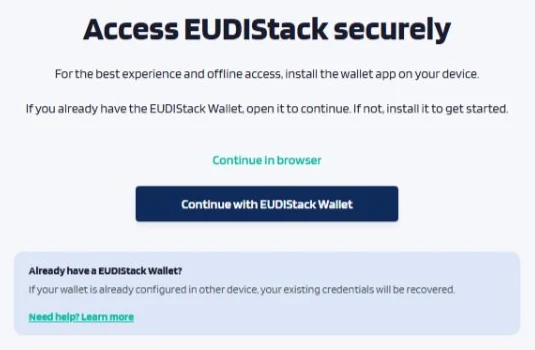{ width="420" }
      <figcaption>Sugerencia de instalación</figcaption>
    </figure>

??? "2. Elegir «Entrar con mi email»"
    En la pantalla **Entra en tu wallet**, la primera vez hay que pulsar **Entrar con mi email**, debajo de *¿Primera vez o sin tu passkey aquí?*.

    **Entrar con passkey** solo funciona cuando ya existe una passkey del wallet en este dispositivo o en el móvil.

    <figure markdown style="margin-left: 0;">
      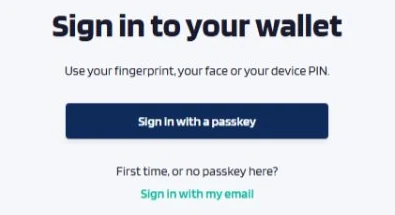{ width="360" }
      <figcaption>Pantalla de acceso</figcaption>
    </figure>

??? "3. Introducir el email corporativo"
    Escribir el email corporativo y pulsar **Enviar código de verificación**.

    <figure markdown style="margin-left: 0;">
      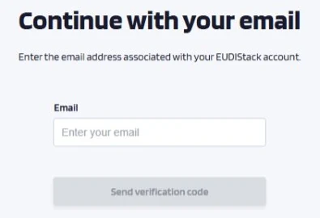{ width="360" }
      <figcaption>Introducción del email</figcaption>
    </figure>

??? "4. Verificar el código <small>*(One-Time Password)*</small>"
    El wallet envía un código de 6 dígitos al email. Introducirlo en **Verifica tu dirección de email** y pulsar **Continuar**.

    - El código es válido durante un tiempo limitado.
    - Si no llega, se puede pedir otro cuando termine la cuenta atrás.
    - **Cambiar email** vuelve al paso anterior.

    <figure markdown style="margin-left: 0;">
      { width="400" }
      <figcaption>Correo con el código de 6 dígitos</figcaption>
    </figure>

    <figure markdown style="margin-left: 0;">
      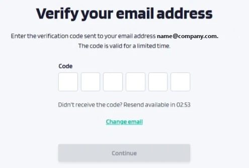{ width="420" }
      <figcaption>Introducción del código</figcaption>
    </figure>

??? "5. Crear la passkey"
    En **¡Email verificado! Configura una passkey**, indicar un nombre para el dispositivo y pulsar **Crear Passkey**.

    <figure markdown style="margin-left: 0;">
      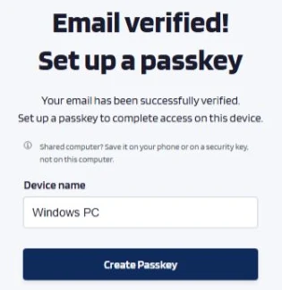{ width="300" }
      <figcaption>Creación de la passkey</figcaption>
    </figure>

    El sistema operativo pregunta dónde guardar la passkey:

    - **Este dispositivo**: Windows Hello, Contraseñas de iCloud o el Gestor de contraseñas de Google, según el sistema.
    - **iPhone, iPad o dispositivo Android**: la passkey se guarda en el móvil (ver más abajo).
    - **Llave de seguridad**: una llave física USB o NFC.

    !!! tip "¿Equipo compartido?"
        En un ordenador que usan otras personas, conviene guardar la passkey en el móvil o en una llave de seguridad, no en el equipo.

    <figure markdown style="margin-left: 0;">
      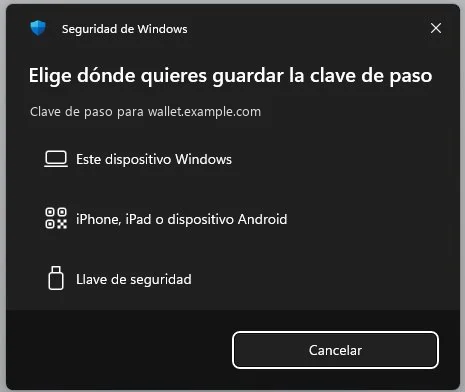{ width="360" }
      <figcaption>Windows: dónde guardar la passkey</figcaption>
    </figure>

    **Guardar la passkey en el móvil desde un ordenador**

    1. Elegir **iPhone, iPad o dispositivo Android**. El ordenador muestra un código QR.
    2. Escanear el QR con la cámara del móvil.
    3. En el móvil, confirmar dónde guardar la passkey y validarla con la cara, la huella o el PIN.

    El ordenador y el móvil necesitan **Bluetooth activado** (no hace falta emparejarlos) y conexión a internet.

    <figure markdown style="margin-left: 0;">
      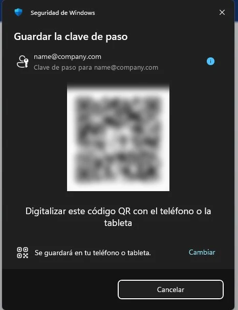{ width="360" }
      <figcaption>Windows: código QR para guardar la passkey en el móvil</figcaption>
    </figure>

    <figure markdown style="margin-left: 0;">
      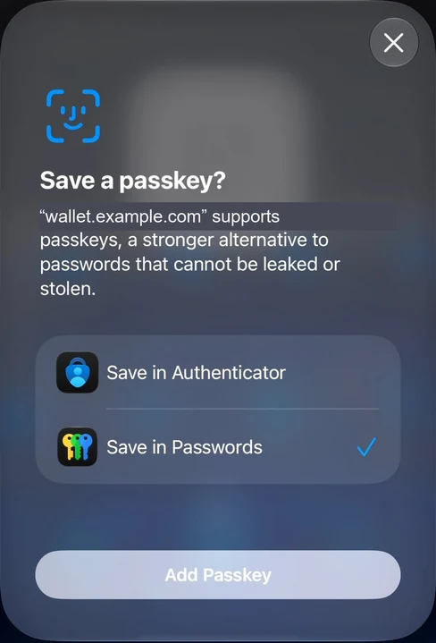{ width="240" }
      <figcaption>iPhone: confirmación para guardar la passkey</figcaption>
    </figure>

    !!! warning "Passkey no compatible"
        Algunas organizaciones protegen las claves del wallet con la propia passkey. En ese caso, si el gestor de passkeys elegido no ofrece la función necesaria, el wallet muestra **Esta passkey no es compatible**. Hay que repetir el paso con el gestor del sistema (iCloud, Google o Windows Hello) o con otra llave de seguridad.

??? "6. Acceso completado"
    El wallet muestra la pantalla de credenciales. A partir de aquí ya es posible recibir y presentar credenciales.

    <figure markdown style="margin-left: 0;">
      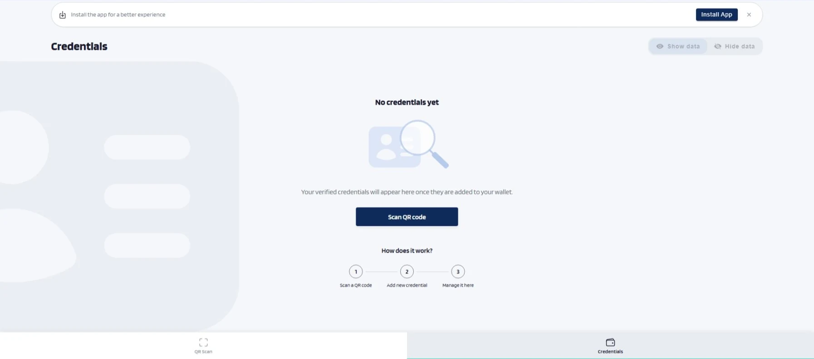{ width="560" }
      <figcaption>Pantalla de credenciales</figcaption>
    </figure>

---

## Si la cuenta ya tiene una passkey

Al entrar con el email desde un dispositivo nuevo, después del código aparece **Bienvenido**:

- **Iniciar sesión con Passkey** permite usar una passkey que ya tiene la cuenta, por ejemplo la del móvil escaneando el QR.
- **Crear una passkey nueva**, debajo de *¿No tienes ninguna a mano?*, crea otra passkey para este dispositivo.

!!! warning "Una passkey nueva no da acceso a las credenciales de otra"
    Las credenciales obtenidas con una passkey solo se ven al entrar con esa passkey. Si se crea una passkey nueva, sus credenciales empiezan vacías.

Después de añadir una passkey, el wallet avisa por email y ofrece cerrar las demás sesiones abiertas.

<figure markdown style="margin-left: 0;">
  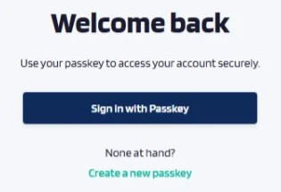{ width="300" }
  <figcaption>Cuenta con passkey</figcaption>
</figure>

---

## Accesos siguientes

En **Entra en tu wallet**, pulsar **Entrar con passkey**. El sistema muestra sus passkeys para el wallet:

- Si la passkey está en el dispositivo, basta con validarla con la cara, la huella o el PIN.
- Si está en el móvil, elegir **iPhone, iPad o dispositivo Android** y escanear el QR con el móvil.

<figure markdown style="margin-left: 0;">
  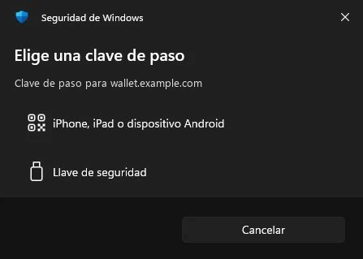{ width="360" }
  <figcaption>Windows: elegir la passkey para entrar</figcaption>
</figure>

La sesión se cierra tras un tiempo sin actividad. Al volver, el wallet muestra *Tu sesión ha caducado. Vuelve a entrar.*

---

## Problemas frecuentes

| Qué pasa | Qué hacer |
|----------|-----------|
| Al pulsar **Entrar con passkey**, el sistema dice que no hay ninguna passkey o muestra un error | No hay passkey del wallet en este dispositivo ni en el móvil. Entrar con **Entrar con mi email**. |
| Al escanear el QR con el móvil, solo aparece texto | La cámara de algunos fabricantes no reconoce el QR de las passkeys. Escanearlo con Google Lens. |
| El móvil se queda en «Conectando con el dispositivo» | Activar el Bluetooth en el ordenador y en el móvil, cancelar en el ordenador y volver a intentarlo. |
| El móvil dice que no hay ninguna passkey disponible | La passkey del wallet no está en ese móvil. Entrar con **Entrar con mi email** y crear una. |

---

## Siguiente paso

[Recibir credenciales →](receive-credentials.md)
