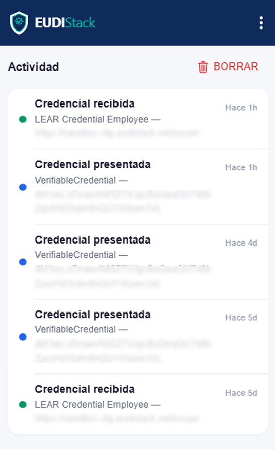

# Settings

Accessible from the *Settings* tab in the bottom navigation bar.

{ width="240" }

From here it is possible to view the activity history, customize the appearance and language, manage the camera for QR scanning and access support resources.

---

??? "Activity"
    History of operations performed with the wallet. Lists each credential received, presented or deleted, with a timestamp and associated issuer/verifier.

    { width="320" }

    { width="240" }

??? "Privacy blur"
    Blurs the credential data in the list and detail views. Useful for protecting sensitive information in public environments.

    **Default:** disabled.

    { width="240" }

??? "Dark mode"
    Switches the application theme between light mode and dark mode.

    **Default:** disabled (light theme).

    { width="240" }

---

??? "Selected camera"
    Lets you choose which device camera is used to scan QR codes. Shows a real-time preview of the selected camera.

    { width="240" }

??? "Language selector"
    Lets you change the application language. The selected language is saved and applied across all sessions.

    Available languages: **Castellano**, **English**, **Català**.

    { width="240" }

---

??? "Knowledge base"
    Link to the official documentation and help resources.

    { width="240" }

??? "View logs"
    Shows the camera error logs collected during use of the application. Visible in both types of wallet when enabled by the environment configuration.

    { width="240" }

??? "Send logs"
    This function is only visible to some customers.

    { width="240" }

??? "My Devices"
    Manages the devices linked to the account.

    { width="240" }

    → See [Devices and keys](../wallet-business/devices.md)

---

<!-- Hidden for now: "Wallet type" field (EUDIW / Business Wallet)

??? "Wallet type"
    Indicates the wallet's operating mode:

    - **EUDIW**: personal wallet. Credentials are stored locally on the device.

        { width="320" }

    - **Business Wallet**: wallet for corporate users. Credentials are stored on the organization's server.

        { width="320" }
-->

??? "Version"
    Current version number of the application. Informational only.

    { width="320" }
